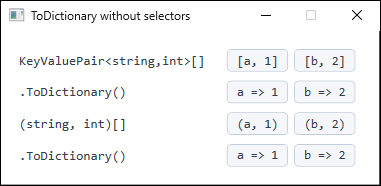

## Overview

.NET 8 added almost no new operators to LINQ.
Its practical addition is a set of **overloads** — `ToDictionary` variants that turn a sequence of `KeyValuePair` or tuples into a dictionary without selectors.
Backporting this batch is therefore not about a new algorithm but about **signature design**: fitting new signatures into an existing method family without friction.

This article implements the selector-free `ToDictionary` polyfill (the `KeyValuePair` and tuple forms) and breaks its design down into three decisions.

1. Avoid colliding with the existing `ToDictionary(keySelector, valueSelector)` during overload resolution
2. Pin the resolution target of internal delegation with the named argument `comparer:`
3. Match the `where TKey : notnull` constraint and the return type so nullable analysis agrees before and after migration

---

## Prerequisites / Environment

- Frameworks: .NET Framework 4.8 (backport target) / .NET 8+ (future migration target)
- APIs: the selector-free `ToDictionary` overloads — 4 signatures (`KeyValuePair` and tuple forms, each with an `IEqualityComparer<TKey>` overload)
- Approach: apply `#nullable enable`; disable automatically on migration via `#if !NET8_0_OR_GREATER`
- Language version: `#nullable enable`, nullable reference annotations, and the `where TKey : notnull` constraint require C# 8.0 or later. The .NET Framework 4.8 default is C# 7.3, so set `LangVersion` to `8.0` or later in the `.csproj` (take particular care in older non-SDK projects that do not set `LangVersion` explicitly)
- Verification environment: .NET 10 / Windows 11

Selector-free `ToDictionary` (with and without a comparer) was called on the same input on `net48` (polyfill) and `net10.0` (BCL), comparing the resulting dictionaries and the exceptions thrown.
Results:

- The `KeyValuePair` and tuple overloads, along with their `IEqualityComparer` variants, produce the same results on both targets.
- The exception type thrown on a duplicate key matches on both targets.

---

## Problem

The following overloads added in .NET 8 are unavailable on .NET Framework.

| Method | Added in | Description |
| --- | --- | --- |
| `ToDictionary<TKey, TValue>(this IEnumerable<KeyValuePair<TKey, TValue>>)` | .NET 8.0 | Converts a sequence of `KeyValuePair` directly into a dictionary |
| `ToDictionary<TKey, TValue>(this IEnumerable<(TKey, TValue)>)` | .NET 8.0 | Converts a sequence of 2-tuples directly into a dictionary |

Each also has an `IEqualityComparer<TKey>` overload, for 4 signatures in total.

Without them, even when elements are already key/value pairs, the existing `ToDictionary` demands explicit identity selectors.

- `pairs.ToDictionary(p => p.Key, p => p.Value)` instead of `pairs.ToDictionary()`
- `items.ToDictionary(t => t.Item1, t => t.Item2)` for tuple sequences

`p => p.Key` / `p => p.Value` are boilerplate unrelated to the conversion itself, and swapping the key and value selectors is an easy mistake to make.

---

## Root Cause / Background

When filtering a `Dictionary` into a new one, or dictionary-izing tuples returned by `Select`, the elements are already key/value shaped.
.NET 8 standardized the selector-free overloads to remove the identity selectors that such call sites were forced to write.

Because this is a *signature addition* to an existing method, the built-in design itself is careful not to disturb resolution of the existing overloads.
A polyfill must be designed under the same constraint — that is the subject of this article.

---

## Solution

The extension methods are defined in the original `System.Linq` namespace and wrapped in `#if !NET8_0_OR_GREATER` (see the [series foundation article](/articles/linq-backport-netframework-to-net5/) for the rationale behind both).

On top of that, three signature-design points are aligned with the built-in API.

- Restrict the first parameter to `IEnumerable<KeyValuePair<TKey, TValue>>` / `IEnumerable<(TKey, TValue)>` so existing overloads are never contested
- Pin internal delegation with the named argument `comparer:`
- Use `Dictionary<TKey, TValue>` as the return type and `where TKey : notnull` as the constraint

<figure class="article-figure">
  
  <figcaption>Results of <code>ToDictionary()</code> called without selectors. Both a sequence of <code>KeyValuePair</code> and a sequence of tuples yield the same key-to-value mapping.</figcaption>
</figure>

---

## Implementation

The polyfill below provides four signatures: the `KeyValuePair` and tuple forms, each with and without a comparer.
For sources implementing `ICollection<T>`, the dictionary capacity is pre-sized from the element count, avoiding rehashing just as the built-in implementation does.
Existing `ToDictionary` calls can stay as they are, so adding a file such as `LinqExtensions.Net8.cs` is all it takes.
A `net48` build with .NET SDK 10.0.404 on Linux, using reference assemblies, placed this polyfill next to three existing call forms that pass a `keySelector` — `ToDictionary(k)`, `ToDictionary(k, v)` and `ToDictionary(k, comparer)` — and compiled without any ambiguity error.

```csharp
#nullable enable

using System;
using System.Collections.Generic;

#if !NET8_0_OR_GREATER // Active only below .NET 8.0 (e.g. .NET Framework)

namespace System.Linq
{
    /// <summary>
    /// Provides extension methods that backfill LINQ methods introduced in .NET 8.0 for older target frameworks.
    /// </summary>
    public static partial class LinqExtensions
    {
        // ==========================================
        // 1. IEnumerable<KeyValuePair<TKey, TValue>>.ToDictionary
        // ==========================================
        public static Dictionary<TKey, TValue> ToDictionary<TKey, TValue>(
            this IEnumerable<KeyValuePair<TKey, TValue>> source)
            where TKey : notnull
            => source.ToDictionary(comparer: null); // Named argument pins resolution to the comparer overload

        public static Dictionary<TKey, TValue> ToDictionary<TKey, TValue>(
            this IEnumerable<KeyValuePair<TKey, TValue>> source,
            IEqualityComparer<TKey>? comparer)
            where TKey : notnull
        {
            if (source == null) throw new ArgumentNullException(nameof(source));

            var dictionary = source is ICollection<KeyValuePair<TKey, TValue>> collection
                ? new Dictionary<TKey, TValue>(collection.Count, comparer)
                : new Dictionary<TKey, TValue>(comparer);

            foreach (var pair in source)
            {
                dictionary.Add(pair.Key, pair.Value);
            }

            return dictionary;
        }

        // ==========================================
        // 2. IEnumerable<(TKey, TValue)>.ToDictionary
        // ==========================================
        public static Dictionary<TKey, TValue> ToDictionary<TKey, TValue>(
            this IEnumerable<(TKey Key, TValue Value)> source)
            where TKey : notnull
            => source.ToDictionary(comparer: null);

        public static Dictionary<TKey, TValue> ToDictionary<TKey, TValue>(
            this IEnumerable<(TKey Key, TValue Value)> source,
            IEqualityComparer<TKey>? comparer)
            where TKey : notnull
        {
            if (source == null) throw new ArgumentNullException(nameof(source));

            var dictionary = source is ICollection<(TKey Key, TValue Value)> collection
                ? new Dictionary<TKey, TValue>(collection.Count, comparer)
                : new Dictionary<TKey, TValue>(comparer);

            foreach (var pair in source)
            {
                dictionary.Add(pair.Key, pair.Value);
            }

            return dictionary;
        }
    }
}

#endif
```



The <code>KeyValuePair</code> and tuple overloads, each with and without a comparer, compared between the <code>net48</code> polyfill and the <code>net10.0</code> built-in, including the exception on duplicate keys. Measured with .NET SDK 10.0.302.
{: .table-caption}

The two sides agree down to raising `ArgumentException` on a duplicate key. Passing `OrdinalIgnoreCase` as the comparer makes keys that differ only in case count as duplicates, producing the same exception.

---

## The Three Signature-Design Decisions

### Decision 1: A First Parameter Type That Cannot Collide

The name `ToDictionary` already exists on .NET Framework, so adding overloads carelessly could disturb resolution.
This polyfill is safe because the first (extended) parameter type partitions the call space.

- Calls that pass selectors (`ToDictionary(x => x.Id)` and friends) resolve to the existing built-in overloads that take `Func<...>` parameters
- Only selector-free calls on `KeyValuePair` or tuple sequences resolve to the polyfill

For any polyfill that adds signatures to an existing method, the first thing to verify is that the new signatures match none of the existing call shapes.
If that property does not hold, code may compile while silently binding to an unintended overload.

### Decision 2: Stating the Target Overload with the Named Argument `comparer:`

The parameterless overloads delegate to the comparer overloads by passing `null`.
Writing that plainly as `source.ToDictionary(null)` is not ambiguous: the overloads that take a `Func<...>` cannot infer their type arguments from `null` and drop out. With `comparer: null` replaced by `null`, the article's polyfill still compiled on net48 and called the comparer overload. The named argument is kept to state explicitly which overload the method delegates to.

```csharp
public static Dictionary<TKey, TValue> ToDictionary<TKey, TValue>(
    this IEnumerable<KeyValuePair<TKey, TValue>> source)
    where TKey : notnull
    => source.ToDictionary(comparer: null); // Named argument pins the comparer overload
```

With the named argument `comparer:`, only overloads that have a parameter of that name remain candidates. The result is the same as without it today, but the intent stays visible in the code.

### Decision 3: Matching `where TKey : notnull` and the Return Type

The built-in overloads return `Dictionary<TKey, TValue>` and constrain `where TKey : notnull`.
Matching both means that in a `#nullable enable` codebase, nullable analysis produces identical results before and after migration.

Omitting the constraint still compiles, but then calls with nullable key types that were accepted under the polyfill start producing warnings after moving to .NET 8.
For the automatic switch to the built-in implementation (see below) to be genuinely seamless, signature compatibility matters exactly as much as algorithmic compatibility.

---

## Behavior by Use Case

### Converting a Sequence of `KeyValuePair`

When filtering an existing dictionary into a new one, the elements are already `KeyValuePair`.

```csharp
var source = new Dictionary<string, int>
{
    ["apple"] = 3,
    ["banana"] = 5,
    ["cherry"] = 2,
};

// Keep only entries with a value of 3 or more
var filtered = source.Where(pair => pair.Value >= 3)
                     .ToDictionary();
// filtered: { "apple": 3, "banana": 5 }
```

`Dictionary<TKey, TValue>` implements `IEnumerable<KeyValuePair<TKey, TValue>>`, so the result of `Where` is a `KeyValuePair` sequence that converts back to a dictionary with no selectors.

### Converting a Sequence of 2-Tuples

Tuples returned by `Select` convert directly as well.

```csharp
var files = new[] { "report.pdf", "photo.jpg", "notes.txt" };

// File name as key, extension as value
var byName = files.Select(name => (name, System.IO.Path.GetExtension(name)))
                  .ToDictionary();
// byName: { "report.pdf": ".pdf", "photo.jpg": ".jpg", "notes.txt": ".txt" }
```

The first tuple element becomes the key, the second the value.
Tuple element names (such as `(name, ext)`) do not affect the type, so the conversion works with or without them.

### Specifying an `IEqualityComparer<TKey>`

The comparer overloads build dictionaries with custom key equality, such as case-insensitive lookups.

```csharp
var pairs = new[] { ("Alpha", 1), ("BETA", 2) };

var dictionary = pairs.ToDictionary(StringComparer.OrdinalIgnoreCase);

bool found = dictionary.ContainsKey("alpha"); // true
```

The comparer-free overloads use `EqualityComparer<TKey>.Default`.

### Eager Evaluation

Unlike `Where` or `Order`, `ToDictionary` evaluates **eagerly**.
It enumerates the source to the end at call time and returns a finished dictionary.

```csharp
var query = Enumerable.Range(1, 3).Select(n => (n, n * n));

var dictionary = query.ToDictionary(); // The source is enumerated here
// dictionary: { 1: 1, 2: 4, 3: 9 }
```

Even when the source is a lazy query, the call produces a settled dictionary.
Later changes to the underlying data do not affect the constructed dictionary.

---

## Migration Guard

The polyfill is wrapped in `#if !NET8_0_OR_GREATER`.
What .NET 8 added to `ToDictionary` is not a new method but new overloads of an existing one.
So when a wrong guard strips the polyfill on .NET 7 or earlier, the symptom differs from the other backports, which add new methods.

- Existing calls that pass a `keySelector` still bind to the old overloads and compile without complaint.
- Only selector-free calls fail, and the error is not "no such method".
  - A parameterless `ToDictionary()` fails with `CS1501`, "No overload for method 'ToDictionary' takes 0 arguments".
  - A comparer-only `ToDictionary(comparer)` is matched against the existing `ToDictionary(keySelector)` and fails with `CS0411`, "The type arguments … cannot be inferred from the usage".

Both messages read like a mistake at the call site, which makes it easy to miss that the guard condition is the real cause.
Both errors were confirmed with .NET SDK 10.0.404 on Linux by building for `net7.0` without the polyfill (the parameterless call gave the same `CS1501` on `net6.0` too).
Guarding with `!NETCOREAPP` strips the polyfill on .NET Core and .NET 5–7, and `!NET7_0_OR_GREATER` strips it on .NET 7, so these errors can appear there.

For the general rule — disable at and above the version that introduced the API — see the [.NET 6 backport article](/articles/linq-backport-netframework-to-net6/).

---

## Caveats

- **When to use the existing `ToDictionary` instead**: the new overloads apply only when elements are already `KeyValuePair` or tuples. For arbitrary element types, keep passing a key selector (and value selector) to the existing `ToDictionary`.
- **Duplicate keys throw**: the implementation uses `Dictionary<TKey, TValue>.Add`, so a duplicate key raises `ArgumentException`, matching the built-in behavior. For last-wins semantics, populate manually with `dictionary[key] = value`.
- **`null` keys throw**: a `null` key raises `ArgumentNullException`. The `where TKey : notnull` constraint makes reference-type keys non-null by contract, and runtime `null` leakage is caught by this exception.
- **Eager evaluation**: the source is enumerated to the end, so avoid infinite sequences and sources with per-enumeration side effects. Passing a `null` source throws `ArgumentNullException` on the spot.

---

## Alternatives / Comparison

| Approach | Pros | Cons | Best for |
| --- | --- | --- | --- |
| Hand-rolled polyfill (this article) | No dependency; signatures match the built-ins exactly | Requires overload-design care | `#nullable enable` codebases heading toward migration |
| Write `ToDictionary(p => p.Key, p => p.Value)` inline | No extra code | Both selectors written every time; mass replacement at migration | When only a handful of conversions exist |
| Upgrade to .NET 8 or later | Root fix; both the `KeyValuePair` and tuple overloads come built in | Migration work, and .NET 8 [went out of support](https://learn.microsoft.com/lifecycle/products/microsoft-net-and-net-core) in November 2026, so a new move should pick a supported release such as .NET 10 | When you want new APIs beyond dictionary conversion too |

Inline selectors cost nothing today, but consolidating to the selector-free spelling after migrating to .NET 8 or later means finding and replacing every call site.

---

## Summary

The .NET 8 selector-free `ToDictionary` is a new *signature*, not a new *algorithm*, and the backport's quality is decided by signature design.

| Decision | Content |
| --- | --- |
| Restricted first parameter | `KeyValuePair` / tuple sequences only — never contests existing overloads |
| Named argument `comparer:` | Pins internal delegation to the comparer overload |
| `notnull` constraint and return type | Match the built-ins so nullable analysis agrees across migration |

Use the selector-free overloads only for inputs that are already pairs, and the classic selector-based `ToDictionary` for everything else.
Under that discipline, the `#if !NET8_0_OR_GREATER` guard swaps in the built-in implementation at migration time with zero code changes.

---

## Related Articles

- [Designing LINQ Polyfills That Preserve Lazy Evaluation — Implementing Append, Prepend, TakeLast and SkipLast](/articles/linq-backport-netframework-to-net5/)
- [Replacing GroupBy and Full-Sort Workarounds — Implementing Chunk, MaxBy, MinBy and DistinctBy](/articles/linq-backport-netframework-to-net6/)
- [Order and OrderDescending by Pure Delegation — A Minimal Polyfill with IOrderedEnumerable Compatibility](/articles/linq-backport-netframework-to-net7/)
- [Key-Based Aggregation Without GroupBy — Dictionary-Backed CountBy, AggregateBy and Index](/articles/linq-backport-netframework-to-net9/)
- [Expressing SQL Outer Joins in LINQ — Implementing LeftJoin, RightJoin and Shuffle](/articles/linq-backport-netframework-to-net10/)
