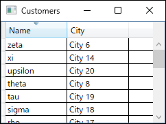

## Overview

Double-clicking a row to open its details is one of the first things users expect from a `DataGrid` in a line-of-business application.
The approach most often shown for MVVM uses an `EventTrigger` from `Microsoft.Xaml.Behaviors.Wpf` to catch the `MouseDoubleClick` event of the `DataGrid` itself and passes `SelectedItem` as the `CommandParameter`.
It works as expected when a row is double-clicked.
However, it also runs when a column header, the scroll bar thumb or track, or the blank area below the last row is double-clicked, and then it opens whichever row was selected before.
On a column header the double-click also sorts the column, so the opened row may no longer even be on screen.

This article compares four ways of catching the double-click by double-clicking the same places with a real mouse.
It shows where the two grid-level approaches fire by mistake, which of the two row-level approaches still works on an editable cell, and how to choose among the four.

---

## Prerequisites / Environment

- Framework: WPF on .NET. The code uses C# 9 or later syntax (patterns such as `is not null and not DataGridRow`) and assumes nullable reference types are enabled. `EventTrigger` and `InvokeCommandAction` come from the NuGet package `Microsoft.Xaml.Behaviors.Wpf`, and the article uses the `EventArgsConverter` property. Behavior was measured only in the verification environment below, not on .NET Framework 4.8 or with other versions of the package
- Architecture: MVVM. The view model base class `ObservableObject` and `RelayCommand<T>` are minimal in-house implementations. `CanExecute` of `RelayCommand<T>` returns `false` when the argument is not a `T` (including `null`). Updating `CanExecute` is covered in [the article on a RelayCommand whose CanExecute does not update the button state](/articles/wpf-relaycommand-canexecute-not-updating/)
- Verification environment: .NET 10 / Windows 11 / `Microsoft.Xaml.Behaviors.Wpf` 1.1.135. Clicks and double-clicks were real OS mouse input; a double-click was sent as two press-release pairs in a single `SendInput` call. Each time, the measurement checked that exactly one mouse-down for the second click (`ClickCount` of 2) reached the `DataGrid`. Because the measurement loaded the XAML with `XamlReader`, only `xmlns:b` was mapped to the same assembly in `clr-namespace` form
- Subject: a customer `DataGrid` with two columns, `Name` and `City` (width 240, height 150, 20 rows). The blank area below the last row (hereafter, the blank area) is measured with a 3-row `DataGrid`. The second row, `beta`, is selected with a click, and each place is double-clicked after waiting longer than the double-click time
- Scope: opening details with a mouse double-click. Opening with the keyboard (such as the Enter key), opening with several rows selected, the arrow buttons of the scroll bar, the row header (`DataGridRowHeader`), `RowDetails`, and nested `DataGrid`s were not measured

The view model holds the list of customers and an `OpenCommand` that receives a customer and opens its details.
Opening the details itself (showing a dialog or switching pages) is not the subject here, so the body of `Open` is left empty.

```csharp
public sealed class CustomersViewModel : ObservableObject
{
    public CustomersViewModel(IEnumerable<Customer> customers)
    {
        Customers = new ObservableCollection<Customer>(customers);
        OpenCommand = new RelayCommand<Customer>(Open);
    }

    public ObservableCollection<Customer> Customers { get; }

    public ICommand OpenCommand { get; }

    private void Open(Customer customer)
    {
        // Open the details (show a dialog, switch to a details page, and so on).
    }
}
```

Because `OpenCommand` is a `RelayCommand<Customer>`, `CanExecute` returns `false` for anything other than a `Customer` (including `null`).
`InvokeCommandAction` calls `Execute` only when `CanExecute` returns `true` ([`Invoke` in InvokeCommandAction.cs](https://github.com/microsoft/XamlBehaviorsWpf/blob/v1.1.135/src/Microsoft.Xaml.Behaviors/InvokeCommandAction.cs#L110-L147)).
This behavior determines the results of the approaches compared later.

---

## Problem

The commonly shown approach puts an `EventTrigger` inside the `DataGrid` and calls `OpenCommand` on `MouseDoubleClick`.
The customer passed is `SelectedItem`, which the first click of the double-click is expected to have selected.

```xml
<DataGrid x:Name="grid" Width="240" Height="150" ItemsSource="{Binding Customers}"
          AutoGenerateColumns="False" IsReadOnly="True">
  <b:Interaction.Triggers>
    <b:EventTrigger EventName="MouseDoubleClick">
      <b:InvokeCommandAction Command="{Binding OpenCommand}"
                             CommandParameter="{Binding SelectedItem, ElementName=grid}" />
    </b:EventTrigger>
  </b:Interaction.Triggers>
  <DataGrid.Columns>
    <DataGridTextColumn Header="Name" Binding="{Binding Name}" Width="90" />
    <DataGridTextColumn Header="City" Binding="{Binding City}" Width="90" />
  </DataGrid.Columns>
</DataGrid>
```

`xmlns:b` is set to `http://schemas.microsoft.com/xaml/behaviors`.
Double-clicking the third row, `gamma`, passes `gamma` as expected.
However, double-clicking the `Name` column header while `beta` is selected passes `beta` to `OpenCommand`.

<figure class="article-figure">
  
  <figcaption>The screen right after selecting beta and double-clicking the Name column header with the XAML above. OpenCommand received beta, but the Name column was sorted in descending order and beta is outside the visible range (.NET 10 / Windows 11, real mouse input).</figcaption>
</figure>

The user only clicked the column header twice to sort, yet a row that is not even visible opens.
The same happens when the scroll bar thumb or track is pressed twice quickly, or when the blank area below a short list is double-clicked: the currently selected row opens.

---

## Cause / Background

`MouseDoubleClick` is a direct routed event defined on `Control`; each `Control` along the element tree raises it for itself ([Control.MouseDoubleClick](https://learn.microsoft.com/en-us/dotnet/api/system.windows.controls.control.mousedoubleclick)).
A `DataGrid` is a `Control`, so not only the rows but also double-clicks on the column headers, the scroll bar thumb or track, and the blank area raise the `DataGrid`'s own `MouseDoubleClick`.
In addition, clicking a column header or the scroll bar thumb or track does not change the selection, so `SelectedItem` still holds the row selected before.
The double-clicked row and the selected row match only when a row is double-clicked.

The following table shows what reaches the `DataGrid` on the second click.



Values read by handlers added to the `DataGrid` with `handledEventsToo` after selecting the second row, `beta`, with a click and then double-clicking each place (.NET 10 / Windows 11, real mouse input). "At that time" means when the handler for the `DataGrid`'s `MouseDoubleClick` ran.
{: .table-caption}

On the column header, the scroll bar thumb and track, a cell double-clicked with Ctrl held, and an editable cell (a cell whose `DataGrid` and column both have `IsReadOnly=False`), the second `MouseLeftButtonDown` is already handled (`Handled` is `True`) when it reaches the handler on the `DataGrid`.
`MouseDoubleClick` is still raised in every place.
This is because `Control` registers the class handler that detects double-clicks so that it also receives handled events, with `handledEventsToo` set to `true` ([the static constructor in Control.cs](https://github.com/dotnet/wpf/blob/v10.0.13/src/Microsoft.DotNet.Wpf/src/PresentationFramework/System/Windows/Controls/Control.cs#L28-L31)).

On an editable cell, editing starts in the middle of the double-click.
`DataGridCell` starts editing when a focused, selected cell is clicked without Ctrl ([`OnAnyMouseLeftButtonDown` in DataGridCell.cs](https://github.com/dotnet/wpf/blob/v10.0.13/src/Microsoft.DotNet.Wpf/src/PresentationFramework/System/Windows/Controls/DataGridCell.cs#L888-L904)).
When the unselected `gamma` is double-clicked, the first click selects it and the second click starts editing.
The cell's `IsEditing` is already `True` when the `MouseDoubleClick` handler runs.
At that point the visual parent of the `TextBlock` that is the `OriginalSource` is `null`.
The `DataGrid`'s `MouseDoubleClick` arrives after the cell has entered edit mode and the display `TextBlock` has left the visual tree.
When the selected `beta` was double-clicked, the first click started editing and the second mouse-down never reached the `DataGrid`.
The `DataGrid`'s `MouseDoubleClick` was not raised either.
Whether editing starts is decided per column (cell).
In a `DataGrid` with only the `Name` column set to `IsReadOnly="True"`, the `Name` cell did not enter edit mode; `Handled` stayed `False` and the parent of the `TextBlock` stayed `ContentPresenter`.
The editable `City` cell in the same `DataGrid` gave the same values as when both the `DataGrid` and the columns have `IsReadOnly=False`.
These two differences (whether the input is already handled, and whether the `OriginalSource` is still in the tree) separate the results of the approaches compared in the next section.

---

## Four Ways to Catch the Double-Click

The following table shows the results of the same fourteen double-click cases with the four approaches.
In the columns for the four approaches, each cell is the customer passed to `OpenCommand`, and "not executed" means `OpenCommand` never ran.



A new `DataGrid` was created for each approach; the second row, `beta`, was selected with a click (except in the "nothing selected beforehand" row), and each place was double-clicked with a real mouse after waiting longer than the double-click time (.NET 10 / Windows 11, `Microsoft.Xaml.Behaviors.Wpf` 1.1.135). Only the two blank-area rows used a 3-row `DataGrid`; all other places used a 20-row `DataGrid`. "SelectedItem after" and "other effects" were the same for all four approaches.
{: .table-caption}

### EventTrigger on DataGrid + SelectedItem

This is the approach from the Problem section.
In the four places outside the rows (the column header, the scroll bar thumb, the track, and the blank area), it received `beta`, the row selected before.
When the blank area was double-clicked in a list with nothing selected, `SelectedItem` was `null`, so `CanExecute` returned `false` and the command did not run.
Once any row has been selected, however, this approach cannot tell a double-click outside the rows from one on a row.

Even inside the rows, the double-clicked row and the row passed can differ.
When the unselected `gamma` was double-clicked with Ctrl held, `SelectedItem` after the double-click was still `beta`, and `OpenCommand` also received `beta`.
`Control` also registers its double-click detection for right-button presses ([the static constructor in Control.cs](https://github.com/dotnet/wpf/blob/v10.0.13/src/Microsoft.DotNet.Wpf/src/PresentationFramework/System/Windows/Controls/Control.cs#L28-L31)), so `MouseDoubleClick` is raised by a right-button double-click as well.
The command ran when `gamma` was double-clicked with the right button.

### MouseBinding on DataGrid + SelectedItem

Putting a `MouseBinding` in the `InputBindings` of the `DataGrid` is also often shown, because it needs no package.

```xml
<DataGrid.InputBindings>
  <MouseBinding Gesture="LeftDoubleClick" Command="{Binding OpenCommand}"
                CommandParameter="{Binding SelectedItem, ElementName=grid}" />
</DataGrid.InputBindings>
```

This approach did not run on the column header, the scroll bar thumb and track, a double-click with Ctrl held, or an editable cell.
All of these are places where the second `MouseLeftButtonDown` was already handled in the Cause / Background table.
Input bindings are matched only when the mouse-down has not been handled ([`OnMouseDownThunk` in UIElement](https://github.com/dotnet/wpf/blob/v10.0.13/src/Microsoft.DotNet.Wpf/src/PresentationCore/System/Windows/Generated/UIElement.cs#L837-L842)), so a `MouseBinding` does not run where the input is already handled.
A double-click with Ctrl held would not match even if it were checked.
`MouseGesture` matching also requires the modifier keys to match ([`Matches` in MouseGesture.cs](https://github.com/dotnet/wpf/blob/v10.0.13/src/Microsoft.DotNet.Wpf/src/PresentationCore/System/Windows/Input/Command/MouseGesture.cs#L132)), so `LeftDoubleClick`, which has no modifier key, does not match input with Ctrl held.
With its `Gesture` set to `LeftDoubleClick`, this approach did not run on a right-button double-click.

On the other hand, it ran on the blank area and received `beta`.
The places where it fires by mistake outside the rows are fewer, but not gone.
Moreover, on an editable cell and with Ctrl held, it does not catch the row double-click at all.

Attaching the `MouseBinding` to the row (`DataGridRow`) instead of the `DataGrid` is not possible through `RowStyle`, because `InputBindings` cannot be set with a `Setter`.



The result of loading XAML with `Property="InputBindings"` in a `Setter` of `<Style TargetType="DataGridRow">` through `XamlReader` (.NET 10 / Windows 11).
{: .table-caption}

`InputBindings` is a read-only CLR property, not a dependency property ([UIElement.InputBindings](https://learn.microsoft.com/en-us/dotnet/api/system.windows.uielement.inputbindings)), so it cannot be the target of a `Setter`, and the XAML fails at load time.

### EventTrigger + EventArgsConverter (Row Item)

The `EventArgsConverter` of `InvokeCommandAction` accepts a converter that turns the event arguments into the command parameter.
The converter walks up the visual tree from the double-clicked element (`OriginalSource`) to find a `DataGridRow`, and returns the row's item if it finds one and `null` otherwise.
Double-clicks with a button other than the left one are turned into `null` here.

```csharp
public sealed class RowItemFromEventArgsConverter : IValueConverter
{
    public object? Convert(object value, Type targetType, object parameter, CultureInfo culture)
    {
        // MouseDoubleClick is also raised by the right button, so anything but the left button becomes null (not executed).
        if (value is not MouseButtonEventArgs { ChangedButton: MouseButton.Left } args)
        {
            return null;
        }

        var current = args.OriginalSource as DependencyObject;
        while (current is not null and not DataGridRow)
        {
            current = current is Visual or System.Windows.Media.Media3D.Visual3D
                ? VisualTreeHelper.GetParent(current)
                : LogicalTreeHelper.GetParent(current);
        }

        return (current as DataGridRow)?.Item;
    }

    public object ConvertBack(object value, Type targetType, object parameter, CultureInfo culture) =>
        throw new NotSupportedException();
}
```

If the double-clicked element is not a visual (for example, a `Run`), the converter follows its logical parent instead.
In XAML, only `EventArgsConverter` is set, without `CommandParameter`.
This is because `InvokeCommandAction` calls `EventArgsConverter` only when `CommandParameter` is `null` ([`Invoke` in InvokeCommandAction.cs](https://github.com/microsoft/XamlBehaviorsWpf/blob/v1.1.135/src/Microsoft.Xaml.Behaviors/InvokeCommandAction.cs#L110-L147)).

```xml
<DataGrid.Resources>
  <local:RowItemFromEventArgsConverter x:Key="RowItemFromEventArgs" />
</DataGrid.Resources>
<b:Interaction.Triggers>
  <b:EventTrigger EventName="MouseDoubleClick">
    <b:InvokeCommandAction Command="{Binding OpenCommand}"
                           EventArgsConverter="{StaticResource RowItemFromEventArgs}" />
  </b:EventTrigger>
</b:Interaction.Triggers>
```

In the four places outside the rows and on a right-button double-click, the converter returns `null` and `CanExecute` returns `false`, so the command does not run.
Even when the unselected `gamma` was double-clicked with Ctrl held, `gamma` was passed.
However, the command did not run on an editable cell.
As the Cause / Background table shows, on an unselected row the `TextBlock` that is the `OriginalSource` has already left the visual tree when the `DataGrid`'s `MouseDoubleClick` arrives, so the converter cannot walk up to the `DataGridRow`.
On a selected row, `MouseDoubleClick` is not raised at all.
This approach is usable only where the double-clicked cell is not editable (the `DataGrid` or its column has `IsReadOnly="True"`).
In a `DataGrid` with only the `Name` column set to `IsReadOnly="True"`, `gamma` was passed for the `Name` cell, and the command did not run for the editable `City` cell.

### RowStyle + Attached Property (Row Item)

To catch only row double-clicks, subscribe to `MouseDoubleClick` on `DataGridRow` instead of `DataGrid`.
`DataGridRow` is also a `Control`, so a double-click inside a row raises that row's own `MouseDoubleClick`.
To keep the handler out of the view's code-behind, the subscription is wrapped in an attached property.

```csharp
public static class RowDoubleClick
{
    public static readonly DependencyProperty CommandProperty =
        DependencyProperty.RegisterAttached("Command", typeof(ICommand), typeof(RowDoubleClick),
            new PropertyMetadata(null, OnCommandChanged));

    public static ICommand? GetCommand(DependencyObject d) => (ICommand?)d.GetValue(CommandProperty);

    public static void SetCommand(DependencyObject d, ICommand? value) => d.SetValue(CommandProperty, value);

    private static void OnCommandChanged(DependencyObject d, DependencyPropertyChangedEventArgs e)
    {
        if (d is not DataGridRow row)
        {
            return;
        }

        row.MouseDoubleClick -= OnMouseDoubleClick;
        if (e.NewValue is not null)
        {
            row.MouseDoubleClick += OnMouseDoubleClick;
        }
    }

    private static void OnMouseDoubleClick(object sender, MouseButtonEventArgs e)
    {
        // MouseDoubleClick is also raised by the right button, so other buttons are ignored.
        if (e.ChangedButton != MouseButton.Left)
        {
            return;
        }

        var row = (DataGridRow)sender;
        ICommand? command = GetCommand(row);
        object item = row.Item;
        if (command?.CanExecute(item) == true)
        {
            command.Execute(item);
        }
    }
}
```

The value passed is not `SelectedItem` but the item of the row that raised the event (`DataGridRow.Item`).
Because the handler's `sender` is the row itself, it is not affected when the `OriginalSource` has left the visual tree.
A `Setter` in `RowStyle` attaches the property to every row.

```xml
<DataGrid.RowStyle>
  <Style TargetType="DataGridRow">
    <Setter Property="local:RowDoubleClick.Command"
            Value="{Binding DataContext.OpenCommand, RelativeSource={RelativeSource AncestorType=DataGrid}}" />
  </Style>
</DataGrid.RowStyle>
```

The row's `DataContext` is the customer itself, so `OpenCommand` is taken from the `DataContext` of the `DataGrid` (the view model).
Unlike `InputBindings`, an attached property is a dependency property, so a `Setter` can set it.
As the table shows, it did not run in the four places outside the rows or on a right-button double-click.
On a row double-click, it passed the double-clicked row in the four cases measured in a read-only `DataGrid` (an unselected row and a selected row without Ctrl, and a selected row and an unselected row with Ctrl) and on an editable cell of an unselected row (without Ctrl).
However, when an editable cell of the selected row was double-clicked, `MouseDoubleClick` was not raised, and this approach did not run either.
A double-click with Ctrl held on an editable cell was not measured.

The attached property class is not screen logic but a reusable component.
The code-behind of each screen can stay limited to `InitializeComponent`.

---

## Decision Criteria

The four approaches differ on five points.

- **Whether it ignores double-clicks outside the rows**: If a double-click on a column header, the scroll bar thumb or track, or the blank area opens details, a row the user is not looking at opens.
- **Whether it works on an editable cell**: On a cell whose `DataGrid` and column both have `IsReadOnly=False`, editing starts in the middle of the double-click. Whether the row double-click is still caught differs by approach.
- **Whether it passes the double-clicked row when Ctrl is held**: A click with Ctrl held toggles the selection, so `SelectedItem` can differ from the double-clicked row. Some approaches do not run at all.
- **Whether right-button double-clicks can be excluded**: `MouseDoubleClick` is also raised by the right button, so without a check a right-button double-click also opens details.
- **What has to be added**: Whether the package (`Microsoft.Xaml.Behaviors.Wpf`) is needed, and whether an in-house class (a converter or an attached property) is needed.

---

## Conclusion by Criterion

Summarizing the measured table by criterion gives the following.

| Approach | Ignores double-clicks outside the rows | Works on an editable cell | Double-click with Ctrl held | Excludes the right button | What to add |
|---|---|---|---|---|---|
| EventTrigger on DataGrid + SelectedItem | No (runs in all four places) | Partly (unselected rows only) | No (passes another row for an unselected row) | No (runs) | Package |
| MouseBinding on DataGrid + SelectedItem | Partly (runs on the blank area) | No (does not run) | No (does not run) | Yes (`LeftDoubleClick`) | Nothing |
| EventTrigger + EventArgsConverter | Yes (with a command that rejects `null`) | No (does not run) | Yes | Yes (checked in the converter, with a command that rejects `null`) | Package + converter |
| RowStyle + attached property | Yes | Partly (unselected rows only) | Yes (measured only with `IsReadOnly=True` on the DataGrid) | Yes (checked in the handler) | Attached property |

Only the `RowStyle` + attached property approach ignored double-clicks outside the rows and also worked on an editable cell of an unselected row.
On an editable cell of the selected row, none of the four approaches ran.
It also needs no package, so it is the right choice for new code.
If the project already uses `Microsoft.Xaml.Behaviors.Wpf` and the double-clicked cells will stay non-editable (the `DataGrid` or the column has `IsReadOnly="True"`), the `EventArgsConverter` approach is also acceptable.
The two approaches that pass `SelectedItem` cannot tell a double-click outside the rows from one on a row, so they are not suitable for opening details.

---

## Notes

- **On an editable cell, opening details by double-click is not reliable.** As "other effects" in the table shows, double-clicking an editable cell of an unselected row put the cell into edit mode at the same time as the `RowStyle` + attached property approach opened the details, and on the selected row no approach opened the details while editing started. If the list should not be edited in place, set `IsReadOnly="True"` on the `DataGrid`. Because whether editing starts is decided per column, making only columns read-only requires `IsReadOnly="True"` on every column that may be double-clicked (as the table shows, in a `DataGrid` with only the `Name` column read-only, editing still started on the `City` cell). To support both in-place editing and opening details, move opening the details to a separate action, such as a button at the start of each row, instead of the double-click.
- **A double-click on a column header also sorts.** As the table shows, the `Name` column, which was not sorted before, was in descending order after the double-click. Catching only row double-clicks does not change this sorting. How to reset the sort state is covered in [How to Reset DataGrid Sorting in WPF](/articles/wpf-datagrid-sort-reset/).
- **In the `EventArgsConverter` approach, only `CanExecute` rejecting `null` keeps the command from running outside the rows and on the right button.** The converter returns `null` for those double-clicks, and `InvokeCommandAction` calls `CanExecute` with that `null`. The `RelayCommand<T>` in this article rejects `null`, but with a command that accepts `null`, `Execute` is called with `null` outside the rows and on the right button. Check for `null` in the command as well. This does not apply to the `RowStyle` + attached property approach, because no event reaches it outside the rows and its handler ignores the right button.
- **The keyboard cannot open details.** These approaches catch only mouse double-clicks, so opening details with the Enter key or similar needs a separate key binding such as a `KeyBinding`. This article did not measure keyboard operation.
- **Parts inside the row were not measured.** The row header and `RowDetails` are also inside the `DataGridRow`, but double-clicks on them were not measured. When nesting another `DataGrid` in `RowDetails`, check which row's command runs.

---

## Summary

The `DataGrid`'s own `MouseDoubleClick` is also raised by double-clicks on the column headers, the scroll bar thumb or track, and the blank area, and at that moment `SelectedItem` still holds the row selected before.
For this reason, the commonly shown approach of passing `SelectedItem` from an `EventTrigger` on the `DataGrid` opens a row the user did not double-click.
With `MouseBinding`, the command still runs on the blank area, and on an editable cell or with Ctrl held it did not catch the row double-click at all.

To catch only row double-clicks, attach a property to `DataGridRow` with a `Setter` in `RowStyle` and pass the row's item from the row's `MouseDoubleClick` only for the left button.
On an editable cell, however, double-clicking the selected row does not raise `MouseDoubleClick`, so for opening details, make the `DataGrid` read-only or provide an action other than the double-click.
For a list whose cells are not editable in a project that already uses `Microsoft.Xaml.Behaviors.Wpf`, converting the event to the row's item with `EventArgsConverter` is also an option.
How to make edits in the opened details cancelable is covered in [the article on master-detail forms bound to SelectedItem](/articles/wpf-master-detail-edit-cancel-selecteditem/), and how to open the details in a dialog is covered in [the article on a minimal IDialogService](/articles/wpf-mvvm-dialog-service/).
