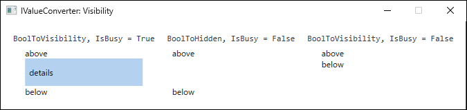

## Overview

Showing or hiding an element from a view model `bool`, and showing enum values under readable display names, are both written with `IValueConverter` in WPF.
The built-in `BooleanToVisibilityConverter` only has its default mapping of `true` to `Visible` and `false` to `Collapsed`; it cannot be told to invert or to produce `Hidden`.
So a custom converter is needed, and the "invert with `ConverterParameter=True`" approach does not invert when the implementation compares `parameter` with a `bool`.
This is because a `ConverterParameter` written as an attribute arrives as a string.

This article writes a `BoolToVisibilityConverter` whose inversion and `Hidden` are set through converter properties, and an `EnumDescriptionConverter` that reads the display name from a `Description` attribute.
It also measures the type in which `ConverterParameter` arrives, the layout difference between `Hidden` and `Collapsed`, the exceptions that an implementation without null checks throws for values without an attribute and for undefined values, and how the converter differs from a display property on the view model.

---

## Prerequisites and Environment

- Framework: WPF on .NET 5 or later (because `Enum.GetValues<T>()` is an API from .NET 5 onward). The code assumes C# 8 or later and a project with nullable reference types enabled (`<Nullable>enable</Nullable>`)
- Architecture: MVVM. The view model base class `ObservableObject` is the minimal in-house implementation below; no external library is used
- Verified on: .NET 10 / Windows 11. XAML was loaded with `XamlReader.Parse` for the measurements; compiled XAML was not measured. Not measured on .NET Framework 4.8 either
- Scope: `IValueConverter` (converting a single value). Not covered: `IMultiValueConverter` for combining several values, the difference between the `ConvertBack` return values (`Binding.DoNothing` and `DependencyProperty.UnsetValue`), and number/date formats and cultures. The return values are measured in the [article on binding RadioButton to an enum](/articles/wpf-radiobutton-enum-binding/), and cultures in the [StringFormat article](/articles/wpf-binding-stringformat-number-currency-date/)

The C# code in this article refers to the following namespaces with `using`.
In a project that uses the implicit `using` directives of .NET 6 and later (`<ImplicitUsings>enable</ImplicitUsings>`), the first two lines are unnecessary.

```csharp
using System;
using System.Collections.Generic;
using System.ComponentModel;
using System.Globalization;
using System.Reflection;
using System.Runtime.CompilerServices;
using System.Windows;
using System.Windows.Data;
```

The view model base class has only a `SetProperty` that returns `true` when the value changes, and an `OnPropertyChanged` that fills in the caller's property name through `[CallerMemberName]`.

```csharp
public abstract class ObservableObject : INotifyPropertyChanged
{
    public event PropertyChangedEventHandler? PropertyChanged;

    protected bool SetProperty<T>(ref T field, T value, [CallerMemberName] string? name = null)
    {
        if (EqualityComparer<T>.Default.Equals(field, value))
        {
            return false;
        }

        field = value;
        OnPropertyChanged(name);
        return true;
    }

    protected void OnPropertyChanged([CallerMemberName] string? name = null) =>
        PropertyChanged?.Invoke(this, new PropertyChangedEventArgs(name));
}
```

Raising the change of another property only when `SetProperty` returns `true` is used later on.

The example is an order screen whose view model has `IsBusy` (whether processing is running) and the order state `Status`.
The state enum carries the words to show on screen in `Description` attributes.
`Shipped` has no attribute.

```csharp
public enum OrderStatus
{
    [Description("Awaiting payment")]
    AwaitingPayment,

    [Description("In progress")]
    InProgress,

    Shipped,
}

public sealed class OrderViewModel : ObservableObject
{
    private bool _isBusy;
    private OrderStatus _status;

    public bool IsBusy
    {
        get => _isBusy;
        set => SetProperty(ref _isBusy, value);
    }

    public OrderStatus Status
    {
        get => _status;
        set
        {
            if (SetProperty(ref _status, value))
            {
                OnPropertyChanged(nameof(StatusText));
            }
        }
    }

    public IReadOnlyList<OrderStatus> Statuses { get; } = Enum.GetValues<OrderStatus>();

    public string StatusText => EnumDescriptionConverter.Describe(Status);
}
```

`Statuses` feeds the choices of a `ComboBox`, and `StatusText` is the view-model-side display name compared with the converter later on.
Why the `Status` setter also raises the change of `StatusText` is shown in that comparison.

---

## Basic Usage

`IValueConverter` has two methods: `Convert` from source to target, and `ConvertBack` from target to source.
A converter from `bool` to `Visibility` looks like this.
It holds the `Visibility` for `true` and for `false` in properties, so inversion and `Hidden` are expressed by setting different values in XAML.

```csharp
public sealed class BoolToVisibilityConverter : IValueConverter
{
    public Visibility TrueValue { get; set; } = Visibility.Visible;

    public Visibility FalseValue { get; set; } = Visibility.Collapsed;

    public object Convert(object? value, Type targetType, object? parameter, CultureInfo culture) =>
        value is true ? TrueValue : FalseValue;

    public object ConvertBack(object? value, Type targetType, object? parameter, CultureInfo culture) =>
        Binding.DoNothing;
}
```

`value is true` holds only when the value is the `bool` `true`.
A `null` source and the string `"True"` both become `FalseValue` (the two right-hand columns of the table in the next section).
There is no use for converting `Visibility` back to `bool`, so `ConvertBack` returns `Binding.DoNothing` instead of a value.

The converter instance goes into resources and is passed to the binding's `Converter` through `StaticResource`.
Instances of the same class with different property values, stored under different keys, serve as the inverting and the `Hidden` variants.

```xml
<Window.Resources>
  <BooleanToVisibilityConverter x:Key="BooleanToVisibility" />
  <local:BoolToVisibilityConverter x:Key="BoolToVisibility" />
  <local:BoolToVisibilityConverter x:Key="InverseBoolToVisibility" TrueValue="Collapsed" FalseValue="Visible" />
  <local:BoolToVisibilityConverter x:Key="BoolToHidden" FalseValue="Hidden" />
</Window.Resources>

<Border Visibility="{Binding IsBusy, Converter={StaticResource BoolToVisibility}}" />
<Border Visibility="{Binding IsBusy, Converter={StaticResource InverseBoolToVisibility}}" />
```

XAML converts attribute values such as `TrueValue="Collapsed"` into enum values to match the `Visibility`-typed property.
The first entry, `BooleanToVisibilityConverter`, is the converter built into WPF and is listed for comparison.
`local` is the `xmlns:local` that points to the namespace of the converters.

---

## Converting bool to Visibility

For each resource above and the resources placed in the next section, a `Border`'s `Visibility` was bound and read.
The two `IsBusy` columns are after showing with `IsBusy` set to `true` and after changing it to `false`; the two right-hand columns put `null` and the string `"True"` into a source property of type `object`.
The last three rows are implementations that specify inversion through `ConverterParameter`, covered in the next section.



The `Visibility` of a `Border` shown in a `Window`, read on .NET 10 / Windows 11.
{: .table-caption}

The built-in `BooleanToVisibilityConverter` and `BoolToVisibility` with its default values give the same result.
`InverseBoolToVisibility`, with `TrueValue` and `FalseValue` swapped, inverts, and `BoolToHidden` (`FalseValue="Hidden"`) becomes `Hidden` on `false`.
The built-in converter has no properties to specify these.
As the second row shows, the built-in converter does not invert even when a `bool` `True` is passed through `ConverterParameter`.
The public properties with a setter were listed for the two types.



On .NET 10 / Windows 11, the result of `Type.GetProperties(BindingFlags.Public | BindingFlags.Instance)` filtered to properties with a public setter.
{: .table-caption}

`Hidden` and `Collapsed` both stop drawing the element, but layout treats them differently.
A vertical `StackPanel` holds a text above, a `Border` with `Height="40"`, and a text below, and the position of the text below was compared while the `Border` was hidden.

```xml
<StackPanel>
  <TextBlock Text="above" />
  <Border Height="40" Background="#FFB4D2F0"
          Visibility="{Binding IsBusy, Converter={StaticResource BoolToHidden}}">
    <TextBlock Text="details" VerticalAlignment="Center" Margin="6,0" />
  </Border>
  <TextBlock Text="below" />
</StackPanel>
```

Each of the three panels in the figure replaces the converter in this `Visibility` binding with the one in the panel's heading and sets `IsBusy` to the heading's value.

<figure class="article-figure">
  
  <figcaption>The window shown on .NET 10 / Windows 11. <code>Hidden</code> in the middle keeps the Border's space, and <code>Collapsed</code> on the right removes it.</figcaption>
</figure>



In the same `StackPanel` as the figure above, the top of the `TextBlock` after the `Border`, read as the position from the top-left of the `StackPanel` (.NET 10 / Windows 11; the `TextBlock` uses the default font and size).
{: .table-caption}

With `Hidden` the position is the same as with `Visible`, and with `Collapsed` it moves up by the Border's height of 40.
Choose `Hidden` when hiding must not move the elements after it (for example, input fields below shifting up), and `Collapsed` when the freed space should close up.

---

## Specifying Inversion with ConverterParameter

Inversion can also be specified through `ConverterParameter` instead of a converter property.
The following implementation inverts when `parameter` is the `bool` `true`.

```csharp
public sealed class ParameterBoolToVisibilityConverter : IValueConverter
{
    public object Convert(object? value, Type targetType, object? parameter, CultureInfo culture)
    {
        bool visible = value is true;
        if (parameter is true)
        {
            visible = !visible;
        }

        return visible ? Visibility.Visible : Visibility.Collapsed;
    }

    public object ConvertBack(object? value, Type targetType, object? parameter, CultureInfo culture) =>
        Binding.DoNothing;
}
```

It is placed in resources and used with `ConverterParameter=True`.
A second binding passes a `bool` resource named `True` instead.

```xml
<Window xmlns:sys="clr-namespace:System;assembly=System.Runtime" ...>
  <Window.Resources>
    <local:ParameterBoolToVisibilityConverter x:Key="ParameterBoolToVisibility" />
    <sys:Boolean x:Key="True">True</sys:Boolean>
  </Window.Resources>

  <Border Visibility="{Binding IsBusy, Converter={StaticResource ParameterBoolToVisibility}, ConverterParameter=True}" />
  <Border Visibility="{Binding IsBusy, Converter={StaticResource ParameterBoolToVisibility}, ConverterParameter={StaticResource True}}" />
</Window>
```

`assembly=System.Runtime` in `sys` is the form measured on .NET.
On .NET Framework, use `assembly=mscorlib` as in the [official documentation's examples](https://learn.microsoft.com/dotnet/desktop/xaml-services/types-for-primitives) (not measured in this article).

In the first table of the previous section (the `Visibility` of a `Border`), the row passing `ConverterParameter=True` to `ParameterBoolToVisibility` is `Visible` for `IsBusy` `True` and `Collapsed` for `False`, so nothing was inverted.
No exception occurs, so the mistake is noticed only by seeing on screen that the display is not reversed.

The cause is that a value written as an attribute string in `ConverterParameter` is passed as is, without type conversion.
`Binding.ConverterParameter` is a property of type `object`, so XAML has nothing to tell it to turn `True` into a `bool`.
A recording converter read the type of the value that reached `parameter`.



`GetType().FullName` and `ToString()` of the `parameter` received by `Convert` on .NET 10 / Windows 11. `True` is the `sys:Boolean` resource in the XAML above.
{: .table-caption}

`True`, `1`, and `Hidden` all arrive as `System.String`.
An enum value passed as the value itself with `x:Static`, as in `{x:Static Visibility.Hidden}`, and a `bool` passed as a `sys:Boolean` resource through `StaticResource`, each arrive with their own type.
In the first table of the previous section, the row passing `ConverterParameter={StaticResource True}` to `ParameterBoolToVisibility` inverts.

Another fix is to accept that the parameter arrives as a string and compare `parameter` with the string `"True"`.

```csharp
public sealed class StringParameterBoolToVisibilityConverter : IValueConverter
{
    public object Convert(object? value, Type targetType, object? parameter, CultureInfo culture)
    {
        bool visible = value is true;
        if (string.Equals(parameter as string, "True", StringComparison.OrdinalIgnoreCase))
        {
            visible = !visible;
        }

        return visible ? Visibility.Visible : Visibility.Collapsed;
    }

    public object ConvertBack(object? value, Type targetType, object? parameter, CultureInfo culture) =>
        Binding.DoNothing;
}
```

As the last row of the first table in the previous section shows (`ConverterParameter=True` passed to `StringParameterBoolToVisibility`), this implementation inverts.
A misspelling, however, behaves differently from the property approach.
A misspelled value was compared for this implementation, placed in resources with `<local:StringParameterBoolToVisibilityConverter x:Key="StringParameterBoolToVisibility" />`, and for the `FalseValue` of `BoolToVisibilityConverter`.



On .NET 10 / Windows 11. The first two rows read the `Visibility` of the bound `Border`; the last two read whether loading XAML containing the resource with `XamlReader.Parse` threw, and the exception type. The third row is a control with the correct spelling in the same XAML.
{: .table-caption}

`ConverterParameter=Ture` fails silently and just does not invert.
While the same XAML with the correct `FalseValue="Hidden"` throws nothing, `FalseValue="Hiden"` fails with `XamlParseException` when loaded through `XamlReader.Parse`.
Property values go through conversion to `Visibility`, so a misspelled value fails in that conversion.
Whether compiled XAML reports this mistake at build time or at run time was not measured.
As the way to specify inversion, use the converter properties.

When enum values are passed through `ConverterParameter` (as when binding RadioButtons to an enum), writing them as strings makes the on-screen selection disappear; that case is measured in the [article on binding RadioButton to an enum](/articles/wpf-radiobutton-enum-binding/).

---

## Converting an Enum to a Display Name

Enum value names (`AwaitingPayment`) cannot contain spaces, so the words for the screen are kept separately.
A converter that returns the `Description` attribute's text, and the value name when there is no attribute, looks like this.

```csharp
public sealed class EnumDescriptionConverter : IValueConverter
{
    public object Convert(object? value, Type targetType, object? parameter, CultureInfo culture) =>
        value is Enum e ? Describe(e) : string.Empty;

    public object ConvertBack(object? value, Type targetType, object? parameter, CultureInfo culture) =>
        Binding.DoNothing;

    public static string Describe(Enum value)
    {
        string name = value.ToString();
        FieldInfo? field = value.GetType().GetField(name);
        return field?.GetCustomAttribute<DescriptionAttribute>()?.Description ?? name;
    }
}
```

`GetField` returns `null` for a value that the enum does not define (`(OrderStatus)99`).
`ToString()` returns the digits `"99"` instead of a name, and there is no field with that name.
`GetCustomAttribute` returns `null` when there is no attribute.
`Describe` checks both `null`s and falls back to the value name (the digits for an undefined value).
`Describe` is `public static` so that the view model's `StatusText` can use the same logic.

This implementation was compared with the following one, which skips the null checks with `!`.

```csharp
public object Convert(object? value, Type targetType, object? parameter, CultureInfo culture) =>
    value!.GetType().GetField(value.ToString()!)!.GetCustomAttribute<DescriptionAttribute>()!.Description;
```

`TextBlock.Text` was bound to a source property of type `object`, shown with `AwaitingPayment` (a value that appears nowhere in the table), and then the source was set on the UI thread to each value in the table.
`FileAttributes.ReadOnly | FileAttributes.Hidden` is a combination of two values of a .NET enum marked `[Flags]`.



`TextBlock.Text` after assigning each value to the source property on .NET 10 / Windows 11. Exceptions are the types caught by `try` / `catch` around the assignment.
{: .table-caption}

The implementation without null checks throws `NullReferenceException` from `.Description` for `Shipped` (no attribute), and from `value!.GetType()` for a `null` source.
For the undefined `99` and the combined value, a `null` field reaches `GetCustomAttribute`, which throws `ArgumentNullException`.
The exception propagates straight to the code that called the source setter, and the on-screen `Text` keeps its previous value.
The [official documentation for IValueConverter.Convert](https://learn.microsoft.com/dotnet/api/system.windows.data.ivalueconverter.convert) also states that the data binding engine does not catch exceptions thrown by a converter.
Where an exception that the caller does not catch ends up is measured in the [article on unhandled exceptions](/articles/wpf-unhandled-exception-dispatcher-task-thread/).
Do not throw from a converter; fall back to a value that can be displayed.

The combined value does not become attribute text even with `EnumDescriptionConverter`; the `ToString()` result `"ReadOnly, Hidden"` is shown as is.
There is no field with that name, so `GetField` returns `null`.
Giving display names to combinations of a `[Flags]` enum needs separate code that splits the value with `Enum.HasFlag` and joins the display names (not written in this article).

The same converter works for `ComboBox` items.
Inside `ItemTemplate`, the item itself (the enum value) is the data context, so the conversion is applied to `{Binding}` without a `Path`.

```xml
<Window.Resources>
  <local:EnumDescriptionConverter x:Key="EnumDescription" />
</Window.Resources>

<ComboBox ItemsSource="{Binding Statuses}" SelectedItem="{Binding Status}">
  <ComboBox.ItemTemplate>
    <DataTemplate>
      <TextBlock Text="{Binding Converter={StaticResource EnumDescription}}" />
    </DataTemplate>
  </ComboBox.ItemTemplate>
</ComboBox>
```

The `ComboBox` was shown with `Status` set to `AwaitingPayment`, the drop-down was opened, and the second item was selected.



Values read on .NET 10 / Windows 11. The item was selected by setting `SelectedIndex` to 1, and the view model's `Status` and the type of `ComboBox.SelectedItem` were read.
{: .table-caption}

The selection box and the drop-down show display names, `SelectedItem` stays an enum value, and the view model's `Status` receives `InProgress`.
Only the display is converted, so the `SelectedItem` binding needs no conversion.
Different ways of building the collection passed to `ItemsSource` are covered in the [article on ComboBox ItemsSource](/articles/wpf-combobox-itemssource-patterns/).

---

## Converter Versus View Model Property

The display name can also be exposed as a view model property (`StatusText`) without a converter.
However, `StatusText` is computed from `Status`, so the screen is not updated unless the change of `StatusText` is raised when `Status` changes.
The `OrderViewModel` at the top calls `OnPropertyChanged(nameof(StatusText))` in the `Status` setter.
The following view model lacks that line.

```csharp
public sealed class SilentOrderViewModel : ObservableObject
{
    private OrderStatus _status;

    public OrderStatus Status
    {
        get => _status;
        set => SetProperty(ref _status, value);
    }

    public string StatusText => EnumDescriptionConverter.Describe(Status);
}
```

`TextBlock.Text` was bound to `Status` through the converter and to `StatusText` of each of the two view models, and `Status` was changed from `AwaitingPayment` to `Shipped`.



`TextBlock.Text` read before and after changing `Status` on .NET 10 / Windows 11.
{: .table-caption}

The converter shows the new display name from the change notification of `Status` alone.
The view model that does not raise `StatusText` keeps showing the old display name, without an exception.

Choose between the two as follows.

| Condition | Approach | Reason |
| --- | --- | --- |
| The same conversion is used on several screens or for several enums | Converter | One instance in resources can be attached to any binding |
| Converting values that do not go through a view model property, such as `ComboBox` items | Converter | There is no per-item property |
| The display name is also used outside the screen (logs, CSV), or should be tested together with the state in view model tests | View model property | `StatusText` after changing `Status` can be read from the view model alone |
| The display depends on several properties | View model property | An `IValueConverter` receives the value of only one binding, so updating on each source property's change needs an `IMultiValueConverter` or a view model property that is raised from each source property |

With `Describe` as a static method, as in this article, both the converter and the view model build display names with the same rule.

---

## Constraints and Boundaries

- **The text passed to the `Description` attribute is a constant.** As written, it does not change with the display language. For several languages, either derive an attribute that overrides the (virtual) `Description` property to read resources (the [official documentation for DescriptionAttribute.DescriptionValue](https://learn.microsoft.com/dotnet/api/system.componentmodel.descriptionattribute.descriptionvalue) names this use), or look up resource files (`.resx`) inside `Describe`. Neither is measured in this article.
- **Combinations of a `[Flags]` enum get no display name.** As the first table in "Converting an Enum to a Display Name" (the one per source value) shows, the list of names from `ToString()` is displayed as is.
- **`ConvertBack` assumes display-only conversion.** Every binding in this article is for display, and the paths on which `ConvertBack` is called are not measured. That returning `Binding.DoNothing` leaves the source unchanged is measured in the [article on binding RadioButton to an enum](/articles/wpf-radiobutton-enum-binding/). When attaching a converter to a binding that accepts input (such as `TextBox.Text`), write the reverse conversion in `ConvertBack`.

---

## Summary

For `bool` to `Visibility`, write one converter that holds the values for `true` and `false` in properties, and put instances with different property values in resources for the inverting and `Hidden` variants.
Specifying inversion with `ConverterParameter=True` passes a string, so an implementation that compares with a `bool` does not invert and throws no exception.
To pass the value itself through `ConverterParameter`, pass an enum value with `x:Static`, and a `bool` as a `sys:Boolean` resource through `StaticResource`.

Show enum display names with a converter that reads the `Description` attribute, and fall back to a displayable value instead of throwing for values without an attribute, undefined values, and `null`.
Use a converter when the same conversion serves many screens or `ComboBox` items, and a view model property when it is also needed for tests or outside the screen; with the latter, raise the change of the display property in the setter of the property it depends on.
