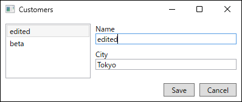
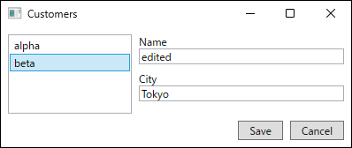

## Overview

A user picks a customer in a list, corrects the name or city in the detail form beside it, and presses Save or Cancel.
This master-detail screen is one of the most common screens in line-of-business applications, and binding the detail form directly to the list's `SelectedItem` is enough to make it look finished.
With that design, however, pressing Cancel leaves the typed value in the list.
The detail form and the list look at the same item, so the input is written straight into that item (even with the default trigger, by the time the Cancel command runs), and the original value is no longer kept anywhere.

This article builds a cancelable detail form in two stages.
The first stage compares receiving the input in a copy for editing with saving the original values through `IEditableObject`.
The second stage deals with the user clicking another row in the list while unsaved input remains.
The two commonly suggested guards, rejecting the change in the `SelectedItem` setter and canceling `CurrentChanging`, both leave the selection on screen out of step with the view model.
Each stage was measured by clicking Cancel, Save, and list rows with the real mouse.

---

## Prerequisites and Environment

- Framework: WPF on .NET. The code assumes C# 9 or later (`is not null`, target-typed `new()`, and `_` discards as lambda parameters) and a project with nullable reference types enabled (`<Nullable>enable</Nullable>`). Behavior was measured only in the environment below; .NET Framework 4.8 was not measured
- Architecture: MVVM. The view model base class `ObservableObject` (with a `SetProperty` that returns `true` when the value changes and an `OnPropertyChanged` that fills in the caller's property name through `[CallerMemberName]`) and `RelayCommand` are minimal hand-written implementations with no external library. The `RelayCommand` in this article always returns `true` from `CanExecute`; an implementation that updates `CanExecute` is in a [related article](/articles/wpf-relaycommand-canexecute-not-updating/)
- Verified on: .NET 10 / Windows 11. Text was typed through WPF's input pipeline (`InputManager`), and buttons and list rows were clicked with real OS mouse input
- Subject: a window with a customer list on the left (a `ListBox`, or a read-only `DataGrid`), a detail form with `Name` and `City` on the right, and Save and Cancel at the bottom. Each measurement selects the first row, `"alpha"`, and retypes the Name box as `"edited"`
- Scope: a screen that edits one item at a time, with simple value properties such as strings. Items with child collections, multiple selection, and display of validation errors are out of scope

The customer is a class that raises change notifications for two properties.
It also has `Clone` to make a copy for editing, `CopyFrom` to write the copy's values back, and `HasSameValues` to compare values.

```csharp
public class Customer : ObservableObject
{
    private string _name = "";
    private string _city = "";

    public string Name
    {
        get => _name;
        set => SetProperty(ref _name, value);
    }

    public string City
    {
        get => _city;
        set => SetProperty(ref _city, value);
    }

    public Customer Clone() => new() { Name = Name, City = City };

    public void CopyFrom(Customer other)
    {
        Name = other.Name;
        City = other.City;
    }

    public bool HasSameValues(Customer other) => Name == other.Name && City == other.City;
}
```

These three methods list the properties one by one.
When a property is added to `Customer`, it has to be added in all three places.

---

## Problem

The first version is usually written by binding the detail form's `TextBox` controls directly to the item selected in the list.

```xml
<ListBox ItemsSource="{Binding Customers}" DisplayMemberPath="Name"
         SelectedItem="{Binding SelectedCustomer}" />
<StackPanel>
  <TextBox Text="{Binding SelectedCustomer.Name}" />
  <TextBox Text="{Binding SelectedCustomer.City}" />
</StackPanel>
```

`SelectedCustomer` is the very item stored in the list's `Customers`.
The input in the `TextBox` is therefore written to the `Name` of the item shown in the list.
With `UpdateSourceTrigger=PropertyChanged`, which updates the source on every keystroke, the list changes while the user is still typing.

<figure class="article-figure">
  
  <figcaption>The detail form uses <code>{Binding SelectedCustomer.Name, UpdateSourceTrigger=PropertyChanged}</code>, captured right after typing <code>edited</code> into the Name box of the first row. The first row of the list has changed before Save is pressed. Captured on .NET 10 / Windows 11.</figcaption>
</figure>

With the default trigger of `TextBox.Text` (`LostFocus`, which updates when the box loses focus), nothing is written while typing, so it looks as if the write can wait until Save.
Clicking the Cancel button, however, moves focus from the `TextBox` to the button.
In the measurement, the source had already been written by the time the Cancel command ran, and the original `"alpha"` was gone.

---

## First Obstacle: Input Is Written into the Item, Leaving Nothing to Restore

The table shows the result of typing `"edited"` into the Name box and clicking Cancel with the real mouse, for each binding target of the detail form.



In every row, "source" is the `Name` of the first item in the list (`Customers[0]`), not the value in a copy for editing.
"Source right after typing" was read right after typing, and "source when Cancel runs" was read inside `CancelCommand`.
Measured on .NET 10 / Windows 11.
{: .table-caption}

In the two rows bound directly to `SelectedCustomer.Name`, the source was already `"edited"` when Cancel ran, even with the default trigger.
From the Cancel handler's point of view, there is no way to know the value before the edit.
Making the edit cancelable requires one of two things: **receive the input somewhere other than the list item**, or **save the original values before the input arrives**.
The first is a copy for editing, and the second is `IEditableObject`.

### Receiving the Input in a Copy for Editing

Each time the selection changes, the view model makes a copy of the selected item, and the detail form binds to that copy (`Editing`).
Save writes the copy's values back to the item, and Cancel makes a new copy.

```csharp
public Customer? SelectedCustomer
{
    get => _selectedCustomer;
    set
    {
        if (SetProperty(ref _selectedCustomer, value))
        {
            Editing = value?.Clone();
        }
    }
}

public Customer? Editing
{
    get => _editing;
    private set => SetProperty(ref _editing, value);
}

private void Save() => SelectedCustomer?.CopyFrom(Editing!);

private void Cancel() => Editing = SelectedCustomer?.Clone();
```

The only change in XAML is the binding path, from `SelectedCustomer.Name` to `Editing.Name`.

```xml
<TextBox Text="{Binding Editing.Name}" />
<TextBox Text="{Binding Editing.City}" />
```

As the third row of the table shows, the source stayed `"alpha"` through the click on Cancel, and after Cancel the list and the detail form were also `"alpha"`.
The input reaches only the copy, so the list item does not change at all until Save.
`CopyFrom` in Save overwrites the values of the item already in the list; it does not replace the item in the collection.

### Saving the Original Values with IEditableObject

`IEditableObject` is an interface that gives the item itself the operations to begin (`BeginEdit`), commit (`EndEdit`), and cancel (`CancelEdit`) an edit.
The implementation saves the values in `BeginEdit` and restores them in `CancelEdit`.

```csharp
public sealed class EditableCustomer : Customer, IEditableObject
{
    private Customer? _backup;

    // If called again during an edit, keep the values saved first.
    public void BeginEdit() => _backup ??= Clone();

    public void EndEdit() => _backup = null;

    public void CancelEdit()
    {
        if (_backup is not null)
        {
            CopyFrom(_backup);
            _backup = null;
        }
    }
}
```

The list's `Customers` must hold `EditableCustomer` instances, not `Customer`.
With plain `Customer`, `value as IEditableObject` is `null`, and none of `BeginEdit`, `EndEdit`, or `CancelEdit` in the following code is called.
The view model calls `BeginEdit` when an item is selected, `EndEdit` on Save, and `CancelEdit` on Cancel.
To let the user keep editing after a commit or cancel, it calls `BeginEdit` again after both.
The detail form stays bound directly to `SelectedCustomer.Name`.

```csharp
public Customer? SelectedCustomer
{
    get => _selectedCustomer;
    set
    {
        if (SetProperty(ref _selectedCustomer, value))
        {
            (value as IEditableObject)?.BeginEdit();
        }
    }
}

private void Save()
{
    if (SelectedCustomer is IEditableObject editable)
    {
        editable.EndEdit();
        editable.BeginEdit();
    }
}

private void Cancel()
{
    if (SelectedCustomer is IEditableObject editable)
    {
        editable.CancelEdit();
        editable.BeginEdit();
    }
}
```

As the fourth row of the table shows, the source was `"edited"` when Cancel ran, and `CancelEdit` restored it to `"alpha"`.
Because the input is written straight into the item, the unsaved value appears in the list once focus leaves the `TextBox` (default trigger) or on every keystroke (`UpdateSourceTrigger=PropertyChanged`), and stays there until Cancel is pressed.
This implementation calls neither `EndEdit` nor `CancelEdit` on the previous row when the selection moves, so, as the code shows, that row stays in the editing state with its values saved (in the row "nothing (IEditableObject)" of the second obstacle's table, `"edited"` remained in the first row).

When Save was clicked instead, both approaches set the source and the list to the typed value.
Typing `"again"` after Save and clicking Cancel returned both to the saved `"edited"`.
With `IEditableObject`, Save calls `BeginEdit` again after `EndEdit`, so the saved value becomes the new point to cancel back to.



The result of typing `"edited"` into the Name box, clicking Save, then typing `"again"` and clicking Cancel.
The detail form uses the default trigger.
Measured on .NET 10 / Windows 11.
{: .table-caption}

### Choosing Between the Two

The difference between the two is where the typed value is visible before Save.

| Aspect | Copy for editing | IEditableObject |
|---|---|---|
| List before Save | Original value | Typed value (with the default trigger, after focus leaves; restored by Cancel) |
| Where the cancel logic lives | View model | Item class |
| Change to the item class | Add `Clone`, `CopyFrom`, and `HasSameValues` | Implement `IEditableObject` (this article's implementation also uses `Clone` and `CopyFrom`) |
| Detecting unsaved changes | Compare the copy with the item | Requires extra code that exposes the saved values (not implemented in this article) |

A copy for editing suits screens that should not show unsaved values in the list, such as screens where the list is treated as the saved state.
On screens that edit directly in `DataGrid` cells, the `DataGrid` itself calls the `IEditableObject` methods during row editing (measured in [DataGrid edits not committed by a Save button](/articles/wpf-datagrid-edit-not-committed-on-save/)).
If the items on such a screen already implement `IEditableObject`, the detail form can follow the same mechanism.
The rest of this article uses a copy for editing, which keeps unsaved values out of the list.

---

## Second Obstacle: Switching Rows During an Edit Discards Input or Desynchronizes the Screen

Even with a working Cancel, the user can still click another row in the list while unsaved input remains.
After typing `"edited"` into the Name box of the first row, the second row (`"beta"`) was clicked with the real mouse.
The table compares doing nothing, the two commonly suggested guards (three variants, counting the setter guard deferred through `Dispatcher.BeginInvoke`), and the one this article adopts (disabling the list).



Columns that show an item show that item's `Name` at the time of measurement (a `CurrentItem` of `"edited"` is still the first item, whose `Name` has changed).
"SelectedItem / SelectedIndex" are the control's property values (`SelectedIndex` counts from 0), and "row highlighted on screen" is the row whose container has `IsSelected` set to `true`.
In rows that leave `IsSynchronizedWithCurrentItem` at its default and pass the collection directly to `ItemsSource`, `CurrentItem` did not follow the selection and stayed on the first item.
Except for the row "nothing (IEditableObject)", the detail form is bound to a copy for editing.
The detail form uses the default trigger (`LostFocus`) except in the rows marked `UpdateSourceTrigger=PropertyChanged`.
"List IsEnabled just before the mouse press" is read after the cursor has moved over the second row and just before the mouse button is pressed.
In the rows with `→`, the left value is right after typing, and the right value is just before the press on the second row, after Save or Cancel was clicked.
The guards that reject the change treat the discard confirmation as answered "do not discard", and the scene also checks that the confirmation was called.
Measured on .NET 10 / Windows 11.
{: .table-caption}

### Doing Nothing

With a copy for editing, the selection moved to the second row and the detail form was replaced by a copy of `"beta"`.
The `"edited"` typed into the first row was discarded without any confirmation.
With `IEditableObject`, the selection moved while `"edited"` remained in the first row.
A value that was never saved looks saved in the list.

### Rejecting in the Setter Splits SelectedItem from SelectedIndex

A commonly suggested guard is to make the setter of the property bound to `SelectedItem` refuse the value when unsaved input exists, and raise `PropertyChanged` so that the control reads the old value back.

```csharp
public Customer? SelectedCustomer
{
    get => _selectedCustomer;
    set
    {
        if (value == _selectedCustomer) return;
        if (IsDirty && !_dialogService.Confirm("Discard the changes?"))
        {
            OnPropertyChanged(); // meant to make the control read the old value back
            return;
        }

        // accept the selection (recreate the copy, and so on)
    }
}
```

`_dialogService` is a service that keeps the confirmation `MessageBox` out of the view model ([the IDialogService article](/articles/wpf-mvvm-dialog-service/)).
`IsDirty` is a property that is `true` when the copy and the item differ; it is defined in "Complete Implementation" below.

As the table shows, the view model's `SelectedCustomer` and `ListBox.SelectedItem` stayed on the first row.
`SelectedIndex`, however, was `1`, and the row highlighted on screen was the second one.
The `SelectedItem` and `SelectedIndex` of the same `ListBox` point at different rows.
Raising `PropertyChanged` later through `Dispatcher.BeginInvoke` at the default priority (`Normal`) gave the same result.
Lower priorities, and deferring an assignment that restores the selection instead of `PropertyChanged`, were not measured.
`DataGrid` showed the same mismatch.

<figure class="article-figure">
  
  <figcaption>After the setter rejected the change of selection. The second row, <code>beta</code>, is highlighted on screen, but the detail form still shows the copy of the first row (<code>edited</code> in Name and the first row's <code>Tokyo</code> in City). Captured on .NET 10 / Windows 11.</figcaption>
</figure>

To the user, the second row is selected but the first row's contents are displayed.
Clicking Save in this state writes back to the first row, so a row other than the highlighted one is updated.



The result of typing `"edited"` into the Name box of the first row, having the change of selection stopped by a click on the second row, and then clicking Save.
The detail form is bound to a copy for editing with the default trigger.
Measured on .NET 10 / Windows 11.
{: .table-caption}

The `CurrentChanging` guard in the next section also updated the first row.

### Canceling CurrentChanging Splits CurrentItem from SelectedItem

The other commonly suggested guard sets `IsSynchronizedWithCurrentItem="True"` on the list so that the selection follows the current item (`CurrentItem`) of the collection view (`ICollectionView`), and sets `e.Cancel = true` in `CurrentChanging`, which is raised just before the current item moves.
The list's `SelectedItem` is not bound, and the view model takes the selection from `CurrentItem`.

```xml
<ListBox ItemsSource="{Binding Customers}" DisplayMemberPath="Name"
         IsSynchronizedWithCurrentItem="True" />
```

The view model subscribes to the events of the default collection view of `Customers`.

```csharp
ICollectionView view = CollectionViewSource.GetDefaultView(Customers);
view.CurrentChanging += (_, e) =>
{
    if (IsDirty && e.IsCancelable && !_dialogService.Confirm("Discard the changes?"))
    {
        e.Cancel = true;
    }
};
view.CurrentChanged += (_, _) => SelectedCustomer = view.CurrentItem as Customer;
SelectedCustomer = view.CurrentItem as Customer; // take the initial selection
```

As the table shows, `CurrentItem` and the view model stayed on the first row.
`SelectedItem`, `SelectedIndex`, and the selection on screen, however, all moved to the second row.
The current item stops moving, but the selection of `ListBox` and `DataGrid` does not go back.

In all three variants, the view model's refusal showed up in `SelectedItem` for the setter guards and in `CurrentItem` for the `CurrentChanging` guard, but the selection on screen (`SelectedIndex` and the row's `IsSelected`) moved to the second row and did not come back.

### Disabling the List So the Selection Cannot Change

Instead of refusing the change afterward, the list is disabled while unsaved input exists.
The view model exposes `CanChangeSelection`, which says whether the selection may change, and the list binds `IsEnabled` to it.

```xml
<ListBox ItemsSource="{Binding Customers}" DisplayMemberPath="Name"
         SelectedItem="{Binding SelectedCustomer}"
         IsEnabled="{Binding CanChangeSelection}" />
<StackPanel>
  <TextBox Text="{Binding Editing.Name, UpdateSourceTrigger=PropertyChanged}" />
  <TextBox Text="{Binding Editing.City, UpdateSourceTrigger=PropertyChanged}" />
</StackPanel>
```

As the table shows, the list's `IsEnabled` was `False` just before the mouse press on the second row, and clicking the second row left the view model, `SelectedItem`, `SelectedIndex`, and the selection on screen all on the first row.
The `"edited"` in the detail form also remained.
`DataGrid` gave the same result.

`UpdateSourceTrigger=PropertyChanged` on the detail form is essential here.
With the default trigger, the copy does not change while typing, so the list's `IsEnabled` was still `True` just before the mouse press on the second row.
In the row "detail with the default trigger", clicking the second row moved the selection and discarded `"edited"`.
Because the input goes to a copy, updating the source on every keystroke does not change the list item.
Choosing a copy for editing in the first obstacle is what makes this work.

While the list is disabled, the user cannot select another row until they finish the edit with Save or Cancel.
As the rows "click Cancel first" show, clicking Cancel set the list's `IsEnabled` back to `True`, and a subsequent click on the second row moved the selection and the detail form to `"beta"` (`ListBox` and `DataGrid`).
In the row "click Save first", `IsEnabled` also returned to `True`, the first row kept `"edited"`, and the selection and the detail form moved to `"beta"`.

---

## Complete Implementation

The following view model combines the copy for editing with disabling the list.
To raise change notifications for `IsDirty` and `CanChangeSelection` whenever a value in `Editing` changes, it resubscribes to the copy's `PropertyChanged` each time `Editing` is replaced.

```csharp
using System.Collections.Generic;
using System.Collections.ObjectModel;
using System.ComponentModel;
using System.Linq;
using System.Windows.Input;

public sealed class CustomerListViewModel : ObservableObject
{
    private Customer? _selectedCustomer;
    private Customer? _editing;

    public CustomerListViewModel(IEnumerable<Customer> customers)
    {
        Customers = new ObservableCollection<Customer>(customers);
        SaveCommand = new RelayCommand(Save);
        CancelCommand = new RelayCommand(Cancel);
        SelectedCustomer = Customers.FirstOrDefault();
    }

    public ObservableCollection<Customer> Customers { get; }

    public ICommand SaveCommand { get; }

    public ICommand CancelCommand { get; }

    public Customer? SelectedCustomer
    {
        get => _selectedCustomer;
        set
        {
            if (SetProperty(ref _selectedCustomer, value))
            {
                Editing = value?.Clone();
            }
        }
    }

    /// <summary>The binding target of the detail form (the copy for editing).</summary>
    public Customer? Editing
    {
        get => _editing;
        private set
        {
            Customer? old = _editing;
            if (SetProperty(ref _editing, value))
            {
                if (old is not null) old.PropertyChanged -= OnEditingChanged;
                if (value is not null) value.PropertyChanged += OnEditingChanged;
                OnDirtyChanged();
            }
        }
    }

    public bool IsDirty =>
        SelectedCustomer is not null && Editing is not null && !Editing.HasSameValues(SelectedCustomer);

    public bool CanChangeSelection => !IsDirty;

    private void OnEditingChanged(object? sender, PropertyChangedEventArgs e) => OnDirtyChanged();

    private void OnDirtyChanged()
    {
        OnPropertyChanged(nameof(IsDirty));
        OnPropertyChanged(nameof(CanChangeSelection));
    }

    private void Save()
    {
        if (SelectedCustomer is null || Editing is null) return;
        SelectedCustomer.CopyFrom(Editing);
        OnDirtyChanged();
    }

    private void Cancel() => Editing = SelectedCustomer?.Clone();
}
```

After Save, the copy and the item hold the same values, so `IsDirty` returns to `false`.
Changing the item's values does not raise the copy's `PropertyChanged`, however, so `Save` calls `OnDirtyChanged` explicitly.

The view connects the list, the detail form, and the buttons with bindings and commands only.
The code-behind contains nothing but `InitializeComponent`.

```xml
<DockPanel Margin="8">
  <StackPanel DockPanel.Dock="Bottom" Orientation="Horizontal"
              HorizontalAlignment="Right" Margin="0,8,0,0">
    <Button Content="Save" Command="{Binding SaveCommand}" Padding="12,2" Margin="0,0,8,0" />
    <Button Content="Cancel" Command="{Binding CancelCommand}" Padding="12,2" />
  </StackPanel>
  <ListBox Width="140" ItemsSource="{Binding Customers}" DisplayMemberPath="Name"
           SelectedItem="{Binding SelectedCustomer}"
           IsEnabled="{Binding CanChangeSelection}" />
  <StackPanel Margin="8,0,0,0">
    <TextBlock Text="Name" />
    <TextBox Text="{Binding Editing.Name, UpdateSourceTrigger=PropertyChanged}" />
    <TextBlock Text="City" Margin="0,8,0,0" />
    <TextBox Text="{Binding Editing.City, UpdateSourceTrigger=PropertyChanged}" />
  </StackPanel>
</DockPanel>
```

Apart from sizes and names (`x:Name`), the scene used for the measurements builds the same screen from this XAML and runs the same logic as this view model.

---

## Caveats

- **`Clone`, `CopyFrom`, and `HasSameValues` list the properties explicitly.** If a property is added to `Customer` and forgotten in any one of them, that property drops out of cancel, save, or the unsaved-change check.
- **A `DataGrid` used as the list was measured only as read-only (`IsReadOnly="True"`).** A `DataGrid` that allows editing in cells calls the `IEditableObject` methods itself during row editing. A setup where the same item is edited both in the `DataGrid` and in the detail form was not measured.
- **Only row clicks were measured as a way to change the selection.** Moving between rows with the keyboard, setting `SelectedCustomer` from the view model, and deleting the selected item were not measured.
- **Closing the window is outside what this mechanism covers.** The list's `IsEnabled` has nothing to do with the window's close button. Confirming unsaved input before closing is covered in [confirming asynchronously in Window.Closing](/articles/wpf-window-closing-async-cancel/). This article did not measure closing combined with `IsDirty`.
- **`UpdateSourceTrigger=PropertyChanged` is safe because the form is bound to a copy.** Using the same setting with the direct binding from the first obstacle (`SelectedCustomer.Name`) changes the list while the user is typing. The difference between triggers is covered in [the UpdateSourceTrigger article](/articles/wpf-textbox-updatesourcetrigger-binding-timing/).

---

## Summary

- Binding the detail form directly to `SelectedItem` writes the input into the list item. Even with the default trigger, the write happens before the Cancel command runs, leaving nothing to restore
- To cancel, receive the input in a copy for editing or save the original values with `IEditableObject`. A copy for editing suits screens that should not show unsaved values in the list
- Stopping a row switch during an edit by rejecting it in the `SelectedItem` setter or by canceling `CurrentChanging` leaves the selection of `ListBox` and `DataGrid` out of step with the view model
- While unsaved input exists, set the list's `IsEnabled` to `false` so the selection cannot change at all. For that, bind the detail form to the copy for editing with `UpdateSourceTrigger=PropertyChanged`
