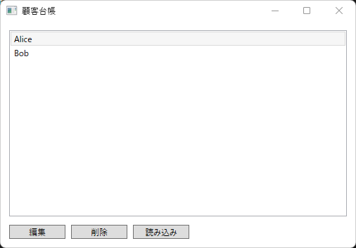
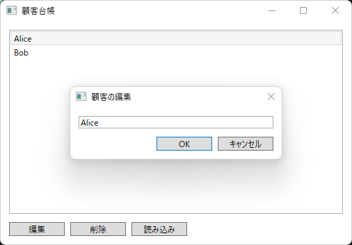

## Overview

In MVVM, actions such as "confirm before deleting", "pick a file to import", and "edit in a child window" tempt the view model to open dialogs itself.
Calling `MessageBox.Show` from the view model works, but the same code blocks when it runs on a test thread.
Moving the dialog code into a separate class raises the next problem: the view model does not know any window, so it cannot decide the dialog's owner (`Owner`).
A child window without an owner that is not `Topmost` falls behind the main window once the main window is moved to the top of the z-order.

This article works through these three obstacles in order and builds a self-written `IDialogService` that handles confirmations, file selection, and child windows.
Each stage was measured: running a command from a separate thread, the Win32 owner and z-order of every dialog, and the values the view model actually received.

---

## Prerequisites and Environment

- Framework: WPF on .NET 5 or later (.NET Framework 4.8 was not measured). The code requires C# 9 or later (`is not null` and target-typed `new()`). Type definitions include their using directives; method-only excerpts omit them. Behavior was measured only in the environment below
- Architecture: MVVM. The view model base class `ObservableObject` (with a `SetProperty` that returns `true` when the value changed) and `RelayCommand` (with `RaiseCanExecuteChanged`) are minimal self-written implementations; no external library is used. A `RelayCommand` implementation is shown in a [related article](/articles/wpf-relaycommand-canexecute-not-updating/)
- Verified on: .NET 10 / Windows 11 (run on an interactive desktop). The windows opened for the measurements were not `Topmost` when the z-order was read; `Topmost` was applied only while capturing the images (see the Second Obstacle). A `Topmost` window appears above all windows that are not `Topmost` ([Window.Topmost](https://learn.microsoft.com/dotnet/api/system.windows.window.topmost)).
- Scenario: from a customer list (the main window), show a delete confirmation (`MessageBox`), a file picker for importing (`OpenFileDialog`), and a child window for editing a customer's name

A customer is a class that only notifies changes to its name.

```csharp
public sealed class Customer : ObservableObject
{
    private string _name;

    public Customer(string name) => _name = name;

    public string Name
    {
        get => _name;
        set => SetProperty(ref _name, value);
    }
}
```

---

## Problem

The first version usually calls `MessageBox.Show` inside a view model command.

```csharp
private void Delete()
{
    if (Selected is null) return;
    if (MessageBox.Show($"Delete {Selected.Name}?", "Confirm delete",
            MessageBoxButton.OKCancel, MessageBoxImage.Question) == MessageBoxResult.OK)
    {
        Customers.Remove(Selected);
    }
}
```

Used from the screen, this code behaves as expected.
The problem appears in unit tests, which run the view model without the screen.
Writing `new CustomerEditWindow().ShowDialog()` for a child window likewise ties the view model to a specific window type, so a test cannot isolate the view model.

---

## First Obstacle: A View Model That Calls MessageBox.Show Blocks the Test Thread

To stand in for a test thread, a separate MTA thread without a UI message loop called `DeleteCommand.Execute`, and the call was given one second to return.



Result of calling `DeleteCommand.Execute(null)` from a separate MTA thread. Measured on .NET 10 / Windows 11 on an interactive desktop. When the call did not return within one second, OK (`IDOK`) was sent from outside to the window the thread had open, and the remaining customers were counted afterwards. Real test runners and non-interactive environments such as CI were not measured.
{: .table-caption}

With the view model that calls `MessageBox.Show` directly, the thread still had a message box open at one second, and `Execute` had not returned.
It returned only after OK was sent from outside, and the customer was deleted.
In this environment, a test stays blocked there until someone presses a button.
Test code also cannot choose between OK and Cancel, except by screen-dependent means such as finding the window and sending it Win32 messages, which is what this measurement did.

The dialog code moves behind an interface, and the view model only calls it.

```csharp
public interface IDialogService
{
    bool Confirm(object ownerViewModel, string message, string caption);
    string? OpenFile(object ownerViewModel, string filter);
    bool ShowDialog(object ownerViewModel, IDialogViewModel viewModel);
}
```

`ownerViewModel` receives the view model that opens the dialog (`this`).
The second obstacle uses it to find the owner window.
`IDialogViewModel` is defined in the third obstacle.

The view model receives `IDialogService` in its constructor.

```csharp
using System.Collections.ObjectModel;

public sealed class CustomerListViewModel : ObservableObject
{
    private readonly IDialogService _dialogs;
    private Customer? _selected;

    public CustomerListViewModel(IDialogService dialogs)
    {
        _dialogs = dialogs;
        DeleteCommand = new RelayCommand(Delete, () => Selected is not null);
    }

    public ObservableCollection<Customer> Customers { get; } = new();
    public RelayCommand DeleteCommand { get; }

    public Customer? Selected
    {
        get => _selected;
        set
        {
            if (SetProperty(ref _selected, value)) DeleteCommand.RaiseCanExecuteChanged();
        }
    }

    private void Delete()
    {
        if (Selected is null) return;
        if (_dialogs.Confirm(this, $"Delete {Selected.Name}?", "Confirm delete"))
        {
            Customers.Remove(Selected);
        }
    }
}
```

A test passes an implementation that returns a predetermined answer immediately.

```csharp
public sealed class FakeDialogService : IDialogService
{
    public bool ConfirmResult { get; set; }
    public int ConfirmCount { get; private set; }

    public bool Confirm(object ownerViewModel, string message, string caption)
    {
        ConfirmCount++;
        return ConfirmResult;
    }

    public string? OpenFile(object ownerViewModel, string filter) => null;
    public bool ShowDialog(object ownerViewModel, IDialogViewModel viewModel) => false;
}
```

The test body is shown as a method that does not depend on a test framework.

```csharp
public void Delete_does_not_remove_when_cancelled()
{
    var dialogs = new FakeDialogService { ConfirmResult = false };
    var vm = new CustomerListViewModel(dialogs);
    vm.Customers.Add(new Customer("Alice"));
    vm.Customers.Add(new Customer("Bob"));
    vm.Selected = vm.Customers[0];

    vm.DeleteCommand.Execute(null);
    // dialogs.ConfirmCount is 1, and vm.Customers.Count stays 2
}
```

The last two rows of the table use this form.
`Execute` returned within one second and `Confirm` was called once; with the answer `true` one customer was deleted, and with `false` both remained.
The test implementation creates no windows, so both branches of the confirmation can be tested from test code alone.

---

## Second Obstacle: A View Model Cannot Choose an Owner It Does Not Know

Once dialogs move into a service, the service has to decide which window the dialog belongs to.
The view model holds no reference to a window, so it cannot simply pass an `Owner`.
The effect of a missing `Owner` was measured as the dialog's Win32 owner (`GetWindow` with `GW_OWNER`), its order relative to the main window after the main window was moved to the top of the z-order, and whether their rectangles overlapped.



The Win32 owner of each dialog, and whether the dialog was above the main window after the main window was moved to the top of the z-order with `SetWindowPos` (`HWND_TOP`, without activating it). Measured on .NET 10 / Windows 11. Overlap compares the DWM extended frame bounds (the visible frame); the system chooses each dialog's position (the Windows default for the child window without an `Owner`, and each dialog's own rule for the message box and file picker), so the overlap can differ between runs. "Main enabled" was read with `IsWindowEnabled`. The main window is 520×360 near the top-left of the work area, and "Search" is another window of the same application with no `Owner`, placed to the right where it does not overlap the main window. "Centered on main" applies to the child window with `WindowStartupLocation="CenterOwner"`; the message box and file picker do not specify a position.
{: .table-caption}

A child window opened with `Window.ShowDialog()` without an `Owner` had no Win32 owner.
Its position was the default chosen by Windows (without an owner, `CenterOwner` is treated like `Manual`; [Window.WindowStartupLocation](https://learn.microsoft.com/dotnet/api/system.windows.window.windowstartuplocation)), and it differed between the runs measured (in one run its whole rectangle lay inside the main window, and in another it only partly overlapped it).
After the main window was moved to the top of the z-order the child was below it, and the main window stayed disabled.
The next two images reproduce the measured order on screen, with Topmost applied only while capturing, and show only the main window's area (a screen capture would otherwise include other applications' windows).
The UI strings in the images are Japanese, as in the measurement scene.

<figure class="article-figure">
  
  <figcaption>After opening a child window without an Owner, the main window was moved to the top of the z-order. The child window is beneath the main window. Captured with the main window made Topmost only while capturing, following the order measured in the first row of the table. Captured on .NET 10 / Windows 11.</figcaption>
</figure>

<figure class="article-figure">
  
  <figcaption>The same operation with a child window whose Owner was set to the main window by DialogService. The child appears at the center of the main window and stays above it. Captured with the main window and then the child made Topmost only while capturing, following the order measured in the second row of the table. Captured on .NET 10 / Windows 11.</figcaption>
</figure>

The part of the child window that overlaps the main window is hidden, and when the whole child lies inside the main window, the only visible window is the disabled main window, so the application looks unresponsive to the user.
This article moved the window with `SetWindowPos` and did not measure the taskbar or Alt+Tab themselves (the [Window.Owner](https://learn.microsoft.com/dotnet/api/system.windows.window.owner) documentation states that without an `Owner`, the taskbar offers the child and the parent as separate choices).

`MessageBox.Show` and `OpenFileDialog.ShowDialog()` got the main window as their owner even without an owner argument, as long as the main window was active.
Both pick the window that is active when they open as the owner first ([MessageBox](https://learn.microsoft.com/dotnet/api/system.windows.messagebox), [CommonDialog.ShowDialog](https://learn.microsoft.com/dotnet/api/microsoft.win32.commondialog.showdialog)).
When another window of the same application (Search) was active, the owner became the Search window, and after the main window was moved to the top of the z-order the dialog was below it.
The main window was not disabled in that case ("Main enabled" is "enabled" in the table).
In the run shown in the table, these two dialogs did not overlap the main window and stayed visible; how they look when they open over the main window was not measured.

The service therefore looks for the window whose `DataContext` is the calling view model and makes it the owner.

```csharp
private static Window FindWindow(object viewModel) =>
    Application.Current.Windows.OfType<Window>().First(w => w.DataContext == viewModel);
```

The "DialogService" rows of the table use this implementation.
For the child window, the message box, and the file picker alike, the owner was the main window even while the Search window was active, and the dialog stayed above the main window after the main window was moved to the top of the z-order.
The child window appeared at the center of the main window.

---

## Third Obstacle: The Child View Model Cannot Set DialogResult

For confirmations and file selection, the return values of `MessageBox.Show` and `OpenFileDialog.ShowDialog` can be passed straight back.
Child windows are different.
`ShowDialog` returns the value of `Window.DialogResult` before the window closes ([Window.ShowDialog](https://learn.microsoft.com/dotnet/api/system.windows.window.showdialog)).
The child window's view model does not reference the `Window` either, so its OK command cannot set `DialogResult`.

The child window's view model only gets an event that announces the wish to close, together with the result.
The service that opened the window is the one that sets `DialogResult`.

```csharp
using System;

public interface IDialogViewModel
{
    event EventHandler<bool>? CloseRequested;
}

public sealed class CustomerEditViewModel : ObservableObject, IDialogViewModel
{
    private string _name;

    public CustomerEditViewModel(string name)
    {
        _name = name;
        OkCommand = new RelayCommand(() => CloseRequested?.Invoke(this, true));
        CancelCommand = new RelayCommand(() => CloseRequested?.Invoke(this, false));
    }

    public event EventHandler<bool>? CloseRequested;

    public string Name
    {
        get => _name;
        set => SetProperty(ref _name, value);
    }

    public RelayCommand OkCommand { get; }
    public RelayCommand CancelCommand { get; }
}
```

The list view model passes a **copy** of the selected customer's name to the child view model and writes it back only when `ShowDialog` returns `true`.

```csharp
private void Edit()
{
    if (Selected is null) return;

    // Edit a copy, and write it back only on OK.
    var editor = new CustomerEditViewModel(Selected.Name);
    if (_dialogs.ShowDialog(this, editor))
    {
        Selected.Name = editor.Name;
    }
}
```

Like `DeleteCommand`, `EditCommand` is created in the constructor as `new RelayCommand(Edit, () => Selected is not null)`.
File selection follows the same shape: `ImportCommand` calls `_dialogs.OpenFile(this, "JSON files (*.json)|*.json")` and stores the path in the `ImportPath` property when it is not `null`.

With the main window shown, each command's `Execute` was called, the dialog it opened was operated and closed, and the value returned to the view model was recorded.



The value returned to the view model when a dialog shown through `DialogService` was closed, and the view model's state afterwards. Measured on .NET 10 / Windows 11. Return values were read through a measurement-only wrapper that records what the service returned. The message box and file picker were closed by sending `IDOK` / `IDCANCEL`, and the file name field received a full path. The "x" in the child window was sent to the `TextBox` as key input, and buttons were pressed through `ButtonBase.OnClick`. × was simulated by sending `WM_CLOSE`. The "Window.ShowDialog() itself" row reads the return value of a window with the main window as `Owner` directly, without the service.
{: .table-caption}

Closing the child window with OK made `ShowDialog` return `true`, and the edit made on the copy reached the customer in the list.
Both Cancel and × returned `false`, and the original name remained.
Closing with × leaves `DialogResult` unset, and `Window.ShowDialog()` itself also returned `false` (the "Window.ShowDialog() itself" row).
The `DialogResult` documentation also says that the value is `false` by default when the window is closed with the Close button ([Window.DialogResult](https://learn.microsoft.com/dotnet/api/system.windows.window.dialogresult)).
Like `OpenFile`, the service turns the `bool?` into a `bool` with `== true`.

For comparison, the `Customer` in the list itself was edited instead of a copy.
In this form, the child view model's `Name` reads and writes the list's `Customer.Name` directly.
Each keystroke then rewrote the original customer, so even though Cancel returned `false`, the name stayed changed to "Alicex".
Branching on the return value does not undo anything when the edited object is shared.

The last three rows of the table call commands on a view model that is no window's `DataContext`.
`First` in `FindWindow` found nothing and threw `InvalidOperationException`; no dialog was shown, and the customer was not removed.
With the article's implementation the `Application.Windows` count did not change either, but with the order that creates the window before finding the owner, one unshown window remained in `Application.Windows` (the last row).
If the caller does not handle this exception, it becomes an unhandled exception (where it goes is covered in a [related article](/articles/wpf-unhandled-exception-dispatcher-task-thread/)).

---

## Complete Implementation

This is the `DialogService` that combines the pieces above.
For child windows, a factory is registered per view model type, and `ShowDialog` looks it up from the type of the view model it receives.

```csharp
using System;
using System.Collections.Generic;
using System.Linq;
using System.Windows;
using Microsoft.Win32;

public sealed class DialogService : IDialogService
{
    private readonly Dictionary<Type, Func<Window>> _windows = new();

    public void Register<TViewModel>(Func<Window> createWindow) where TViewModel : IDialogViewModel =>
        _windows[typeof(TViewModel)] = createWindow;

    public bool Confirm(object ownerViewModel, string message, string caption) =>
        MessageBox.Show(FindWindow(ownerViewModel), message, caption,
            MessageBoxButton.OKCancel, MessageBoxImage.Question) == MessageBoxResult.OK;

    public string? OpenFile(object ownerViewModel, string filter)
    {
        var dialog = new OpenFileDialog { Filter = filter };
        return dialog.ShowDialog(FindWindow(ownerViewModel)) == true ? dialog.FileName : null;
    }

    public bool ShowDialog(object ownerViewModel, IDialogViewModel viewModel)
    {
        // Find the owner first, so that a failed lookup does not leave a created-but-unshown window in Application.Windows.
        Window owner = FindWindow(ownerViewModel);
        Window window = _windows[viewModel.GetType()]();
        window.Owner = owner;
        window.DataContext = viewModel;

        void OnCloseRequested(object? sender, bool result) => window.DialogResult = result;
        viewModel.CloseRequested += OnCloseRequested;
        try
        {
            return window.ShowDialog() == true;
        }
        finally
        {
            viewModel.CloseRequested -= OnCloseRequested;
        }
    }

    private static Window FindWindow(object viewModel) =>
        Application.Current.Windows.OfType<Window>().First(w => w.DataContext == viewModel);
}
```

`ShowDialog` looks up the owner first because, as the last row of the results table shows, creating the window first leaves an unshown window in `Application.Windows` when no owner is found.
A window created on the UI thread enters `Application.Windows` as soon as it is created and leaves only when it closes ([Application.Windows](https://learn.microsoft.com/dotnet/api/system.windows.application.windows)).
The `CloseRequested` subscription is removed in `finally`, so no link remains between the closed window and the view model.

The child window's XAML uses only bindings and commands.
Its code-behind contains nothing but `InitializeComponent`.

```xml
<Window x:Class="CustomerLedger.CustomerEditWindow"
        xmlns="http://schemas.microsoft.com/winfx/2006/xaml/presentation"
        xmlns:x="http://schemas.microsoft.com/winfx/2006/xaml"
        Title="Edit customer" Width="320" SizeToContent="Height"
        WindowStartupLocation="CenterOwner" ResizeMode="NoResize">
  <StackPanel Margin="12">
    <TextBox Text="{Binding Name, UpdateSourceTrigger=PropertyChanged}" />
    <StackPanel Orientation="Horizontal" HorizontalAlignment="Right" Margin="0,12,0,0">
      <Button Content="OK" IsDefault="True" Width="80" Command="{Binding OkCommand}" />
      <Button Content="Cancel" Width="80" Margin="8,0,0,0" Command="{Binding CancelCommand}" />
    </StackPanel>
  </StackPanel>
</Window>
```

The `TextBox` uses `UpdateSourceTrigger=PropertyChanged` so that input reaches the copy immediately.
The timing differences are covered in a [related article](/articles/wpf-textbox-updatesourcetrigger-binding-timing/).
The Cancel button has no `IsCancel` (how closing with the Esc key interacts with the command was not measured).

Creating the service, registering windows, and handing it to the view model happen once at startup (`OnStartup` in `App`), with `StartupUri` removed from `App.xaml`.

```csharp
protected override void OnStartup(StartupEventArgs e)
{
    base.OnStartup(e);

    var dialogs = new DialogService();
    dialogs.Register<CustomerEditViewModel>(() => new CustomerEditWindow());

    var main = new MainWindow { DataContext = new CustomerListViewModel(dialogs) };
    main.Show();
}
```

The view model knows only `IDialogService` and references none of `MessageBox`, `OpenFileDialog`, or `CustomerEditWindow`.

---

## Caveats

- **The calling view model must be the window's `DataContext` itself.** A view model that is no window's `DataContext` (such as a separate view model held by a `UserControl`) passing `this` finds no owner and gets `InvalidOperationException` (last three rows of the results table; the last row is the comparison service with the other order). In that case the window's view model should be passed instead.
- **If two windows share the same view model as `DataContext`, `First` returns whichever is found first.** The implementation here assumes one view model per window.
- **This `DialogService` handles modal dialogs only.** A modeless window opened with `Show` does not hand its result back at the point where it closes, so it does not fit the `ShowDialog` shape. This article did not measure it.
- **The view model's command stays inside the call until `ShowDialog` returns.** The UI thread keeps processing messages in the modal loop meanwhile (the measurement code itself ran inside that loop).

---

## Summary

Calling `MessageBox.Show` directly from a view model opens a message box on the test thread and blocks there, and test code cannot pick between the OK and Cancel branches.
Dialogs belong behind `IDialogService`, and tests receive an implementation that returns a predetermined answer.

The service makes the window whose `DataContext` is the calling view model the owner.
A child window without an `Owner` that is not `Topmost` falls below the main window when the main window is moved to the top of the z-order.
A `MessageBox` or file picker without an owner argument takes whichever window is active at the time, so the owner is always passed explicitly.

For child windows, the view model announces the result through `CloseRequested`, and the service sets it as `DialogResult`.
The edit is made on a copy and written back only when `true` is returned.

---

## Related Articles

- [Fixing a RelayCommand Whose CanExecute Does Not Update the Button State in WPF](/articles/wpf-relaycommand-canexecute-not-updating/)
- [WPF Window.Closing: Why e.Cancel Has No Effect After await, and How to Close Again Safely](/articles/wpf-window-closing-async-cancel/)
- [Controlling When TextBox Input Reaches the Source with UpdateSourceTrigger in WPF](/articles/wpf-textbox-updatesourcetrigger-binding-timing/)
- [Why WPF PasswordBox.Password Cannot Be Bound, and Two Ways to Pass It to a ViewModel](/articles/wpf-passwordbox-binding-mvvm/)
- [Exceptions WPF's DispatcherUnhandledException Never Sees — Where Thread, Task and async void Exceptions Go](/articles/wpf-unhandled-exception-dispatcher-task-thread/)
