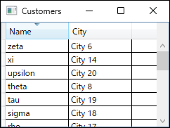

## 概要

一覧の行をダブルクリックして詳細を開く操作は、業務アプリの `DataGrid` でまず求められる。
MVVM で書く場合によく紹介されるのは、`Microsoft.Xaml.Behaviors.Wpf` の `EventTrigger` で `DataGrid` 自身の `MouseDoubleClick` を拾い、`CommandParameter` に `SelectedItem` を渡す書き方である。
この書き方は行のダブルクリックでは期待どおりに動く。
しかし、列ヘッダー・スクロールバーのつまみやトラック・最後の行より下の空白をダブルクリックしても実行され、直前に選んでいた行が開く。
列ヘッダーの場合は並び替えも同時に起きるため、開いた行が画面の外へ移っていることさえある。

本記事では、ダブルクリックを拾う 4 つの書き方を、実際のマウスで同じ場所をダブルクリックして比べる。
`DataGrid` 全体で拾う 2 つの書き方がどこで誤って動くのか、行だけを拾う 2 つの書き方のうち、編集できるセルのダブルクリックでも動くのはどちらかを示し、4 つの書き方の選び方をまとめる。

---

## 前提・対象環境

- フレームワーク: .NET の WPF。コード例は C# 9 以降の構文（`is not null and not DataGridRow` などのパターン）と、null 許容参照型を有効にしたプロジェクトを前提にする。`EventTrigger` と `InvokeCommandAction` は NuGet パッケージ `Microsoft.Xaml.Behaviors.Wpf` のもので、`EventArgsConverter` プロパティを使う。動作は下記の検証環境でだけ測り、.NET Framework 4.8 と、ほかの版のパッケージでは測っていない
- アーキテクチャ: MVVM。ビューモデルの基底クラス `ObservableObject` と `RelayCommand<T>` は自前の最小実装である。`RelayCommand<T>` の `CanExecute` は、引数が `T` でないとき（`null` を含む）に `false` を返す。`CanExecute` の更新については [WPF で RelayCommand の CanExecute がボタンの有効・無効に反映されない問題の記事](/ja/articles/wpf-relaycommand-canexecute-not-updating/)にまとめている
- 検証環境: .NET 10 / Windows 11 / `Microsoft.Xaml.Behaviors.Wpf` 1.1.135。クリックとダブルクリックは OS の実際のマウス入力で行い、ダブルクリックは、1 回目と 2 回目のクリックの間を 100 ms 空けて送った（ダブルクリックの時間の既定値 500 ms より短い）。毎回、`DataGrid` に 2 つのマウスダウンが `ClickCount` 1、2 として届いたことを確かめている。間を空けずに 4 つの入力を一度に送った試行では、編集できるセルを選択中の行でダブルクリックしたときの結果が変わったため、人の操作に近い、間を空けた送り方にそろえた。計測では XAML を `XamlReader` で読み込んだため、`xmlns:b` だけは同じアセンブリを `clr-namespace` 形式で指定した
- 題材: `Name` と `City` の 2 列を持つ顧客の `DataGrid`（幅 240、高さ 150、20 行）。最後の行より下の空白（以下、空白）を測るときだけ 3 行にする。2 行目の `beta` をクリックで選び、ダブルクリックの時間より長く待ってから、各場所をダブルクリックする
- 扱う範囲: マウスのダブルクリックで詳細を開く操作。キーボード（Enter キーなど）で開く操作、複数行を選んだ状態で開く操作、スクロールバーの矢印のボタン、行ヘッダー（`DataGridRowHeader`）、`RowDetails`、`DataGrid` を入れ子にした場合は測っていない

ビューモデルは、顧客の一覧と、顧客を受け取って詳細を開く `OpenCommand` を持つ。
詳細を開く処理そのもの（ダイアログやページの切り替え）は本記事の主題ではないため、`Open` の本体は空にしている。

```csharp
public sealed class CustomersViewModel : ObservableObject
{
    public CustomersViewModel(IEnumerable<Customer> customers)
    {
        Customers = new ObservableCollection<Customer>(customers);
        OpenCommand = new RelayCommand<Customer>(Open);
    }

    public ObservableCollection<Customer> Customers { get; }

    public ICommand OpenCommand { get; }

    private void Open(Customer customer)
    {
        // 詳細を開く（ダイアログを出す、詳細のページへ切り替えるなど）。
    }
}
```

`OpenCommand` は `RelayCommand<Customer>` なので、`Customer` 以外（`null` を含む）を渡されたときは `CanExecute` が `false` になる。
`InvokeCommandAction` は `CanExecute` が `true` のときだけ `Execute` を呼ぶ（[InvokeCommandAction.cs の `Invoke`](https://github.com/microsoft/XamlBehaviorsWpf/blob/v1.1.135/src/Microsoft.Xaml.Behaviors/InvokeCommandAction.cs#L110-L147)）。
この性質が、後で比べる書き方の結果を左右する。

---

## 問題

よく紹介される書き方では、`DataGrid` の中に `EventTrigger` を置き、`MouseDoubleClick` で `OpenCommand` を呼ぶ。
渡す顧客は、ダブルクリックの 1 回目のクリックで選ばれているはずの `SelectedItem` である。

```xml
<DataGrid x:Name="grid" Width="240" Height="150" ItemsSource="{Binding Customers}"
          AutoGenerateColumns="False" IsReadOnly="True">
  <b:Interaction.Triggers>
    <b:EventTrigger EventName="MouseDoubleClick">
      <b:InvokeCommandAction Command="{Binding OpenCommand}"
                             CommandParameter="{Binding SelectedItem, ElementName=grid}" />
    </b:EventTrigger>
  </b:Interaction.Triggers>
  <DataGrid.Columns>
    <DataGridTextColumn Header="Name" Binding="{Binding Name}" Width="90" />
    <DataGridTextColumn Header="City" Binding="{Binding City}" Width="90" />
  </DataGrid.Columns>
</DataGrid>
```

`xmlns:b` には `http://schemas.microsoft.com/xaml/behaviors` を指定する。
3 行目の `gamma` をダブルクリックすると、`gamma` が渡されて期待どおりに動く。
ところが、`beta` を選んだまま `Name` の列ヘッダーをダブルクリックすると、`OpenCommand` に `beta` が渡される。

<figure class="article-figure">
  
  <figcaption>上の XAML で beta を選んでから Name の列ヘッダーをダブルクリックした直後の画面。OpenCommand には beta が渡されたが、Name の列は降順に並び替わり、beta は表示範囲の外にある（.NET 10 / Windows 11、実際のマウスで操作）。</figcaption>
</figure>

利用者は並び替えのつもりで列ヘッダーを続けて押しただけなのに、画面に見えていない行の詳細が開く。
スクロールバーのつまみやトラックを素早く 2 回押した場合も、行の少ない一覧で空白をダブルクリックした場合も同じで、そのとき選ばれている行が開く。

---

## 原因・背景

`MouseDoubleClick` は `Control` が定義する直接ルーティングイベントで、要素ツリーに沿って `Control` ごとに、その `Control` 自身について発生する（[Control.MouseDoubleClick](https://learn.microsoft.com/ja-jp/dotnet/api/system.windows.controls.control.mousedoubleclick)）。
`DataGrid` も `Control` なので、行だけでなく、列ヘッダー・スクロールバーのつまみやトラック・空白のダブルクリックでも、`DataGrid` 自身の `MouseDoubleClick` が発生する。
そのうえ、列ヘッダーやスクロールバーのつまみ・トラックのクリックでは選択が変わらず、`SelectedItem` には直前に選んでいた行が残っている。
「ダブルクリックされた行」と「選ばれている行」が一致するのは、行をダブルクリックしたときだけである。

`DataGrid` に届くイベントを、2 回目のクリックについて読んだ結果が次の表である。



2 行目の `beta` をクリックで選んだ後に各場所をダブルクリックし、`DataGrid` に `handledEventsToo` で足したハンドラーで読んだ値（.NET 10 / Windows 11、実際のマウスで操作）。「その時点の」は、`DataGrid` の `MouseDoubleClick` のハンドラーが動いた時点を指す。
{: .table-caption}

列ヘッダー・スクロールバーのつまみとトラック・Ctrl を押しながらのセル・編集できるセル（`DataGrid` も列も `IsReadOnly=False` のセル）では、2 回目の `MouseLeftButtonDown` が `DataGrid` のハンドラーに届いた時点で、すでに処理済み（`Handled` が `True`）になっている。
`MouseDoubleClick` は、それでもすべての場所で発生している。
`Control` は、ダブルクリックを判定するクラスハンドラーを、処理済みのイベントも受け取る形（`handledEventsToo` が `true`）で登録しているためである（[Control.cs の静的コンストラクター](https://github.com/dotnet/wpf/blob/v10.0.13/src/Microsoft.DotNet.Wpf/src/PresentationFramework/System/Windows/Controls/Control.cs#L28-L31)）。

編集できるセルでは、ダブルクリックの途中でセルの編集が始まる。
`DataGridCell` は、フォーカスがあって選択済みのセルが Ctrl なしでクリックされると編集を始めるためである（[DataGridCell.cs の `OnAnyMouseLeftButtonDown`](https://github.com/dotnet/wpf/blob/v10.0.13/src/Microsoft.DotNet.Wpf/src/PresentationFramework/System/Windows/Controls/DataGridCell.cs#L888-L904)）。
未選択の `gamma` をダブルクリックすると、1 回目のクリックで選ばれ、2 回目のクリックで編集が始まる。
`MouseDoubleClick` のハンドラーが動いた時点で、セルの `IsEditing` はすでに `True` になっている。
このとき `OriginalSource` の `TextBlock` は、visual の親が `null` になっている。
セルが編集状態に入って、表示用の `TextBlock` が visual ツリーから外れた後に、`DataGrid` の `MouseDoubleClick` が届いている。
選択中の `beta` をダブルクリックすると、1 回目のクリックで編集が始まり、2 回目のクリックは編集用の `TextBox` に当たる。
このときの `OriginalSource` は `TextBox` の中の `TextBoxView` で、visual ツリーに残っている。
編集が始まるかは列（セル）ごとに決まる。
`Name` 列だけを `IsReadOnly="True"` にした `DataGrid` では、`Name` のセルは編集状態にならず、`Handled` は `False`、`TextBlock` の親も `ContentPresenter` のままだった。
同じ `DataGrid` の編集できる `City` 列のセルでは、`DataGrid` も列も `IsReadOnly=False` のときと同じ値になった。
この 2 つ（処理済みかどうかと、`OriginalSource` がツリーに残っているかどうか）が、次の節で比べる書き方の結果を分ける。

---

## ダブルクリックを拾う 4 つの書き方

4 つの書き方で、同じ 14 通りのダブルクリックをした結果が次の表である。
4 つの書き方の列のセルは `OpenCommand` に渡された顧客で、「実行されない」は `OpenCommand` が 1 回も実行されなかったことを示す。



書き方ごとに `DataGrid` を作り直し、2 行目の `beta` をクリックで選んでから（「事前に何も選ばない」の行を除く）、ダブルクリックの時間より長く待って各場所を実際のマウスでダブルクリックした（.NET 10 / Windows 11、`Microsoft.Xaml.Behaviors.Wpf` 1.1.135）。空白の 2 行だけは 3 行の `DataGrid` で、そのほかは 20 行の `DataGrid` で測った。「ダブルクリック後の SelectedItem」と「そのほかの変化」は 4 つの書き方で同じ値だった。
{: .table-caption}

### DataGrid の EventTrigger ＋ SelectedItem

「問題」の節の書き方である。
行の外の 4 か所（列ヘッダー・スクロールバーのつまみ・トラック・空白）では、直前に選んでいた `beta` が渡された。
何も選んでいない一覧で空白をダブルクリックしたときは、`SelectedItem` が `null` なので `CanExecute` が `false` を返し、実行されなかった。
しかし、行を一度でも選んだ後は、この書き方では行の外のダブルクリックを区別できない。

行の中でも、ダブルクリックした行と渡す行が食い違う場合がある。
Ctrl を押しながら未選択の `gamma` をダブルクリックすると、ダブルクリックの後の `SelectedItem` は `beta` のままで、`OpenCommand` にも `beta` が渡された。
さらに、`Control` はダブルクリックの判定を右ボタンの押下にも登録しているため（[Control.cs の静的コンストラクター](https://github.com/dotnet/wpf/blob/v10.0.13/src/Microsoft.DotNet.Wpf/src/PresentationFramework/System/Windows/Controls/Control.cs#L28-L31)）、`MouseDoubleClick` は右ボタンのダブルクリックでも発生する。
右ボタンで `gamma` をダブルクリックしても実行された。

### DataGrid の MouseBinding ＋ SelectedItem

パッケージを足さずに書ける形として、`DataGrid` の `InputBindings` に `MouseBinding` を置く書き方もよく紹介される。

```xml
<DataGrid.InputBindings>
  <MouseBinding Gesture="LeftDoubleClick" Command="{Binding OpenCommand}"
                CommandParameter="{Binding SelectedItem, ElementName=grid}" />
</DataGrid.InputBindings>
```

この書き方は、列ヘッダー・スクロールバーのつまみとトラック・Ctrl を押しながらのダブルクリック・編集できるセルでは実行されなかった。
いずれも、「原因・背景」の表で 2 回目の `MouseLeftButtonDown` が処理済みになっていた場所である。
`InputBindings` の照合はマウスダウンが処理済みでないときにだけ行われるため（[UIElement の `OnMouseDownThunk`](https://github.com/dotnet/wpf/blob/v10.0.13/src/Microsoft.DotNet.Wpf/src/PresentationCore/System/Windows/Generated/UIElement.cs#L837-L842)）、処理済みの場所では `MouseBinding` が動かない。
Ctrl を押したダブルクリックは、照合されたとしても一致しない。
`MouseGesture` の照合は修飾キーの一致まで求めるため（[MouseGesture.cs の `Matches`](https://github.com/dotnet/wpf/blob/v10.0.13/src/Microsoft.DotNet.Wpf/src/PresentationCore/System/Windows/Input/Command/MouseGesture.cs#L132)）、修飾キーを書いていない `LeftDoubleClick` は、Ctrl を押した入力と一致しないためである。
`Gesture` を `LeftDoubleClick` にしたこの書き方は、右ボタンのダブルクリックでは実行されなかった。

一方で、空白では実行されて `beta` が渡された。
行の外で誤って動く場所は減るが、なくならない。
そのうえ、編集できるセルと、Ctrl を押しながらのダブルクリックでは、行のダブルクリックそのものを拾えない。

`MouseBinding` を `DataGrid` ではなく行（`DataGridRow`）に付けようとしても、`InputBindings` は `RowStyle` の `Setter` では設定できない。



`<Style TargetType="DataGridRow">` の `Setter` に `Property="InputBindings"` を書いた XAML を `XamlReader` で読み込んだ結果（.NET 10 / Windows 11）。
{: .table-caption}

`InputBindings` は依存関係プロパティではない読み取り専用の CLR プロパティなので（[UIElement.InputBindings](https://learn.microsoft.com/ja-jp/dotnet/api/system.windows.uielement.inputbindings)）、`Setter` の対象にできず、読み込みの時点で例外になる。

### EventTrigger ＋ EventArgsConverter（行のアイテム）

`InvokeCommandAction` の `EventArgsConverter` には、イベントの引数をコマンドの引数に変換するコンバーターを指定できる。
ダブルクリックされた要素（`OriginalSource`）から visual ツリーをさかのぼって `DataGridRow` を探し、見つかればその行のアイテムを、見つからなければ `null` を返す。
左ボタン以外のダブルクリックは、ここで `null` にして除く。

```csharp
public sealed class RowItemFromEventArgsConverter : IValueConverter
{
    public object? Convert(object value, Type targetType, object parameter, CultureInfo culture)
    {
        // MouseDoubleClick は右ボタンのダブルクリックでも発生するため、左ボタン以外は null（実行しない）にする。
        if (value is not MouseButtonEventArgs { ChangedButton: MouseButton.Left } args)
        {
            return null;
        }

        var current = args.OriginalSource as DependencyObject;
        while (current is not null and not DataGridRow)
        {
            current = current is Visual or System.Windows.Media.Media3D.Visual3D
                ? VisualTreeHelper.GetParent(current)
                : LogicalTreeHelper.GetParent(current);
        }

        return (current as DataGridRow)?.Item;
    }

    public object ConvertBack(object value, Type targetType, object parameter, CultureInfo culture) =>
        throw new NotSupportedException();
}
```

ダブルクリックされた要素が visual でない場合（`Run` など）は、論理ツリーの親をたどる。
XAML では、`CommandParameter` を書かずに `EventArgsConverter` だけを指定する。
`InvokeCommandAction` は、`CommandParameter` が `null` のときにだけ `EventArgsConverter` を呼ぶためである（[InvokeCommandAction.cs の `Invoke`](https://github.com/microsoft/XamlBehaviorsWpf/blob/v1.1.135/src/Microsoft.Xaml.Behaviors/InvokeCommandAction.cs#L110-L147)）。

```xml
<DataGrid.Resources>
  <local:RowItemFromEventArgsConverter x:Key="RowItemFromEventArgs" />
</DataGrid.Resources>
<b:Interaction.Triggers>
  <b:EventTrigger EventName="MouseDoubleClick">
    <b:InvokeCommandAction Command="{Binding OpenCommand}"
                           EventArgsConverter="{StaticResource RowItemFromEventArgs}" />
  </b:EventTrigger>
</b:Interaction.Triggers>
```

行の外の 4 か所と右ボタンのダブルクリックでは、コンバーターが `null` を返し、`CanExecute` が `false` になるので実行されない。
行のダブルクリックでは、Ctrl を押しながら未選択の `gamma` をダブルクリックした場合も、`gamma` が渡された。
ところが、編集できるセルを未選択の行でダブルクリックしたときは実行されなかった。
「原因・背景」の表のとおり、`DataGrid` の `MouseDoubleClick` が届いた時点で `OriginalSource` の `TextBlock` が visual ツリーから外れており、`DataGridRow` までさかのぼれないためである。
選択中の行では、2 回目のクリックが編集用の `TextBox` に当たり、`OriginalSource` が visual ツリーに残るので、`beta` が渡された。
このため、ダブルクリックする行が選択済みかどうかで結果が変わる。
この書き方を安定して使えるのは、ダブルクリックするセルが編集できない場合（`DataGrid` かその列が `IsReadOnly="True"` の場合）に限られる。
`Name` 列だけを `IsReadOnly="True"` にした `DataGrid` でも、`Name` のセルでは `gamma` が渡され、編集できる `City` のセルでは実行されなかった。

### RowStyle ＋ 添付プロパティ（行のアイテム）

行のダブルクリックだけを拾うなら、`DataGrid` ではなく `DataGridRow` の `MouseDoubleClick` を購読すればよい。
`DataGridRow` も `Control` なので、行の中のダブルクリックについて、その行自身の `MouseDoubleClick` が発生する。
ビューのコードビハインドにハンドラーを書かないよう、購読は添付プロパティに閉じ込める。

```csharp
public static class RowDoubleClick
{
    public static readonly DependencyProperty CommandProperty =
        DependencyProperty.RegisterAttached("Command", typeof(ICommand), typeof(RowDoubleClick),
            new PropertyMetadata(null, OnCommandChanged));

    public static ICommand? GetCommand(DependencyObject d) => (ICommand?)d.GetValue(CommandProperty);

    public static void SetCommand(DependencyObject d, ICommand? value) => d.SetValue(CommandProperty, value);

    private static void OnCommandChanged(DependencyObject d, DependencyPropertyChangedEventArgs e)
    {
        if (d is not DataGridRow row)
        {
            return;
        }

        row.MouseDoubleClick -= OnMouseDoubleClick;
        if (e.NewValue is not null)
        {
            row.MouseDoubleClick += OnMouseDoubleClick;
        }
    }

    private static void OnMouseDoubleClick(object sender, MouseButtonEventArgs e)
    {
        // MouseDoubleClick は右ボタンのダブルクリックでも発生するため、左ボタンだけを拾う。
        if (e.ChangedButton != MouseButton.Left)
        {
            return;
        }

        var row = (DataGridRow)sender;
        ICommand? command = GetCommand(row);
        object item = row.Item;
        if (command?.CanExecute(item) == true)
        {
            command.Execute(item);
        }
    }
}
```

渡す値は `SelectedItem` ではなく、イベントを起こした行のアイテム（`DataGridRow.Item`）である。
ハンドラーの `sender` は行そのものなので、`OriginalSource` が visual ツリーから外れていても影響を受けない。
`RowStyle` の `Setter` で、すべての行にこの添付プロパティを付ける。

```xml
<DataGrid.RowStyle>
  <Style TargetType="DataGridRow">
    <Setter Property="local:RowDoubleClick.Command"
            Value="{Binding DataContext.OpenCommand, RelativeSource={RelativeSource AncestorType=DataGrid}}" />
  </Style>
</DataGrid.RowStyle>
```

行の `DataContext` は顧客そのものなので、`OpenCommand` は `DataGrid` の `DataContext`（ビューモデル）から取る。
`InputBindings` と違って添付プロパティは依存関係プロパティなので、`Setter` で設定できる。
表のとおり、行の外の 4 か所と右ボタンのダブルクリックでは実行されなかった。
行のダブルクリックでは、読み取り専用の `DataGrid` で測った 4 通り（Ctrl なしで未選択の行・選択中の行、Ctrl ありで選択中の行・未選択の行）でも、編集できるセルの未選択の行と選択中の行（Ctrl なし）でも、ダブルクリックした行が渡された。
編集できるセルを Ctrl を押しながらダブルクリックした場合は測っていない。

添付プロパティのクラスは画面の処理ではなく、どの画面でも使い回す部品のコードである。
画面のコードビハインドは `InitializeComponent` だけのまま保てる。

---

## 判断の軸

4 つの書き方は、次の 5 点で差が出る。

- **行の外で実行されないか**: 列ヘッダー・スクロールバーのつまみやトラック・空白のダブルクリックで詳細が開くと、利用者が見ていない行が開く。
- **編集できるセルのダブルクリックで動くか**: `DataGrid` も列も `IsReadOnly=False` のセルでは、ダブルクリックの途中で編集が始まる。そのとき行のダブルクリックを拾えるかが分かれる。
- **Ctrl を押したダブルクリックで、ダブルクリックした行を渡すか**: Ctrl を押したクリックは選択を切り替えるため、`SelectedItem` がダブルクリックした行と食い違うことがある。書き方によっては実行そのものがされない。
- **右ボタンのダブルクリックを除けるか**: `MouseDoubleClick` は右ボタンでも発生するため、何もしなければ右ボタンのダブルクリックでも詳細が開く。
- **足すもの**: パッケージ（`Microsoft.Xaml.Behaviors.Wpf`）が要るか、自前のクラス（コンバーターや添付プロパティ）が要るか。

---

## 軸ごとの結論

実測の表を、判断の軸ごとにまとめると次のとおりである。

| 書き方 | 行の外で実行されない | 編集できるセルで動く | Ctrl を押したダブルクリック | 右ボタンを除ける | 足すもの |
|---|---|---|---|---|---|
| DataGrid の EventTrigger ＋ SelectedItem | ×（4 か所すべてで実行） | ○ | ×（未選択の行では別の行を渡す） | ×（実行される） | パッケージ |
| DataGrid の MouseBinding ＋ SelectedItem | △（空白で実行） | ×（実行されない） | ×（実行されない） | ○（`LeftDoubleClick`） | なし |
| EventTrigger ＋ EventArgsConverter | ○（`null` を拒むコマンドのとき） | △（選択中の行だけ） | ○ | ○（コンバーターで判定。`null` を拒むコマンドのとき） | パッケージ＋コンバーター |
| RowStyle ＋ 添付プロパティ | ○ | ○ | ○（IsReadOnly=True の DataGrid でだけ測定） | ○（ハンドラーで判定） | 添付プロパティ |

行の外で実行されず、編集できるセルでも選択の有無によらず動くのは、`RowStyle` ＋添付プロパティの書き方だけだった。
パッケージを使わずに済むため、新しく書くならこの書き方が適する。
すでに `Microsoft.Xaml.Behaviors.Wpf` を使っていて、ダブルクリックするセルが編集できない（`DataGrid` かその列が `IsReadOnly="True"` の）まま変わらないなら、`EventArgsConverter` の書き方でもよい。
`SelectedItem` を渡す 2 つの書き方は、行の外のダブルクリックを行のダブルクリックと区別できないため、詳細を開く操作には向かない。

---

## 注意点

- **編集できるセルでは、ダブルクリックでセルの編集も始まる。** 表の「そのほかの変化」のとおり、編集できるセルをダブルクリックすると、`RowStyle` ＋添付プロパティの書き方で詳細が開くのと同時に、セルが編集状態になった（未選択の行・選択中の行とも）。一覧で直接編集させないなら、`DataGrid` を `IsReadOnly="True"` にする。編集が始まるかは列ごとに決まるため、列だけを読み取り専用にする場合は、ダブルクリックされうるすべての列を `IsReadOnly="True"` にする（表のとおり、`Name` 列だけを読み取り専用にした `DataGrid` でも、`City` のセルでは編集が始まった）。直接の編集と詳細を開く操作を両立させるなら、詳細を開くのを行の先頭のボタンにするなど、ダブルクリックとは別の操作に分ける。
- **列ヘッダーのダブルクリックでは、並び替えも起きる。** 表のとおり、並び替えていない `Name` の列は、ダブルクリックの後に降順になった。行だけを拾う書き方にしても、この並び替えは変わらない。並び替えの状態を戻す方法は [WPFのDataGridのソートを初期化する方法](/ja/articles/wpf-datagrid-sort-reset/)にある。
- **`EventArgsConverter` の書き方が行の外と右ボタンで実行されないのは、`CanExecute` が `null` を拒むためである。** コンバーターは行の外と右ボタンのダブルクリックで `null` を返し、`InvokeCommandAction` はその `null` で `CanExecute` を呼ぶ。本記事の `RelayCommand<T>` は `null` を拒むが、`null` を受け付けるコマンドを使う場合は、行の外や右ボタンでも `Execute` が `null` で呼ばれる。コマンドの側でも `null` を確かめる。`RowStyle` ＋添付プロパティの書き方は、行の外ではイベントが届かず、右ボタンはハンドラーで除くため、この注意は当てはまらない。
- **キーボードでは開けない。** マウスのダブルクリックだけを拾う書き方なので、Enter キーなどで詳細を開くには、別に `KeyBinding` などの割り当てが要る。本記事ではキーボードの操作を測っていない。
- **行の中の部品は測っていない。** 行ヘッダーと `RowDetails` も `DataGridRow` の中にあるが、そこでのダブルクリックは測っていない。`RowDetails` に別の `DataGrid` を入れ子にする場合も、どちらの行のコマンドが実行されるかを確かめる必要がある。

---

## まとめ

`DataGrid` 自身の `MouseDoubleClick` は、列ヘッダー・スクロールバーのつまみやトラック・空白のダブルクリックでも発生し、そのとき `SelectedItem` には直前に選んでいた行が残っている。
このため、よく紹介される「`DataGrid` の `EventTrigger` で `SelectedItem` を渡す」書き方は、利用者がダブルクリックしていない行を開く。
`MouseBinding` に替えても空白では同じことが起き、編集できるセルと Ctrl を押しながらのダブルクリックでは、行のダブルクリックそのものを拾えなかった。

行のダブルクリックだけを拾うには、`RowStyle` の `Setter` で `DataGridRow` に添付プロパティを付け、行の `MouseDoubleClick` で、左ボタンのときだけ行のアイテムを渡す。
編集できるセルでは、詳細が開くのと同時にセルの編集も始まるため、一覧で直接編集させないなら `DataGrid` を読み取り専用にする。
セルが編集できない一覧で、すでに `Microsoft.Xaml.Behaviors.Wpf` を使っているなら、`EventArgsConverter` で行のアイテムに変換する書き方も選べる。
開いた詳細で編集を取り消せるようにする方法は [WPF マスター詳細で SelectedItem に直接バインドすると編集を取り消せない問題の記事](/ja/articles/wpf-master-detail-edit-cancel-selecteditem/)に、詳細をダイアログで開く方法は [WPF MVVM でダイアログを出す IDialogService の記事](/ja/articles/wpf-mvvm-dialog-service/)にまとめている。
