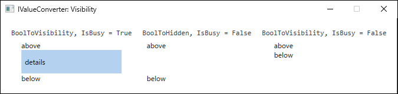

## 概要

ビューモデルの `bool` による要素の表示の切り替えと、列挙値の画面向けの表示名は、どちらも WPF では `IValueConverter` で書く。
組み込みの `BooleanToVisibilityConverter` は `true` を `Visible`、`false` を `Collapsed` にする既定の変換しか持たず、反転も `Hidden` も指定できない。
そのため自作することになるが、よく見かける「`ConverterParameter=True` で反転する」書き方は、`parameter` を `bool` と比べる実装では反転しない。
XAML の属性に書いた `ConverterParameter` は文字列で届くからである。

本記事では、反転と `Hidden` をコンバーターのプロパティで指定する `BoolToVisibilityConverter` と、`Description` 属性から表示名を引く `EnumDescriptionConverter` を書く。
あわせて、`ConverterParameter` が届く型、`Hidden` と `Collapsed` の配置の違い、null を確かめない実装が属性の無い値や定義の無い値で投げる例外、ビューモデルに表示用のプロパティを持たせる方法との違いを実測で示す。

---

## 前提・対象環境

- フレームワーク: .NET 5 以降の WPF（`Enum.GetValues<T>()` が .NET 5 以降の API であるため）。コード例は C# 8 以降と、null 許容参照型を有効にしたプロジェクト（`<Nullable>enable</Nullable>`）を前提にする
- アーキテクチャ: MVVM。ビューモデルの基底クラス `ObservableObject` は下記の自前の最小実装で、外部のライブラリは使わない
- 検証環境: .NET 10 / Windows 11。.NET Framework 4.8 では測っていない
- 扱う範囲: `IValueConverter`（値 1 つの変換）。複数の値を組み合わせる `IMultiValueConverter`、`ConvertBack` の戻り値（`Binding.DoNothing` と `DependencyProperty.UnsetValue`）の違い、数値や日付の書式とカルチャは扱わない。戻り値は [RadioButton を enum にバインドする記事](/ja/articles/wpf-radiobutton-enum-binding/)で、カルチャは [StringFormat の記事](/ja/articles/wpf-binding-stringformat-number-currency-date/)で測っている

本記事の C# のコードは、次の名前空間を `using` で参照する。
.NET 6 以降の暗黙の `using`（`<ImplicitUsings>enable</ImplicitUsings>`）を使うプロジェクトでは、先頭の 2 行は不要である。

```csharp
using System;
using System.Collections.Generic;
using System.ComponentModel;
using System.Globalization;
using System.Reflection;
using System.Runtime.CompilerServices;
using System.Windows;
using System.Windows.Data;
```

ビューモデルの基底クラスは、値が変わったときに `true` を返す `SetProperty` と、`[CallerMemberName]` で呼び出し元のプロパティ名を補う `OnPropertyChanged` だけを持つ。

```csharp
public abstract class ObservableObject : INotifyPropertyChanged
{
    public event PropertyChangedEventHandler? PropertyChanged;

    protected bool SetProperty<T>(ref T field, T value, [CallerMemberName] string? name = null)
    {
        if (EqualityComparer<T>.Default.Equals(field, value))
        {
            return false;
        }

        field = value;
        OnPropertyChanged(name);
        return true;
    }

    protected void OnPropertyChanged([CallerMemberName] string? name = null) =>
        PropertyChanged?.Invoke(this, new PropertyChangedEventArgs(name));
}
```

`SetProperty` が `true` を返したときだけ別のプロパティの変更も通知する、という書き方を後で使う。

題材は注文の画面で、処理中かどうかの `IsBusy` と、注文の状態 `Status` を持つビューモデルを使う。
状態の列挙型には、画面に出す言葉を `Description` 属性で付けておく。
`Shipped` には属性を付けていない。

```csharp
public enum OrderStatus
{
    [Description("Awaiting payment")]
    AwaitingPayment,

    [Description("In progress")]
    InProgress,

    Shipped,
}

public sealed class OrderViewModel : ObservableObject
{
    private bool _isBusy;
    private OrderStatus _status;

    public bool IsBusy
    {
        get => _isBusy;
        set => SetProperty(ref _isBusy, value);
    }

    public OrderStatus Status
    {
        get => _status;
        set
        {
            if (SetProperty(ref _status, value))
            {
                OnPropertyChanged(nameof(StatusText));
            }
        }
    }

    public IReadOnlyList<OrderStatus> Statuses { get; } = Enum.GetValues<OrderStatus>();

    public string StatusText => EnumDescriptionConverter.Describe(Status);
}
```

`Statuses` は `ComboBox` の選択肢に、`StatusText` は後半でコンバーターと比べるビューモデル側の表示名に使う。
`Status` のセッターが `StatusText` の変更も通知している理由は、後半の比較で示す。

---

## 基本の使い方

`IValueConverter` は、ソースからターゲットへの変換 `Convert` と、ターゲットからソースへの変換 `ConvertBack` の 2 つのメソッドを持つ。
`bool` を `Visibility` に変えるコンバーターは次のとおりである。
`true` と `false` のそれぞれに対応する `Visibility` をプロパティで持たせ、反転や `Hidden` は XAML で値を変えて表す。

```csharp
public sealed class BoolToVisibilityConverter : IValueConverter
{
    public Visibility TrueValue { get; set; } = Visibility.Visible;

    public Visibility FalseValue { get; set; } = Visibility.Collapsed;

    public object Convert(object? value, Type targetType, object? parameter, CultureInfo culture) =>
        value is true ? TrueValue : FalseValue;

    public object ConvertBack(object? value, Type targetType, object? parameter, CultureInfo culture) =>
        Binding.DoNothing;
}
```

`value is true` は、値が `bool` の `true` のときだけ成り立つ。
ソースが `null` のときや、文字列の `"True"` のときは `FalseValue` になる（次の節の表の右 2 列）。
`Visibility` から `bool` へ戻す用途は無いので、`ConvertBack` は値を返す代わりに `Binding.DoNothing` を返す。

コンバーターはリソースにインスタンスを置き、バインドの `Converter` に `StaticResource` で渡す。
同じクラスでも、プロパティの値を変えたインスタンスを別のキーで置けば、反転用と `Hidden` 用になる。

```xml
<Window.Resources>
  <BooleanToVisibilityConverter x:Key="BooleanToVisibility" />
  <local:BoolToVisibilityConverter x:Key="BoolToVisibility" />
  <local:BoolToVisibilityConverter x:Key="InverseBoolToVisibility" TrueValue="Collapsed" FalseValue="Visible" />
  <local:BoolToVisibilityConverter x:Key="BoolToHidden" FalseValue="Hidden" />
</Window.Resources>

<Border Visibility="{Binding IsBusy, Converter={StaticResource BoolToVisibility}}" />
<Border Visibility="{Binding IsBusy, Converter={StaticResource InverseBoolToVisibility}}" />
```

`TrueValue="Collapsed"` のような属性の値は、XAML が `Visibility` 型のプロパティに合わせて列挙値に変換する。
1 つ目の `BooleanToVisibilityConverter` は WPF に組み込みのコンバーターで、比較のために並べている。
`local` は、コンバーターを置いた名前空間を指す `xmlns:local` である。

---

## bool から Visibility への変換

上のリソースのそれぞれで `Border` の `Visibility` をバインドし、`Visibility` を読んだ。
`IsBusy` の 2 列は `IsBusy` を `true` で表示した後と `false` に変えた後で、右の 2 列は `object` 型のソースのプロパティに `null` と文字列の `"True"` を入れた場合である。
表の下 3 行は、次の節で扱う `ConverterParameter` で反転を指定する実装である。



.NET 10 / Windows 11 で、`Window` に表示した `Border` の `Visibility` を読んだ値。
{: .table-caption}

組み込みの `BooleanToVisibilityConverter` と、既定値のままの `BoolToVisibility` は同じ結果になる。
`TrueValue` と `FalseValue` を入れ替えた `InverseBoolToVisibility` は反転し、`FalseValue="Hidden"` の `BoolToHidden` は `false` で `Hidden` になる。
組み込みのコンバーターには、これを指定するプロパティが無い。
2 つの型の、公開されていて値を設定できるプロパティを列挙した。



.NET 10 / Windows 11 で、`Type.GetProperties(BindingFlags.Public | BindingFlags.Instance)` のうち公開のセッターを持つものを列挙した結果。
{: .table-caption}

`Hidden` と `Collapsed` は、どちらも要素を描かないが、レイアウトでの扱いが違う。
縦の `StackPanel` に、上の文字・高さ 40 の `Border`・下の文字を並べ、`Border` を隠したときの下の文字の位置を比べた。

```xml
<StackPanel>
  <TextBlock Text="above" />
  <Border Height="40" Background="#FFB4D2F0"
          Visibility="{Binding IsBusy, Converter={StaticResource BoolToHidden}}">
    <TextBlock Text="details" VerticalAlignment="Center" Margin="6,0" />
  </Border>
  <TextBlock Text="below" />
</StackPanel>
```

図の 3 つのパネルは、この `Visibility` のバインドを図の見出しのコンバーターに替え、`IsBusy` を見出しの値にしたものである。

<figure class="article-figure">
  
  <figcaption>.NET 10 / Windows 11 で表示したウィンドウ。中央の <code>Hidden</code> は Border の場所を空けたまま残し、右の <code>Collapsed</code> は場所ごと詰める。</figcaption>
</figure>



上の図と同じ `StackPanel` で、`Border` の次にある `TextBlock` の上端を、`StackPanel` の左上からの位置で読んだ値（.NET 10 / Windows 11。`TextBlock` は既定のフォントとサイズ）。
{: .table-caption}

`Hidden` の位置は `Visible` と同じで、`Collapsed` では `Border` の高さの 40 だけ上へ詰まる。
隠しても後ろの要素の位置を動かしたくない場合（下に並べた入力欄が上へずれる、など）は `Hidden` を、空いた場所を詰めたい場合は `Collapsed` を選ぶ。

---

## ConverterParameter で反転を指定する場合

反転をコンバーターのプロパティではなく `ConverterParameter` で指定する書き方も広く見かける。
次の実装は、`parameter` が `bool` の `true` のときに反転する。

```csharp
public sealed class ParameterBoolToVisibilityConverter : IValueConverter
{
    public object Convert(object? value, Type targetType, object? parameter, CultureInfo culture)
    {
        bool visible = value is true;
        if (parameter is true)
        {
            visible = !visible;
        }

        return visible ? Visibility.Visible : Visibility.Collapsed;
    }

    public object ConvertBack(object? value, Type targetType, object? parameter, CultureInfo culture) =>
        Binding.DoNothing;
}
```

これをリソースに置き、`ConverterParameter=True` で使う。
`True` という `bool` のリソースを置いて渡す書き方も並べる。

```xml
<Window xmlns:sys="clr-namespace:System;assembly=System.Runtime" ...>
  <Window.Resources>
    <local:ParameterBoolToVisibilityConverter x:Key="ParameterBoolToVisibility" />
    <sys:Boolean x:Key="True">True</sys:Boolean>
  </Window.Resources>

  <Border Visibility="{Binding IsBusy, Converter={StaticResource ParameterBoolToVisibility}, ConverterParameter=True}" />
  <Border Visibility="{Binding IsBusy, Converter={StaticResource ParameterBoolToVisibility}, ConverterParameter={StaticResource True}}" />
</Window>
```

`sys` の `assembly=System.Runtime` は .NET で測った書き方である。
.NET Framework では、[公式ドキュメントの例](https://learn.microsoft.com/dotnet/desktop/xaml-services/types-for-primitives)どおり `assembly=mscorlib` を使う（本記事では測っていない）。

前節の最初の表（`Border` の `Visibility`）で、`ParameterBoolToVisibility` に `ConverterParameter=True` を渡した行は、`IsBusy` が `True` で `Visible`、`False` で `Collapsed` であり、反転していない。
例外は出ないので、表示が逆になっていないことを画面で見ないと気づけない。

原因は、`ConverterParameter` に属性の文字列で書いた値が、型の変換を受けずにそのまま渡ることにある。
`Binding.ConverterParameter` は `object` 型のプロパティなので、XAML には `True` を `bool` に変える手がかりが無い。
計測用のコンバーターで、`parameter` に届いた値の型を読んだ。



.NET 10 / Windows 11 で、`Convert` が受け取った `parameter` の `GetType().FullName` と `ToString()`。`True` は上の XAML の `sys:Boolean` のリソースである。
{: .table-caption}

`True` も `1` も `Hidden` も `System.String` で届く。
列挙値は `{x:Static Visibility.Hidden}` のように `x:Static` で値そのものを渡し、`bool` は `sys:Boolean` のリソースを `StaticResource` で渡すと、それぞれの型で届く。
前節の最初の表で、`ParameterBoolToVisibility` に `ConverterParameter={StaticResource True}` を渡した行は反転している。

文字列で届くことを前提に、`parameter` を文字列の `"True"` と比べる直し方もある。

```csharp
public sealed class StringParameterBoolToVisibilityConverter : IValueConverter
{
    public object Convert(object? value, Type targetType, object? parameter, CultureInfo culture)
    {
        bool visible = value is true;
        if (string.Equals(parameter as string, "True", StringComparison.OrdinalIgnoreCase))
        {
            visible = !visible;
        }

        return visible ? Visibility.Visible : Visibility.Collapsed;
    }

    public object ConvertBack(object? value, Type targetType, object? parameter, CultureInfo culture) =>
        Binding.DoNothing;
}
```

前節の最初の表の最後の行（`StringParameterBoolToVisibility` に `ConverterParameter=True` を渡した行）のとおり、この実装は反転する。
ただし、綴りを誤ったときの振る舞いは、コンバーターのプロパティで指定する場合と違う。
`StringParameterBoolToVisibility` のキーでリソースに置いたこの実装と、`BoolToVisibilityConverter` の `FalseValue` で、それぞれ値の綴りを誤った場合を比べた。



.NET 10 / Windows 11 で、上 2 行はバインドした `Border` の `Visibility` を、最後の行はリソースを含む XAML を `XamlReader.Parse` で読み込んだときの例外の型を読んだ。
{: .table-caption}

`ConverterParameter=Ture` は例外を出さずに反転しないだけで、`FalseValue="Hiden"` は `XamlReader.Parse` での読み込みで `XamlParseException` になる。
プロパティの値は `Visibility` への変換を受けるので、誤った値はその変換で失敗する。
ビルドした XAML で、この誤りがビルド時と実行時のどちらで表に出るかは測っていない。
反転を指定する手段としては、コンバーターのプロパティを選ぶ。

列挙型の値を `ConverterParameter` で渡す場面（RadioButton と列挙型のバインドなど）で、文字列で書くと画面の選択が消える例は、[RadioButton を enum にバインドする記事](/ja/articles/wpf-radiobutton-enum-binding/)で測っている。

---

## enum から表示名への変換

列挙型の値の名前（`AwaitingPayment`）には空白を入れられないため、画面に出す言葉は別に持たせる。
`Description` 属性の文字列を返し、属性が無ければ値の名前を返すコンバーターは次のとおりである。

```csharp
public sealed class EnumDescriptionConverter : IValueConverter
{
    public object Convert(object? value, Type targetType, object? parameter, CultureInfo culture) =>
        value is Enum e ? Describe(e) : string.Empty;

    public object ConvertBack(object? value, Type targetType, object? parameter, CultureInfo culture) =>
        Binding.DoNothing;

    public static string Describe(Enum value)
    {
        string name = value.ToString();
        FieldInfo? field = value.GetType().GetField(name);
        return field?.GetCustomAttribute<DescriptionAttribute>()?.Description ?? name;
    }
}
```

`GetField` は、列挙型に定義の無い値（`(OrderStatus)99`）では `null` を返す。
`ToString()` が名前ではなく数字の `"99"` を返し、その名前のフィールドが無いためである。
`GetCustomAttribute` は、属性が無ければ `null` を返す。
`Describe` はどちらの `null` も確かめて、値の名前（定義の無い値では数字）に戻す。
`Describe` を `public static` にしているのは、ビューモデルの `StatusText` からも同じ処理を使うためである。

この実装を、`null` を確かめずに `!` で書いた次の実装と比べた。

```csharp
public object Convert(object? value, Type targetType, object? parameter, CultureInfo culture) =>
    value!.GetType().GetField(value.ToString()!)!.GetCustomAttribute<DescriptionAttribute>()!.Description;
```

`TextBlock.Text` を `object` 型のソースのプロパティにバインドし、`InProgress` で表示した後に、UI スレッドでソースの値を表の値に変えた。
`FileAttributes.ReadOnly | FileAttributes.Hidden` は、`[Flags]` の付いた .NET の列挙型で 2 つの値を組み合わせた値である。



.NET 10 / Windows 11 で、ソースのプロパティにそれぞれの値を代入した後の `TextBlock.Text`。例外は、代入したコードの `try` / `catch` で捕まえた型である。
{: .table-caption}

`null` を確かめない実装は、属性の無い `Shipped` で `.Description` の参照から、ソースが `null` で `value!.GetType()` から `NullReferenceException` を投げる。
定義の無い `99` と組み合わせた値では、`GetCustomAttribute` に `null` のフィールドが渡り、`ArgumentNullException` を投げる。
例外は、ソースのセッターを呼んだコードへそのまま上がり、画面の `Text` は前の値のまま残る。
[IValueConverter.Convert の公式ドキュメント](https://learn.microsoft.com/dotnet/api/system.windows.data.ivalueconverter.convert)も、データバインドのエンジンはコンバーターが投げた例外を捕まえないと書いている。
セッターを呼んだ側で捕まえなかった例外がどこへ届くかは、[未処理の例外の記事](/ja/articles/wpf-unhandled-exception-dispatcher-task-thread/)で測っている。
コンバーターの中では例外を投げず、表示できる値に戻す。

組み合わせた値は、`EnumDescriptionConverter` でも属性の文字列にはならず、`ToString()` の `"ReadOnly, Hidden"` がそのまま出る。
その名前のフィールドが無く、`GetField` が `null` を返すためである。
`[Flags]` の列挙型の組み合わせに表示名を付けるには、値ごとに `Enum.HasFlag` で分けて表示名をつなぐ処理が別に要る（本記事では書いていない）。

このコンバーターは `ComboBox` の項目の表示にも使える。
`ItemTemplate` の中では、項目そのもの（列挙値）がデータコンテキストなので、`Path` を省いた `{Binding}` に変換をかける。

```xml
<Window.Resources>
  <local:EnumDescriptionConverter x:Key="EnumDescription" />
</Window.Resources>

<ComboBox ItemsSource="{Binding Statuses}" SelectedItem="{Binding Status}">
  <ComboBox.ItemTemplate>
    <DataTemplate>
      <TextBlock Text="{Binding Converter={StaticResource EnumDescription}}" />
    </DataTemplate>
  </ComboBox.ItemTemplate>
</ComboBox>
```

`Status` が `AwaitingPayment` の状態で表示し、ドロップダウンを開いて 2 番目の項目を選んだ。



.NET 10 / Windows 11 で読んだ値。項目を選ぶ操作は `SelectedIndex` を 1 にして行い、ビューモデルの `Status` と `ComboBox.SelectedItem` の型を読んだ。
{: .table-caption}

選択欄とドロップダウンには表示名が出て、`SelectedItem` は列挙型の値のままで、ビューモデルの `Status` には `InProgress` が入る。
変換しているのは表示だけなので、`SelectedItem` のバインドに変換は要らない。
`ItemsSource` に渡すコレクションの作り方の違いは、[ComboBox の ItemsSource の記事](/ja/articles/wpf-combobox-itemssource-patterns/)で扱っている。

---

## コンバーターとビューモデルのプロパティ

表示名は、コンバーターを使わずにビューモデルのプロパティ（`StatusText`）として出すこともできる。
ただし `StatusText` は `Status` から計算するプロパティなので、`Status` が変わったときに `StatusText` の変更も通知しなければ画面が更新されない。
冒頭の `OrderViewModel` は、`Status` のセッターで `OnPropertyChanged(nameof(StatusText))` を呼んでいる。
次のビューモデルは、その 1 行が無い。

```csharp
public sealed class SilentOrderViewModel : ObservableObject
{
    private OrderStatus _status;

    public OrderStatus Status
    {
        get => _status;
        set => SetProperty(ref _status, value);
    }

    public string StatusText => EnumDescriptionConverter.Describe(Status);
}
```

`TextBlock.Text` を、コンバーターを通した `Status` と、2 つのビューモデルの `StatusText` にバインドし、`Status` を `AwaitingPayment` から `Shipped` に変えた。



.NET 10 / Windows 11 で、`Status` を変える前と後に読んだ `TextBlock.Text`。
{: .table-caption}

コンバーターは `Status` の変更通知だけで新しい表示名になる。
`StatusText` を通知しないビューモデルは、例外を出さずに古い表示名を出し続ける。

2 つは次の条件で使い分ける。

| 条件 | 向く方法 | 理由 |
| --- | --- | --- |
| 同じ変換を複数の画面・複数の列挙型で使う | コンバーター | リソースに 1 つ置けば、どのバインドにも付けられる |
| `ComboBox` の項目など、ビューモデルのプロパティを経由しない値を変換する | コンバーター | 項目ごとのプロパティが無い |
| 表示名を単体テストで確かめたい、画面以外（ログ・CSV）でも使う | ビューモデルのプロパティ | `StatusText` を読むだけで確かめられる |
| 表示が複数のプロパティから決まる | ビューモデルのプロパティ | `IValueConverter` は 1 つのバインドの値しか受け取らないため、元のプロパティごとの変更で更新させるには `IMultiValueConverter` か、元のプロパティごとに通知を足したビューモデルのプロパティが要る |

本記事のように `Describe` を静的なメソッドにしておけば、コンバーターとビューモデルのどちらからも同じ規則で表示名を作れる。

---

## 制約と境界

- **`Description` 属性に渡す文字列は定数である。** そのままでは表示言語ごとに変わらない。多言語にするには、`Description` プロパティ（virtual）をオーバーライドしてリソースを引く派生属性を作るか（[DescriptionAttribute.DescriptionValue の公式ドキュメント](https://learn.microsoft.com/dotnet/api/system.componentmodel.descriptionattribute.descriptionvalue)はこの用途を挙げている）、`Describe` の中でリソースファイル（`.resx`）を引く。本記事ではどちらも測っていない。
- **`[Flags]` の列挙型の組み合わせには表示名が付かない。** 「enum から表示名への変換」の表のとおり、`ToString()` の名前の並びがそのまま出る。
- **`ConvertBack` は表示用の変換しか想定していない。** 本記事のバインドはどれも表示用で、`ConvertBack` が呼ばれる経路は測っていない。`Binding.DoNothing` を返したときにソースが変わらないことは [RadioButton を enum にバインドする記事](/ja/articles/wpf-radiobutton-enum-binding/)で測っている。入力を受けるバインド（`TextBox.Text` など）に付ける場合は、`ConvertBack` で逆の変換を書く。

---

## まとめ

`bool` を `Visibility` にする変換は、`true` と `false` に対応する値をプロパティで持つコンバーターを 1 つ書き、反転用と `Hidden` 用はプロパティを変えたインスタンスをリソースに置いて使い分ける。
`ConverterParameter=True` で反転を指定すると、値が文字列で届くため、`bool` と比べる実装では反転せず、例外も出ない。
`ConverterParameter` に値そのものを渡す場合は、列挙値は `x:Static` で、`bool` は `sys:Boolean` のリソースを `StaticResource` で渡す。

列挙型の表示名は、`Description` 属性を読むコンバーターで出し、属性の無い値・定義の無い値・`null` でも例外を投げずに表示できる値に戻す。
同じ変換を多くの画面や `ComboBox` の項目で使うならコンバーターを、テストや画面以外でも使うならビューモデルのプロパティを選び、後者では元のプロパティのセッターで表示用のプロパティの変更も通知する。
