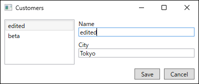
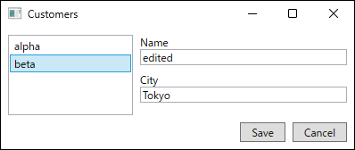

## 概要

顧客の一覧で行を選び、横の詳細欄で名前や住所を直して Save か Cancel を押す。
業務アプリで最もよく作るこの「マスター詳細」の画面は、詳細欄を一覧の `SelectedItem` に直接バインドするだけで形になる。
ところがその作りでは、Cancel を押しても入力した値が一覧に残る。
詳細欄と一覧が同じアイテムを見ているため、入力はアイテムに直接書き込まれ（既定のトリガーでも、Cancel のコマンドが動くまでに）、取り消すための元の値がどこにも残らないからである。

本記事では、取り消せる詳細欄を 2 段階で作る。
1 段目では、入力を編集用のコピーで受ける方法と `IEditableObject` で元の値を控える方法を比べる。
2 段目では、未保存の入力があるまま一覧の別の行をクリックされる問題を扱う。
よく紹介される「`SelectedItem` のセッターで変更を拒む」「`CurrentChanging` を取り消す」の 2 つは、どちらも画面の選択とビューモデルを食い違わせる。
各段階の挙動は、実際のマウスで Cancel・Save・一覧の行をクリックして実測した。

---

## 前提・対象環境

- フレームワーク: .NET の WPF。コード例は C# 9 以降（`is not null`、型を省いた `new()`、ラムダの引数の `_`）と、null 許容参照型を有効にしたプロジェクト（`<Nullable>enable</Nullable>`）を前提にする。動作は下記の検証環境でだけ測り、.NET Framework 4.8 では測っていない
- アーキテクチャ: MVVM。ビューモデルの基底クラス `ObservableObject`（値が変わったときに `true` を返す `SetProperty` と、`[CallerMemberName]` で呼び出し元のプロパティ名を補う `OnPropertyChanged` を持つ）と `RelayCommand` は自前の最小実装で、外部のライブラリは使わない。本記事の `RelayCommand` は `CanExecute` を常に `true` にした最小のもので、`CanExecute` を更新する実装は[関連記事](/ja/articles/wpf-relaycommand-canexecute-not-updating/)にある
- 検証環境: .NET 10 / Windows 11。文字の入力は WPF の入力処理（`InputManager`）に送り、ボタンと一覧の行のクリックは OS の実際のマウス入力で行った
- 題材: 左に顧客の一覧（`ListBox`、または読み取り専用の `DataGrid`）、右に名前（`Name`）と都市（`City`）の詳細欄、下に Save と Cancel を置いた画面。1 行目の `"alpha"` を選び、詳細欄の Name を `"edited"` に打ち替えてから操作する
- 扱う範囲: 1 件ずつ、文字列などの単純な値のプロパティを編集する画面。子のコレクションを持つアイテム、複数行の選択、検証エラーの表示は扱わない

顧客は、2 つのプロパティの変更を通知するクラスである。
編集用のコピーを作る `Clone`、コピーの値を書き戻す `CopyFrom`、値が同じかを比べる `HasSameValues` も持たせておく。

```csharp
public class Customer : ObservableObject
{
    private string _name = "";
    private string _city = "";

    public string Name
    {
        get => _name;
        set => SetProperty(ref _name, value);
    }

    public string City
    {
        get => _city;
        set => SetProperty(ref _city, value);
    }

    public Customer Clone() => new() { Name = Name, City = City };

    public void CopyFrom(Customer other)
    {
        Name = other.Name;
        City = other.City;
    }

    public bool HasSameValues(Customer other) => Name == other.Name && City == other.City;
}
```

この 3 つのメソッドは、プロパティを 1 つずつ列挙している。
`Customer` にプロパティを足したら、3 か所すべてに足す必要がある。

---

## 問題

最初に書かれがちなのは、詳細欄の `TextBox` を一覧の選択中のアイテムへ直接バインドする形である。

```xml
<ListBox ItemsSource="{Binding Customers}" DisplayMemberPath="Name"
         SelectedItem="{Binding SelectedCustomer}" />
<StackPanel>
  <TextBox Text="{Binding SelectedCustomer.Name}" />
  <TextBox Text="{Binding SelectedCustomer.City}" />
</StackPanel>
```

`SelectedCustomer` は一覧の `Customers` に入っているアイテムそのものである。
そのため `TextBox` の入力は、一覧に並んでいるアイテムの `Name` に書き込まれる。
入力のたびにソースを更新する `UpdateSourceTrigger=PropertyChanged` を付けると、打っている最中から一覧の表示が変わる。

<figure class="article-figure">
  
  <figcaption>詳細欄を <code>{Binding SelectedCustomer.Name, UpdateSourceTrigger=PropertyChanged}</code> にして、1 行目の Name に <code>edited</code> と打った直後。Save を押す前から一覧の 1 行目が変わっている。.NET 10 / Windows 11 で撮影。</figcaption>
</figure>

`TextBox.Text` の既定のトリガー（フォーカスを失ったときに更新する `LostFocus`）なら打っている間は書き込まれないため、Save を押すまで待てるように見える。
しかし Cancel ボタンをクリックすると、フォーカスは `TextBox` からボタンへ移る。
実測では、Cancel のコマンドが動いた時点でソースはすでに書き込まれており、元の `"alpha"` はもう残っていなかった。

---

## 第一の壁: 入力がアイテムに書き込まれ、取り消す値が残らない

詳細欄の Name に `"edited"` と打ち、実際のマウスで Cancel をクリックした結果を、詳細欄のバインド先ごとに並べる。



表の「ソース」は、どの行も一覧の 1 行目のアイテム（`Customers[0]`）の `Name` で、編集用のコピーの値ではない。
「入力の直後のソース」は打ち終えた直後に、「Cancel の実行時のソース」は `CancelCommand` の中で読んだ。
.NET 10 / Windows 11 で実測。
{: .table-caption}

`SelectedCustomer.Name` に直接バインドした 2 行は、既定のトリガーでも、Cancel が実行された時点でソースが `"edited"` になっていた。
Cancel の処理から見ると、取り消す前の値を知る手段が無い。
取り消せるようにするには、**入力を一覧のアイテムとは別の場所で受ける**か、**入力を受ける前に元の値を控えておく**かのどちらかが要る。
前者が編集用のコピー、後者が `IEditableObject` である。

### 編集用のコピーで受ける

選択が変わるたびに、選んだアイテムのコピーを作り、詳細欄はそのコピー（`Editing`）にバインドする。
Save でコピーの値をアイテムへ書き戻し、Cancel でコピーを作り直す。

```csharp
public Customer? SelectedCustomer
{
    get => _selectedCustomer;
    set
    {
        if (SetProperty(ref _selectedCustomer, value))
        {
            Editing = value?.Clone();
        }
    }
}

public Customer? Editing
{
    get => _editing;
    private set => SetProperty(ref _editing, value);
}

private void Save() => SelectedCustomer?.CopyFrom(Editing!);

private void Cancel() => Editing = SelectedCustomer?.Clone();
```

XAML は、バインドのパスを `SelectedCustomer.Name` から `Editing.Name` に変えるだけである。

```xml
<TextBox Text="{Binding Editing.Name}" />
<TextBox Text="{Binding Editing.City}" />
```

表の 3 行目のとおり、Cancel をクリックしてもソースは `"alpha"` のままで、Cancel の後は一覧と詳細欄も `"alpha"` だった。
入力はコピーにしか届かないので、一覧のアイテムは Save まで一度も変わらない。
Save の `CopyFrom` は、一覧に入っているアイテムの値を書き換えるだけで、コレクションのアイテムを差し替えない。

### IEditableObject で元の値を控える

`IEditableObject` は、編集の開始（`BeginEdit`）・確定（`EndEdit`）・取り消し（`CancelEdit`）をアイテム自身に持たせるインターフェイスである。
`BeginEdit` で値を控え、`CancelEdit` で戻すように実装する。

```csharp
public sealed class EditableCustomer : Customer, IEditableObject
{
    private Customer? _backup;

    // 編集中にもう一度呼ばれても、最初に控えた値を残す。
    public void BeginEdit() => _backup ??= Clone();

    public void EndEdit() => _backup = null;

    public void CancelEdit()
    {
        if (_backup is not null)
        {
            CopyFrom(_backup);
            _backup = null;
        }
    }
}
```

一覧の `Customers` には、`Customer` ではなく `EditableCustomer` のインスタンスを入れる。
`Customer` のままでは `value as IEditableObject` が `null` になり、次のコードの `BeginEdit`・`EndEdit`・`CancelEdit` はどれも呼ばれない。
ビューモデルは、選んだときに `BeginEdit` を呼び、Save で `EndEdit`、Cancel で `CancelEdit` を呼ぶ。
確定・取り消しの後も続けて編集できるよう、どちらの後にも `BeginEdit` を呼び直す。
詳細欄は `SelectedCustomer.Name` に直接バインドしたままでよい。

```csharp
public Customer? SelectedCustomer
{
    get => _selectedCustomer;
    set
    {
        if (SetProperty(ref _selectedCustomer, value))
        {
            (value as IEditableObject)?.BeginEdit();
        }
    }
}

private void Save()
{
    if (SelectedCustomer is IEditableObject editable)
    {
        editable.EndEdit();
        editable.BeginEdit();
    }
}

private void Cancel()
{
    if (SelectedCustomer is IEditableObject editable)
    {
        editable.CancelEdit();
        editable.BeginEdit();
    }
}
```

表の 4 行目のとおり、Cancel の実行時にはソースが `"edited"` になっていたが、`CancelEdit` で `"alpha"` に戻った。
入力はアイテムに直接書き込まれるので、`TextBox` からフォーカスが離れた時点で（既定のトリガー）、または打つたびに（`UpdateSourceTrigger=PropertyChanged`）、一覧に未保存の値が出て、Cancel を押すまで残る。
この実装は、選択が別の行に移っても前の行の `EndEdit` も `CancelEdit` も呼ばないため、コードのとおり、前の行は値を控えたまま編集中の状態で残る（第二の壁の表の「なし（IEditableObject）」の行では、1 行目に `"edited"` が残った）。

Save をクリックした場合は、どちらの方法でもソースと一覧が入力した値になった。
Save の後に続けて `"again"` と打って Cancel をクリックすると、どちらも Save した `"edited"` に戻った。
`IEditableObject` では、Save で `EndEdit` の後に `BeginEdit` を呼び直しているため、Save した値が新しい取り消し先になる。



Name に `"edited"` と打ってから Save をクリックし、続けて `"again"` と打って Cancel をクリックした結果。
詳細欄は既定のトリガーである。
.NET 10 / Windows 11 で実測。
{: .table-caption}

### 2 つの方法の選び方

両者の違いは、Save の前に入力した値がどこに見えるかである。

| 観点 | 編集用のコピー | IEditableObject |
|---|---|---|
| Save の前の一覧の表示 | 元の値のまま | 入力した値（既定のトリガーではフォーカスが離れた後。Cancel で戻る） |
| 取り消しの仕組みを持つ場所 | ビューモデル | アイテムのクラス |
| アイテムのクラスへの変更 | `Clone`・`CopyFrom`・`HasSameValues` を足す | `IEditableObject` を実装する（本記事の実装は `Clone`・`CopyFrom` も使う） |
| 未保存の判定 | コピーとアイテムの値を比べる | 控えた値を外から読める形にする実装が別に要る（本記事では実装していない） |

一覧に未保存の値を出したくない画面、たとえば一覧の値を保存済みの内容として扱う画面には、編集用のコピーが向く。
`DataGrid` のセルで直接編集する画面は、`DataGrid` 自身が行の編集で `IEditableObject` のメソッドを呼ぶ（[DataGrid の編集が保存ボタンで確定されない問題](/ja/articles/wpf-datagrid-edit-not-committed-on-save/)で実測した）。
そのような画面でアイテムが既に `IEditableObject` を実装しているなら、詳細欄もそれに合わせる選択肢がある。
本記事の以降の実装は、一覧に未保存の値を出さない編集用のコピーで進める。

---

## 第二の壁: 編集中に別の行を選ぶと、入力が消えるか画面とずれる

取り消しができても、未保存の入力を残したまま一覧の別の行をクリックされる問題が残る。
1 行目の Name に `"edited"` と打った後、実際のマウスで一覧の 2 行目（`"beta"`）をクリックした。
止め方は、何もしない場合と、よく紹介される 2 つ（セッターの方法は `Dispatcher.BeginInvoke` で遅らせる書き方も含めて 3 通り）、本記事が採る 1 つ（一覧を無効にする）を比べた。



アイテムを表す列には、そのアイテムの計測時点の `Name` を示す（`CurrentItem` が `"edited"` の行も、1 行目のアイテムの `Name` が変わっているだけである）。
「SelectedItem / SelectedIndex」はコントロールのプロパティの値（`SelectedIndex` は 0 から数える）、「画面で選ばれている行」は行のコンテナの `IsSelected` が `true` の行である。
`IsSynchronizedWithCurrentItem` を既定値のまま `ItemsSource` にコレクションを直接渡した行では、`CurrentItem` は選択に追従せず 1 行目のアイテムのままだった。
「なし（IEditableObject）」の行以外は、詳細欄を編集用のコピーにバインドしている。
詳細欄のトリガーは、`UpdateSourceTrigger=PropertyChanged` と書いた行を除き、既定のトリガー（`LostFocus`）である。
「マウスのボタンを押す直前の一覧の IsEnabled」は、カーソルを 2 行目の上へ動かし終え、マウスのボタンを押す直前に読んだ値である。
`→` のある行は、左が入力の直後、右が Save か Cancel をクリックした後、2 行目でマウスのボタンを押す直前の値である。
変更を拒む止め方では、破棄の確認に「破棄しない」と答えたものとして扱い、確認が呼ばれたことも確かめた。
.NET 10 / Windows 11 で実測。
{: .table-caption}

### 何もしない場合

編集用のコピーでは、選択が 2 行目に移り、詳細欄は `"beta"` のコピーに置き換わった。
1 行目に打った `"edited"` は、確認も無く捨てられている。
`IEditableObject` では、1 行目に `"edited"` が残ったまま選択が移った。
Save を押していない値が、一覧では保存済みのように見える。

### セッターで拒むと、SelectedItem と SelectedIndex が食い違う

よく紹介されるのは、`SelectedItem` にバインドしたプロパティのセッターで、未保存の入力があれば値を受け取らずに `PropertyChanged` を発生させ、コントロールに元の値を読み直させる方法である。

```csharp
public Customer? SelectedCustomer
{
    get => _selectedCustomer;
    set
    {
        if (value == _selectedCustomer) return;
        if (IsDirty && !_dialogService.Confirm("変更を破棄しますか。"))
        {
            OnPropertyChanged(); // 元の値を読み直させるつもりの通知
            return;
        }

        // 選択を受け入れる処理（コピーの作り直しなど）
    }
}
```

`_dialogService` は、確認の `MessageBox` をビューモデルから切り離すサービスである（[IDialogService の記事](/ja/articles/wpf-mvvm-dialog-service/)）。
`IsDirty` は、コピーとアイテムの値が違うときに `true` になるプロパティで、後の「全体の実装」で定義する。

表のとおり、ビューモデルの `SelectedCustomer` と `ListBox.SelectedItem` は 1 行目のままになった。
ところが `SelectedIndex` は `1` で、画面で選ばれているのも 2 行目だった。
同じ `ListBox` の `SelectedItem` と `SelectedIndex` が別の行を指している。
`PropertyChanged` を既定の優先度（`Normal`）の `Dispatcher.BeginInvoke` で遅らせて発生させる書き方も、結果は同じだった。
優先度を下げる書き方や、`PropertyChanged` ではなく選択を戻す代入を遅らせる書き方は測っていない。
`DataGrid` でも同じ食い違いになった。

<figure class="article-figure">
  
  <figcaption>セッターで選択の変更を拒んだ後。画面では 2 行目の <code>beta</code> が選ばれているが、詳細欄は 1 行目のコピー（Name に <code>edited</code>、City は 1 行目の <code>Tokyo</code>）のままである。.NET 10 / Windows 11 で撮影。</figcaption>
</figure>

利用者からは、2 行目を選んだのに 1 行目の内容が表示されているように見える。
この状態で Save をクリックすると、ビューモデルは 1 行目に書き戻すため、画面で選ばれている行とは別の行が更新される。



1 行目の Name に `"edited"` と打ち、2 行目のクリックで選択の変更を止められた後に、Save をクリックした結果。
詳細欄は、編集用のコピーに既定のトリガーでバインドしている。
.NET 10 / Windows 11 で実測。
{: .table-caption}

次の節の `CurrentChanging` で止める方法でも、同じく 1 行目が更新された。

### CurrentChanging を取り消すと、CurrentItem と SelectedItem が食い違う

もう 1 つよく紹介されるのが、一覧に `IsSynchronizedWithCurrentItem="True"` を付けて選択をコレクションビュー（`ICollectionView`）の現在の項目（`CurrentItem`）と連動させ、その移動の直前に発生する `CurrentChanging` で `e.Cancel = true` にする方法である。
一覧の `SelectedItem` はバインドせず、ビューモデルは `CurrentItem` から選択を受け取る。

```xml
<ListBox ItemsSource="{Binding Customers}" DisplayMemberPath="Name"
         IsSynchronizedWithCurrentItem="True" />
```

ビューモデルは、`Customers` の既定のコレクションビューのイベントを購読する。

```csharp
ICollectionView view = CollectionViewSource.GetDefaultView(Customers);
view.CurrentChanging += (_, e) =>
{
    if (IsDirty && e.IsCancelable && !_dialogService.Confirm("変更を破棄しますか。"))
    {
        e.Cancel = true;
    }
};
view.CurrentChanged += (_, _) => SelectedCustomer = view.CurrentItem as Customer;
SelectedCustomer = view.CurrentItem as Customer; // 最初の選択を受け取る
```

表のとおり、`CurrentItem` とビューモデルは 1 行目のままになった。
しかし `SelectedItem`・`SelectedIndex`・画面の選択は、いずれも 2 行目に移った。
`CurrentItem` の移動は止まっても、`ListBox` と `DataGrid` の選択は戻らない。

3 通りの止め方はどれも、ビューモデルが選択の受け取りを拒んだことは、セッターの方法では `SelectedItem` に、`CurrentChanging` の方法では `CurrentItem` に表れたが、画面の選択（`SelectedIndex` と行の `IsSelected`）は 2 行目に移ったまま戻らなかった。

### 一覧を無効にして、選択の変更そのものを起こさせない

変更を後から拒むのではなく、未保存の入力がある間は一覧を無効にする。
ビューモデルに「選択を変えてよいか」を表す `CanChangeSelection` を置き、一覧の `IsEnabled` にバインドする。

```xml
<ListBox ItemsSource="{Binding Customers}" DisplayMemberPath="Name"
         SelectedItem="{Binding SelectedCustomer}"
         IsEnabled="{Binding CanChangeSelection}" />
<StackPanel>
  <TextBox Text="{Binding Editing.Name, UpdateSourceTrigger=PropertyChanged}" />
  <TextBox Text="{Binding Editing.City, UpdateSourceTrigger=PropertyChanged}" />
</StackPanel>
```

表のとおり、2 行目でマウスのボタンを押す直前の一覧の `IsEnabled` は `False` で、2 行目をクリックしても、ビューモデル・`SelectedItem`・`SelectedIndex`・画面の選択は、すべて 1 行目のままだった。
詳細欄の `"edited"` も残っている。
`DataGrid` でも同じ結果になった。

ここで詳細欄の `UpdateSourceTrigger=PropertyChanged` が欠かせない。
既定のトリガーのままでは、打っている間はコピーが変わらないため、2 行目でマウスのボタンを押す直前の一覧の `IsEnabled` は `True` だった。
表の「詳細欄は既定のトリガー」の行では、2 行目のクリックで選択が移り、`"edited"` が捨てられた。
入力をコピーで受けているので、入力のたびにソースを更新しても一覧のアイテムは変わらない。
第一の壁で編集用のコピーを選んだことが、ここで効いている。

一覧が無効の間、利用者は Save か Cancel を押して編集を終えるまで別の行を選べない。
表の「先に Cancel をクリック」の行のとおり、Cancel をクリックすると一覧の `IsEnabled` は `True` に戻り、その後の 2 行目のクリックで選択と詳細欄が `"beta"` に移った（`ListBox`・`DataGrid`）。
「先に Save をクリック」の行でも `IsEnabled` は `True` に戻り、1 行目は `"edited"` のまま、選択と詳細欄が `"beta"` に移った。

---

## 全体の実装

編集用のコピーと、一覧を無効にする仕組みをまとめたビューモデルである。
`Editing` の値が変わるたびに `IsDirty` と `CanChangeSelection` の変更を通知するため、`Editing` を差し替えるときにコピーの `PropertyChanged` を購読し直す。

```csharp
using System.Collections.Generic;
using System.Collections.ObjectModel;
using System.ComponentModel;
using System.Linq;
using System.Windows.Input;

public sealed class CustomerListViewModel : ObservableObject
{
    private Customer? _selectedCustomer;
    private Customer? _editing;

    public CustomerListViewModel(IEnumerable<Customer> customers)
    {
        Customers = new ObservableCollection<Customer>(customers);
        SaveCommand = new RelayCommand(Save);
        CancelCommand = new RelayCommand(Cancel);
        SelectedCustomer = Customers.FirstOrDefault();
    }

    public ObservableCollection<Customer> Customers { get; }

    public ICommand SaveCommand { get; }

    public ICommand CancelCommand { get; }

    public Customer? SelectedCustomer
    {
        get => _selectedCustomer;
        set
        {
            if (SetProperty(ref _selectedCustomer, value))
            {
                Editing = value?.Clone();
            }
        }
    }

    /// <summary>詳細欄のバインド先（編集用のコピー）。</summary>
    public Customer? Editing
    {
        get => _editing;
        private set
        {
            Customer? old = _editing;
            if (SetProperty(ref _editing, value))
            {
                if (old is not null) old.PropertyChanged -= OnEditingChanged;
                if (value is not null) value.PropertyChanged += OnEditingChanged;
                OnDirtyChanged();
            }
        }
    }

    public bool IsDirty =>
        SelectedCustomer is not null && Editing is not null && !Editing.HasSameValues(SelectedCustomer);

    public bool CanChangeSelection => !IsDirty;

    private void OnEditingChanged(object? sender, PropertyChangedEventArgs e) => OnDirtyChanged();

    private void OnDirtyChanged()
    {
        OnPropertyChanged(nameof(IsDirty));
        OnPropertyChanged(nameof(CanChangeSelection));
    }

    private void Save()
    {
        if (SelectedCustomer is null || Editing is null) return;
        SelectedCustomer.CopyFrom(Editing);
        OnDirtyChanged();
    }

    private void Cancel() => Editing = SelectedCustomer?.Clone();
}
```

Save の後は、コピーとアイテムの値が同じになるので `IsDirty` が `false` に戻る。
ただしアイテムの値が変わってもコピーの `PropertyChanged` は発生しないため、`Save` の中で `OnDirtyChanged` を明示的に呼んでいる。

ビューは、一覧・詳細欄・ボタンをバインドとコマンドだけでつなぐ。
コードビハインドには `InitializeComponent` 以外を書かない。

```xml
<DockPanel Margin="8">
  <StackPanel DockPanel.Dock="Bottom" Orientation="Horizontal"
              HorizontalAlignment="Right" Margin="0,8,0,0">
    <Button Content="Save" Command="{Binding SaveCommand}" Padding="12,2" Margin="0,0,8,0" />
    <Button Content="Cancel" Command="{Binding CancelCommand}" Padding="12,2" />
  </StackPanel>
  <ListBox Width="140" ItemsSource="{Binding Customers}" DisplayMemberPath="Name"
           SelectedItem="{Binding SelectedCustomer}"
           IsEnabled="{Binding CanChangeSelection}" />
  <StackPanel Margin="8,0,0,0">
    <TextBlock Text="Name" />
    <TextBox Text="{Binding Editing.Name, UpdateSourceTrigger=PropertyChanged}" />
    <TextBlock Text="City" Margin="0,8,0,0" />
    <TextBox Text="{Binding Editing.City, UpdateSourceTrigger=PropertyChanged}" />
  </StackPanel>
</DockPanel>
```

計測に使ったシーンは、寸法と名前（`x:Name`）の指定を除いてこの XAML と同じ画面を組み立て、このビューモデルと同じ処理を実行している。

---

## 注意点

- **`Clone`・`CopyFrom`・`HasSameValues` はプロパティを列挙している。** `Customer` にプロパティを足して 1 か所でも書き忘れると、そのプロパティは取り消し・保存・未保存の判定のどれかから漏れる。
- **`DataGrid` を一覧にする場合は、読み取り専用（`IsReadOnly="True"`）で測った。** セルで直接編集できる `DataGrid` は、行の編集で `IEditableObject` のメソッドを自分で呼ぶ。詳細欄と同じアイテムを `DataGrid` でも編集させる構成は測っていない。
- **選択の変更は、行のクリックだけを測った。** キーボードでの行の移動、ビューモデルからの `SelectedCustomer` の書き換え、選択中のアイテムの削除は測っていない。
- **ウィンドウを閉じる操作は、本記事の仕組みの対象外である。** 一覧の `IsEnabled` はウィンドウの閉じるボタンに関係しない。閉じる前に未保存の入力を確認する方法は、[Window.Closing で非同期に確認して閉じるのを取り消す記事](/ja/articles/wpf-window-closing-async-cancel/)で扱っている。本記事では、閉じる操作と `IsDirty` の組み合わせは測っていない。
- **`UpdateSourceTrigger=PropertyChanged` は、コピーにバインドしているから安全である。** 第一の壁の問題の形（`SelectedCustomer.Name` への直接バインド）で同じ指定をすると、打っている最中から一覧が変わる。トリガーの違いは[UpdateSourceTrigger の記事](/ja/articles/wpf-textbox-updatesourcetrigger-binding-timing/)で扱っている。

---

## まとめ

- 詳細欄を `SelectedItem` に直接バインドすると、入力は一覧のアイテムへ書き込まれる。既定のトリガーでも、Cancel のコマンドが動くまでに書き込まれ、取り消す値が残らない
- 取り消すには、入力を編集用のコピーで受けるか、`IEditableObject` で元の値を控える。一覧に未保存の値を出したくない画面には、編集用のコピーが向く
- 編集中の行の切り替えを、`SelectedItem` のセッターで拒んだり `CurrentChanging` を取り消したりして止めると、`ListBox`・`DataGrid` の選択とビューモデルが食い違う
- 未保存の入力がある間は、一覧の `IsEnabled` を `false` にして、選択の変更そのものを起こさせない。そのために詳細欄は `UpdateSourceTrigger=PropertyChanged` で編集用のコピーにバインドする
