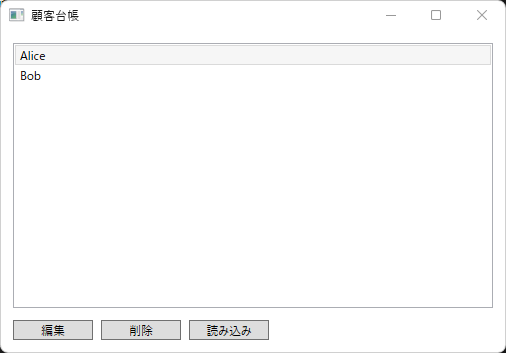
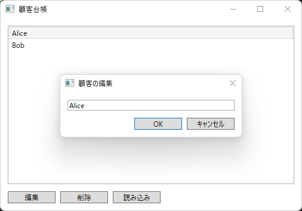

## 概要

MVVM で「削除の前に確認する」「読み込むファイルを選ばせる」「子ウィンドウで編集させる」といった処理を書くと、ビューモデルの中からダイアログを出したくなる。
ビューモデルで `MessageBox.Show` を呼べば動くが、その書き方はテストから実行すると止まる。
ダイアログを別のクラスへ移すと、今度はビューモデルがウィンドウを知らないため、ダイアログの所有者（`Owner`）を決められない。
所有者の無い子ウィンドウは、メインウィンドウが前に来ると、その下に回る。

本記事では、この 3 つの壁を順に越えながら、確認・ファイル選択・子ウィンドウをまとめて扱う `IDialogService` を自前で実装する。
各段階の挙動は、別のスレッドからのコマンドの実行、Win32 の所有者と Z オーダー、ビューモデルが受け取った値を実測して確かめた。

---

## 前提・対象環境

- フレームワーク: .NET 5 以降の WPF（.NET Framework 4.8 では測っていない）。コード例は C# 9 以降が要る（`is not null` と、型を省いた `new()`）。型の定義には using を付け、メソッドだけを抜き出したコードでは省いた。動作は下記の検証環境でだけ測った
- アーキテクチャ: MVVM。ビューモデルの基底クラス `ObservableObject`（値が変わったときに `true` を返す `SetProperty` を持つ）と `RelayCommand`（`RaiseCanExecuteChanged` を持つ）は自前の最小実装で、外部のライブラリは使わない。`RelayCommand` の実装例は[関連記事](/ja/articles/wpf-relaycommand-canexecute-not-updating/)にある
- 検証環境: .NET 10 / Windows 11（対話できるデスクトップで実行）
- 題材: 顧客の一覧画面（メインウィンドウ）から、削除の確認（`MessageBox`）、読み込むファイルの選択（`OpenFileDialog`）、顧客名の編集（子ウィンドウ）を出す

顧客は、名前の変更を通知するだけのクラスである。

```csharp
public sealed class Customer : ObservableObject
{
    private string _name;

    public Customer(string name) => _name = name;

    public string Name
    {
        get => _name;
        set => SetProperty(ref _name, value);
    }
}
```

---

## 問題

最初に書かれがちなのは、ビューモデルのコマンドの中で `MessageBox.Show` を呼ぶ形である。

```csharp
private void Delete()
{
    if (Selected is null) return;
    if (MessageBox.Show($"{Selected.Name} を削除しますか。", "削除の確認",
            MessageBoxButton.OKCancel, MessageBoxImage.Question) == MessageBoxResult.OK)
    {
        Customers.Remove(Selected);
    }
}
```

画面から使う限り、このコードは期待どおりに動く。
問題は、画面を通さずにビューモデルだけを動かす単体テストで現れる。
子ウィンドウを `new CustomerEditWindow().ShowDialog()` と書く場合も、ビューモデルが特定のウィンドウの型に依存し、テストでビューモデルだけを切り出せない。

---

## 第一の壁: MessageBox.Show を呼ぶビューモデルはテストで止まる

テストのスレッドを模して、UI のメッセージループを持たない MTA のスレッドを別に作り、そこから `DeleteCommand.Execute` を呼んで 1 秒待った。



別に作った MTA のスレッドから `DeleteCommand.Execute(null)` を呼んだ結果。.NET 10 / Windows 11 の対話できるデスクトップで実測。1 秒たっても戻らない場合は、そのスレッドが開いていたウィンドウに外から OK（`IDOK`）を送って閉じ、その後の顧客の件数を数えた。実際のテストランナーと、CI のような対話できない環境では測っていない。
{: .table-caption}

`MessageBox.Show` を直接呼ぶビューモデルでは、1 秒の時点でスレッドがメッセージボックスを開いたまま、`Execute` は戻っていなかった。
外から OK を送って初めて戻り、顧客が削除された。
この環境では、誰もボタンを押さなければテストはそこで止まる。
OK とキャンセルのどちらを選ぶかも、この計測のようにウィンドウを探して Win32 のメッセージを送る、画面に依存した手段を使わない限りテストのコードから指定できない。

ダイアログを出す処理をインターフェイスの向こうへ移し、ビューモデルはそれを受け取って呼ぶだけにする。

```csharp
public interface IDialogService
{
    bool Confirm(object ownerViewModel, string message, string caption);
    string? OpenFile(object ownerViewModel, string filter);
    bool ShowDialog(object ownerViewModel, IDialogViewModel viewModel);
}
```

`ownerViewModel` は、ダイアログを出すビューモデル自身（`this`）を渡す引数である。
第二の壁で、所有者のウィンドウを探すのに使う。
`IDialogViewModel` は第三の壁で定義する。

ビューモデルは、コンストラクターで `IDialogService` を受け取る。

```csharp
using System.Collections.ObjectModel;

public sealed class CustomerListViewModel : ObservableObject
{
    private readonly IDialogService _dialogs;
    private Customer? _selected;

    public CustomerListViewModel(IDialogService dialogs)
    {
        _dialogs = dialogs;
        DeleteCommand = new RelayCommand(Delete, () => Selected is not null);
    }

    public ObservableCollection<Customer> Customers { get; } = new();
    public RelayCommand DeleteCommand { get; }

    public Customer? Selected
    {
        get => _selected;
        set
        {
            if (SetProperty(ref _selected, value)) DeleteCommand.RaiseCanExecuteChanged();
        }
    }

    private void Delete()
    {
        if (Selected is null) return;
        if (_dialogs.Confirm(this, $"{Selected.Name} を削除しますか。", "削除の確認"))
        {
            Customers.Remove(Selected);
        }
    }
}
```

テストでは、決めた答えをすぐに返す実装を渡す。

```csharp
public sealed class FakeDialogService : IDialogService
{
    public bool ConfirmResult { get; set; }
    public int ConfirmCount { get; private set; }

    public bool Confirm(object ownerViewModel, string message, string caption)
    {
        ConfirmCount++;
        return ConfirmResult;
    }

    public string? OpenFile(object ownerViewModel, string filter) => null;
    public bool ShowDialog(object ownerViewModel, IDialogViewModel viewModel) => false;
}
```

テストの本体は、テストのフレームワークによらない形のメソッドで示す。

```csharp
public void Delete_does_not_remove_when_cancelled()
{
    var dialogs = new FakeDialogService { ConfirmResult = false };
    var vm = new CustomerListViewModel(dialogs);
    vm.Customers.Add(new Customer("Alice"));
    vm.Customers.Add(new Customer("Bob"));
    vm.Selected = vm.Customers[0];

    vm.DeleteCommand.Execute(null);
    // dialogs.ConfirmCount は 1、vm.Customers.Count は 2 のまま
}
```

表の下の 2 行がこの形である。
`Execute` は 1 秒以内に戻り、`Confirm` は 1 回呼ばれ、答えが `true` なら 1 件削除され、`false` なら 2 件のまま残った。
テスト用の実装はウィンドウを作らないので、確認の分岐を両方ともテストのコードだけで確かめられる。

---

## 第二の壁: ウィンドウを知らないビューモデルは Owner を決められない

ダイアログを出す処理をサービスへ移すと、そのサービスはどのウィンドウの上にダイアログを出すかを決める必要がある。
ビューモデルはウィンドウを参照しないので、`Owner` を素直に渡せない。
`Owner` を設定しなかった場合に何が起きるかを、ダイアログの Win32 の所有者（`GetWindow` の `GW_OWNER`）、メインウィンドウを Z オーダーの先頭へ移した後の上下、両者の矩形の重なりで測った。



各ダイアログの Win32 の所有者と、メインウィンドウを `SetWindowPos`（`HWND_TOP`、アクティブにはしない）で Z オーダーの先頭へ移した後に、ダイアログがメインより上にあるか。.NET 10 / Windows 11 で実測。重なりは DWM の拡張フレームの矩形（見えている枠）で比べ、「メインは有効か」は `IsWindowEnabled` で読んだ。メインは作業領域の左上寄りに 520×360 で置き、「検索」は同じアプリが開いている `Owner` を持たない別のウィンドウで、メインと重ならない右側に置いた。「メインの中央に出た」は、`WindowStartupLocation="CenterOwner"` を指定した子ウィンドウについて見る列で、メッセージボックスとファイル選択は位置を指定していない。
{: .table-caption}

`Owner` を設定せずに `Window.ShowDialog()` で開いた子ウィンドウは、Win32 の所有者を持たなかった。
位置は Windows が決める既定の位置で（所有者が無いと `CenterOwner` は `Manual` と同じ扱いになる。[Window.WindowStartupLocation](https://learn.microsoft.com/dotnet/api/system.windows.window.windowstartuplocation)）、この環境では矩形の全体がメインの内側に出た。
メインを Z オーダーの先頭へ移すと子ウィンドウはメインより下になり、メインは無効のままだった。
次の 2 枚は、表で測った上下関係を、撮る間だけ Topmost を付けて再現した画面である（画面の撮影はほかのアプリのウィンドウも写すため）。

<figure class="article-figure">
  
  <figcaption>Owner を設定しない子ウィンドウを開いた後、メインを Z オーダーの先頭へ移した画面。子ウィンドウはメインの下にある。表の 1 行目で測った上下関係のとおりに、撮る間だけメインを Topmost にして撮った。.NET 10 / Windows 11 で撮影。</figcaption>
</figure>

<figure class="article-figure">
  
  <figcaption>DialogService で Owner をメインにした子ウィンドウで、同じ操作をした画面。子ウィンドウはメインの中央に出て、メインより上に残る。表の 2 行目で測った上下関係のとおりに、撮る間だけメインと子ウィンドウをこの順に Topmost にして撮った。.NET 10 / Windows 11 で撮影。</figcaption>
</figure>

1 枚目の状態では、見えているのは無効になったメインだけで、利用者からは操作を受け付けないアプリに見える。
本記事では `SetWindowPos` で前に移しており、タスクバーや Alt+Tab の操作そのものは測っていない（`Owner` が無いとタスクバーで子と親が別々の候補になることは、[Window.Owner](https://learn.microsoft.com/dotnet/api/system.windows.window.owner) のドキュメントにある）。

`MessageBox.Show` と `OpenFileDialog.ShowDialog()` は、所有者の引数を省いても、メインがアクティブなら所有者がメインになった。
どちらも、開いた時点でアクティブなウィンドウをまず所有者に選ぶためである（[MessageBox](https://learn.microsoft.com/dotnet/api/system.windows.messagebox)、[CommonDialog.ShowDialog](https://learn.microsoft.com/dotnet/api/microsoft.win32.commondialog.showdialog)）。
同じアプリの別のウィンドウ（検索）がアクティブだと、所有者は検索ウィンドウになり、メインを Z オーダーの先頭へ移すとダイアログはメインより下になった。
このときメインは無効にならなかった（表の「メインは有効か」が「有効」）。
この配置ではダイアログがメインと重ならなかったため見えたままだったが、メインと重なる位置に出た場合の見え方は測っていない。

サービスには、呼び出したビューモデルを `DataContext` に持つウィンドウを探させ、それを所有者にする。

```csharp
private static Window FindWindow(object viewModel) =>
    Application.Current.Windows.OfType<Window>().First(w => w.DataContext == viewModel);
```

表の「DialogService」の行がこの実装である。
子ウィンドウ・メッセージボックス・ファイル選択のどれも、検索ウィンドウがアクティブな場合も含めて所有者はメインになり、メインを Z オーダーの先頭へ移してもメインより上に残った。
子ウィンドウはメインの中央に出た。

---

## 第三の壁: 子ウィンドウのビューモデルは DialogResult を設定できない

確認とファイル選択は、`MessageBox.Show` と `OpenFileDialog.ShowDialog` の戻り値をそのまま返せばよい。
子ウィンドウは事情が違う。
`ShowDialog` の戻り値は、閉じる前の `Window.DialogResult` の値である（[Window.ShowDialog](https://learn.microsoft.com/dotnet/api/system.windows.window.showdialog)）。
ところが子ウィンドウのビューモデルも `Window` を参照しないので、OK ボタンのコマンドから `DialogResult` を設定できない。

子ウィンドウのビューモデルには、閉じたいことを結果付きで知らせるイベントだけを持たせる。
`DialogResult` を設定するのは、ウィンドウを開いたサービスの側である。

```csharp
using System;

public interface IDialogViewModel
{
    event EventHandler<bool>? CloseRequested;
}

public sealed class CustomerEditViewModel : ObservableObject, IDialogViewModel
{
    private string _name;

    public CustomerEditViewModel(string name)
    {
        _name = name;
        OkCommand = new RelayCommand(() => CloseRequested?.Invoke(this, true));
        CancelCommand = new RelayCommand(() => CloseRequested?.Invoke(this, false));
    }

    public event EventHandler<bool>? CloseRequested;

    public string Name
    {
        get => _name;
        set => SetProperty(ref _name, value);
    }

    public RelayCommand OkCommand { get; }
    public RelayCommand CancelCommand { get; }
}
```

一覧のビューモデルは、選んだ顧客の名前の**写し**を子ウィンドウのビューモデルに渡し、`ShowDialog` が `true` を返したときだけ元の顧客へ書き戻す。

```csharp
private void Edit()
{
    if (Selected is null) return;

    // 編集は写しに対して行い、OK のときだけ元へ戻す。
    var editor = new CustomerEditViewModel(Selected.Name);
    if (_dialogs.ShowDialog(this, editor))
    {
        Selected.Name = editor.Name;
    }
}
```

`EditCommand` は `DeleteCommand` と同じく、コンストラクターで `new RelayCommand(Edit, () => Selected is not null)` として作る。
ファイルの選択も同じ形で、`ImportCommand` が `_dialogs.OpenFile(this, "JSON ファイル (*.json)|*.json")` を呼び、`null` でなければパスを `ImportPath` プロパティに入れる。

メインウィンドウを表示した状態で各コマンドの `Execute` を呼び、開いたダイアログを操作して閉じたときにビューモデルが受け取った値を記録した。



`DialogService` を通して出したダイアログを閉じたときに、ビューモデルへ返った値と、その後のビューモデルの状態。.NET 10 / Windows 11 で実測。戻り値は、サービスを包んで記録する計測用の実装で読んだ。メッセージボックスとファイル選択は `IDOK` / `IDCANCEL` を送って閉じ、ファイル名は名前の欄に完全なパスを入れた。子ウィンドウの「x」は `TextBox` へのキー入力として送り、ボタンは `ButtonBase.OnClick` から押した。× は `WM_CLOSE` を送って閉じた。「Window.ShowDialog() そのもの」の行は、サービスを通さずに `Owner` をメインにしたウィンドウの戻り値を直接読んだ。
{: .table-caption}

子ウィンドウを OK で閉じると `ShowDialog` は `true` を返し、写しに加えた編集が一覧の顧客に入った。
キャンセルでも × でも `false` が返り、元の名前のまま残った。
× で閉じた場合は誰も `DialogResult` を設定しないが、`Window.ShowDialog()` そのものも `false` を返した（表の「Window.ShowDialog() そのもの」の行）。
`DialogResult` のドキュメントも、閉じるボタンで閉じた場合の値は既定で `false` としている（[Window.DialogResult](https://learn.microsoft.com/dotnet/api/system.windows.window.dialogresult)）。
サービスは、`OpenFile` と同じく `bool?` を `== true` で `bool` にして返す。

比較のため、写しではなく一覧の `Customer` そのものを編集させる形も測った。
子ウィンドウのビューモデルの `Name` が、一覧の `Customer.Name` をそのまま読み書きする形である。
こちらは入力のたびに元の顧客が書き換わるので、キャンセルして `false` が返っても、名前は「Alicex」に変わったままだった。
戻り値で分岐していても、編集の対象を共有していれば取り消しにならない。

表の最後の 3 行は、どのウィンドウの `DataContext` でもないビューモデルから呼んだ場合である。
`FindWindow` の `First` が該当なしで `InvalidOperationException` を投げ、ダイアログは表示されず、顧客も消えなかった。
記事の実装では `Application.Windows` の数も変わらなかったが、ウィンドウを作ってから所有者を探す順序にすると、表示されないウィンドウが `Application.Windows` に 1 つ残った（最後の行）。
呼び出し側でこの例外を扱わなければ、未処理の例外になる（届く先は[関連記事](/ja/articles/wpf-unhandled-exception-dispatcher-task-thread/)で扱っている）。

---

## 全体の実装

ここまでの部品をまとめた `DialogService` である。
子ウィンドウは、ビューモデルの型ごとにウィンドウを作る処理を登録しておき、`ShowDialog` に渡されたビューモデルの型から引く。

```csharp
using System;
using System.Collections.Generic;
using System.Linq;
using System.Windows;
using Microsoft.Win32;

public sealed class DialogService : IDialogService
{
    private readonly Dictionary<Type, Func<Window>> _windows = new();

    public void Register<TViewModel>(Func<Window> createWindow) where TViewModel : IDialogViewModel =>
        _windows[typeof(TViewModel)] = createWindow;

    public bool Confirm(object ownerViewModel, string message, string caption) =>
        MessageBox.Show(FindWindow(ownerViewModel), message, caption,
            MessageBoxButton.OKCancel, MessageBoxImage.Question) == MessageBoxResult.OK;

    public string? OpenFile(object ownerViewModel, string filter)
    {
        var dialog = new OpenFileDialog { Filter = filter };
        return dialog.ShowDialog(FindWindow(ownerViewModel)) == true ? dialog.FileName : null;
    }

    public bool ShowDialog(object ownerViewModel, IDialogViewModel viewModel)
    {
        // 所有者を先に探す。見つからずに例外になったとき、作っただけのウィンドウを Application.Windows に残さないため。
        Window owner = FindWindow(ownerViewModel);
        Window window = _windows[viewModel.GetType()]();
        window.Owner = owner;
        window.DataContext = viewModel;

        void OnCloseRequested(object? sender, bool result) => window.DialogResult = result;
        viewModel.CloseRequested += OnCloseRequested;
        try
        {
            return window.ShowDialog() == true;
        }
        finally
        {
            viewModel.CloseRequested -= OnCloseRequested;
        }
    }

    private static Window FindWindow(object viewModel) =>
        Application.Current.Windows.OfType<Window>().First(w => w.DataContext == viewModel);
}
```

`ShowDialog` で所有者を先に探すのは、結果の表の最後の行のとおり、ウィンドウを先に作ると、所有者が見つからなかったときに表示しないウィンドウが `Application.Windows` に残るためである。
`Application.Windows` には、UI スレッドで作ったウィンドウが作った時点で入り、閉じるまで外れない（[Application.Windows](https://learn.microsoft.com/dotnet/api/system.windows.application.windows)）。
`CloseRequested` の購読は `finally` で外し、閉じた後のウィンドウとビューモデルのつながりを残さない。

子ウィンドウの XAML は、バインドとコマンドだけで組む。
コードビハインドは `InitializeComponent` だけである。

```xml
<Window x:Class="CustomerLedger.CustomerEditWindow"
        xmlns="http://schemas.microsoft.com/winfx/2006/xaml/presentation"
        xmlns:x="http://schemas.microsoft.com/winfx/2006/xaml"
        Title="顧客の編集" Width="320" SizeToContent="Height"
        WindowStartupLocation="CenterOwner" ResizeMode="NoResize">
  <StackPanel Margin="12">
    <TextBox Text="{Binding Name, UpdateSourceTrigger=PropertyChanged}" />
    <StackPanel Orientation="Horizontal" HorizontalAlignment="Right" Margin="0,12,0,0">
      <Button Content="OK" IsDefault="True" Width="80" Command="{Binding OkCommand}" />
      <Button Content="キャンセル" Width="80" Margin="8,0,0,0" Command="{Binding CancelCommand}" />
    </StackPanel>
  </StackPanel>
</Window>
```

`TextBox` は `UpdateSourceTrigger=PropertyChanged` にして、入力をすぐ写しへ反映させている。
反映のタイミングの違いは[関連記事](/ja/articles/wpf-textbox-updatesourcetrigger-binding-timing/)で扱っている。
キャンセルのボタンに `IsCancel` は付けていない（Esc キーで閉じる動きと、コマンドの実行が重なる場合は測っていない）。

サービスを作って登録し、ビューモデルへ渡すのは、アプリの起動時（`App` の `OnStartup`）で 1 回だけ行う。
`App.xaml` からは `StartupUri` を外しておく。

```csharp
protected override void OnStartup(StartupEventArgs e)
{
    base.OnStartup(e);

    var dialogs = new DialogService();
    dialogs.Register<CustomerEditViewModel>(() => new CustomerEditWindow());

    var main = new MainWindow { DataContext = new CustomerListViewModel(dialogs) };
    main.Show();
}
```

ビューモデルは `IDialogService` だけを知っており、`MessageBox`・`OpenFileDialog`・`CustomerEditWindow` のどれも参照しない。

---

## 注意点

- **呼び出すビューモデルは、ウィンドウの `DataContext` そのものでなければならない。** どのウィンドウの `DataContext` でもないビューモデル（`UserControl` に別に持たせたビューモデルなど）が `this` を渡すと、所有者が見つからずに `InvalidOperationException` になる（結果の表の最後の 3 行。最後の行は比較用の順序のサービス）。その場合はウィンドウのビューモデルを渡す。
- **同じビューモデルを `DataContext` に持つウィンドウが 2 つあると、`First` は先に見つかった方を返す。** 本記事の実装は 1 つのビューモデルを 1 つのウィンドウに付ける前提である。
- **この `DialogService` はモーダルのダイアログだけを扱う。** `Show` で開く非モーダルのウィンドウは、呼び出し元へ結果を返す時点が閉じたときではないので、`ShowDialog` と同じ形にはならない。本記事では測っていない。
- **`ShowDialog` が戻るまで、ビューモデルのコマンドはその呼び出しの中にとどまる。** その間も UI スレッドはモーダルのループでメッセージを処理する（計測の処理は、このループの中で動かした）。

---

## まとめ

ビューモデルから `MessageBox.Show` を直接呼ぶと、テストのスレッドでメッセージボックスが開いて処理が止まり、OK とキャンセルの分岐をテストのコードから選べない。
ダイアログは `IDialogService` の向こうへ移し、テストでは決めた答えを返す実装を渡す。

サービスは、呼び出したビューモデルを `DataContext` に持つウィンドウを所有者にする。
`Owner` の無い子ウィンドウは、メインが Z オーダーの先頭に来るとその下に回る。
引数を省いた `MessageBox` やファイル選択はその時点でアクティブなウィンドウを所有者にするので、所有者は常に明示して渡す。

子ウィンドウの結果は、ビューモデルが `CloseRequested` で知らせ、サービスが `DialogResult` に設定する。
編集させる値は写しにし、`true` が返ったときだけ元へ書き戻す。

---

## 関連記事

- [WPF で RelayCommand の CanExecute がボタンの有効・無効に反映されない問題の解決方法](/ja/articles/wpf-relaycommand-canexecute-not-updating/)
- [WPF の Window.Closing で await すると e.Cancel が効かない理由と、先に止めて閉じ直す実装](/ja/articles/wpf-window-closing-async-cancel/)
- [WPF TextBox の UpdateSourceTrigger で入力がソースへ反映されるタイミングを制御する](/ja/articles/wpf-textbox-updatesourcetrigger-binding-timing/)
- [WPF の PasswordBox.Password をバインドできない理由と、MVVM でビューモデルへ渡す 2 つの方法](/ja/articles/wpf-passwordbox-binding-mvvm/)
- [WPF の DispatcherUnhandledException で捕まらない例外 — 別スレッド・Task・async void の届き先](/ja/articles/wpf-unhandled-exception-dispatcher-task-thread/)
